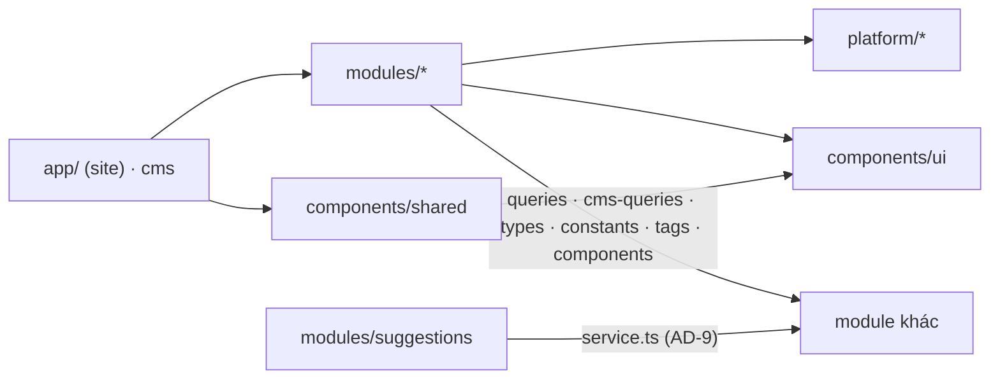
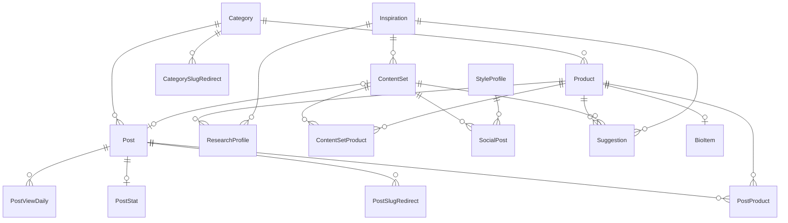
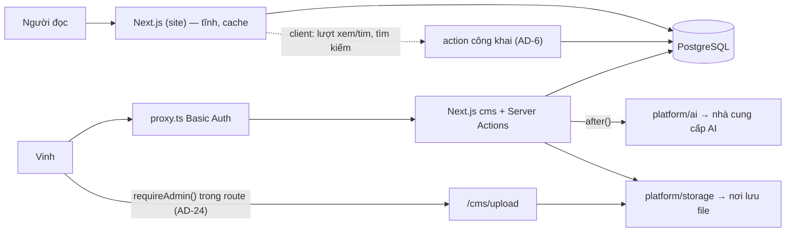

# Architecture Spine — affiliate-project

## Design Paradigm

**Modular monolith, chia dọc theo miền nghiệp vụ**, một ứng dụng Next.js chạy một tiến trình. Ba tầng, phụ thuộc một chiều:

| Tầng | Thư mục | Vai trò |
| --- | --- | --- |
| Định tuyến | `app/` | Route, layout, metadata, ghép màn hình. Không logic nghiệp vụ. |
| Nghiệp vụ | `modules/<miền>/` | Mỗi miền sở hữu bảng, đọc, ghi, prompt và UI của thực thể mình. |
| Hạ tầng | `platform/` | DB, auth, AI, lưu file, HTML, slug, validate dùng chung. Không biết nghiệp vụ. |
| UI nền | `components/ui`, `components/shared` | shadcn và component không nghiệp vụ. |

Khi spine này mâu thuẫn với `docs/` (vốn mô tả code hiện tại), **spine thắng**; `docs/` được cập nhật theo AD-17.

## Invariants & Rules



### AD-1 — Cấu trúc repo theo module dọc [ADOPTED]

- **Binds:** all
- **Prevents:** logic của một thực thể rải ở nhiều thư mục; hai tính năng cùng sửa một file `lib/` dùng chung.
- **Rule:** Code nghiệp vụ nằm trong `modules/<miền>/`, hạ tầng trong `platform/`, định tuyến trong `app/`. Không tạo lại `lib/`, `components/site/`, `components/cms/`. Code cũ di chuyển theo AD-17.

### AD-2 — Hướng phụ thuộc [ADOPTED]

- **Binds:** all
- **Prevents:** vòng phụ thuộc; module đọc/ghi nội bộ của module khác.
- **Rule:** `app → modules → platform`, `modules → components/{ui,shared}`. `platform/` và `components/` không import `modules/` hay `app/`. Module A chỉ được import từ module B các file `queries.ts`, `cms-queries.ts`, `types.ts`, `constants.ts`, `tags.ts` và `components/`; không import `service.ts`, `actions.ts`, `schema.ts`, `prompts/` của B (ngoại lệ duy nhất: AD-9). `app/` không import `platform/db` hay `service.ts`. Không có vòng import giữa hai module.
  - **Tầng module:** T0 `categories`, `style-profiles` · T1 `products`, `inspirations` · T2 `research`, `posts`, `banners` (Banner dùng `AffiliateLink` của `products`) · T3 `engagement`, `content-sets`, `bio` · T4 `suggestions`. Module chỉ import module ở tầng **thấp hơn**; cùng tầng không import nhau.
  - **Đọc chéo bảng:** query được đọc bảng của module tầng thấp hơn qua quan hệ Prisma (chỉ đọc); điều kiện hoặc select mà module đó đã định nghĩa (ví dụ `visibleProductWhere`) phải import từ `queries.ts` của nó, không viết lại. Query chạm bảng của nhiều module nằm ở module **tầng cao nhất** trong số đó (ví dụ Danh mục có bài đã xuất bản → `posts`; bài xếp theo Lượt xem → `engagement`; Sản phẩm đang dùng ở bài nào → `posts`). Màn cần dữ liệu từ hai module cùng tầng thì Screen gọi từng query rồi ghép.

### AD-3 — Danh sách module đóng [ADOPTED]

- **Binds:** all
- **Prevents:** agent tự đặt module mới trùng hoặc chồng lấn trách nhiệm.
- **Rule:** Module hợp lệ: `posts`, `products`, `categories`, `content-sets`, `suggestions`, `research`, `style-profiles`, `inspirations`, `banners`, `bio`, `engagement`. Thêm hoặc đổi tên module phải sửa spine trước.

### AD-4 — Mỗi bảng có đúng một chủ [ADOPTED]

- **Binds:** all modules, `prisma/schema/`
- **Prevents:** hai module cùng ghi một bảng theo hai luật khác nhau.
- **Rule:** Mỗi model nằm trong `prisma/schema/<module chủ>.prisma`, chủ theo bảng *Chủ sở hữu bảng* ở Structural Seed. Chỉ `service.ts` của module chủ ghi bảng đó. Khoá ngoại thuộc bảng chứa nó. Module khác được thêm **trường quan hệ ngược** (chỉ field quan hệ Prisma, không tạo cột) vào model của mình hoặc của module kia khi Prisma bắt buộc; không thêm cột vào model không thuộc mình. Bảng nối luôn khai báo tường minh (có model riêng), không dùng many-to-many ngầm.

### AD-5 — Hợp đồng file trong module [ADOPTED]

- **Binds:** all modules
- **Prevents:** mỗi agent tự chế cấu trúc module; trộn đọc có cache với kiểm quyền; trộn ghi với validate.
- **Rule:** Một module chỉ gồm các file sau, đúng trách nhiệm:

| File | Trách nhiệm | Cấm |
| --- | --- | --- |
| `schema.ts` | Zod input + kiểu `z.input`/`z.infer` | gọi DB, gọi AI |
| `types.ts` | kiểu xuất ra ngoài, suy ra từ select/query | logic |
| `constants.ts` (tuỳ chọn) | nhãn tiếng Việt, giới hạn cứng, mặc định; giá trị enum lấy từ Prisma | gõ lại giá trị enum |
| `tags.ts` | cache tag của miền: `export const <MIỀN>_TAG = "<tên module>"` | — |
| `queries.ts` | đọc cho site public, có cache, chỉ dữ liệu xuất bản/đang hiện | `headers()`, `cookies()`, `requireAdmin`, ghi |
| `cms-queries.ts` | đọc cho CMS, không cache | `"use cache"` |
| `service.ts` | ghi DB (nhận input đã validate và `tx` tuỳ chọn); đọc không cache cho action công khai chỉ đọc (AD-6) | `"use server"`, `updateTag`, `requireAdmin`, validate |
| `actions.ts` | `"use server"`, cửa ngõ ghi và action công khai (AD-6), gọi `service.ts` | gọi Prisma trực tiếp |
| `prompts/*.prompt.ts` | prompt AI của miền (AD-10) | gọi AI |
| `components/` | UI của thực thể (AD-11) | import `app/`, gọi DB |

Không có `index.ts` gom export; import thẳng từng file.

### AD-6 — Đường ghi dữ liệu và các ngoại lệ có tên [ADOPTED]

- **Binds:** mọi FR có ghi dữ liệu; NFR-6, NFR-7
- **Prevents:** ghi bỏ qua kiểm quyền, bỏ qua validate, hoặc quên làm mới cache.
- **Rule:** Mọi thao tác ghi của CMS là Server Action trong `actions.ts` của module chủ: `run()` (gồm `requireAdmin()`) → `schema.safeParse` → `service` → `updateTag(<tag của mọi module có dữ liệu thay đổi>)`. Chỉ có ba ngoại lệ, không thêm ngoại lệ khác:
  1. `modules/engagement/actions.ts` — ghi Lượt xem, Lượt tim từ người đọc, và đọc số Lượt tim của một bài (chỉ đọc, để trang tĩnh hiện số tim kể cả khi không gửi lượt xem): không `requireAdmin`, validate, giới hạn tần suất, không `updateTag`, không lưu định danh người đọc (AD-23).
  2. `posts.searchPosts` trong `modules/posts/actions.ts` — action **chỉ đọc** công khai cho FR-36: validate, giới hạn tần suất, chỉ trả Bài web đã xuất bản.
  3. `app/cms/upload/route.ts` — Route Handler upload file (AD-24).

  Không có endpoint công khai dưới `/api` (proxy chặn). `docs/quy-dinh.md` [QD-20] ghi cùng ba ngoại lệ này.

### AD-7 — Đường đọc và cache [ADOPTED]

- **Binds:** `(site)`, mọi `queries.ts`; FR-5, FR-29, FR-36, NFR-5
- **Prevents:** trang public bị chuyển thành động hoặc hỏng build; ẩn Sản phẩm không có hiệu lực vì cache cũ.
- **Rule:**
  - Trang `(site)` giữ `ensureStatic = "navigation"`; chỉ đọc qua `queries.ts` (`"use cache"` + `cacheLife` + `cacheTag`). Profile `cacheLife` phải có stale ≥ 30 giây, revalidate > 0, expire ≥ 5 phút.
  - Một query gắn tag của **mọi** module có bảng nó đọc — trả về, lọc, đếm hay sắp xếp (ví dụ chip Danh mục chỉ hiện Danh mục có Sản phẩm đang hiện cũng gắn `products`; `getPostBySlug` gắn `posts` và `products`; danh sách bài có ảnh Sản phẩm cũng gắn `products`).
  - Mọi query trả Sản phẩm cho public dùng `visibleProductWhere` và `publicProductSelect` xuất từ `modules/products/queries.ts`; không tự viết điều kiện "đang hiện". Ảnh đại diện fallback từ Sản phẩm cũng đi qua bộ lọc này.
  - Không đọc `searchParams`, `headers()`, `cookies()` ở server trong `(site)`. Dữ liệu theo request (Lượt xem, Lượt tim, kết quả tìm kiếm) lấy phía client qua action công khai (AD-6). Phân trang dùng đoạn đường dẫn tĩnh: `/[danh-muc]/trang/[n]`, `/meo-vat/trang/[n]`, `/gom-link/trang/[n]` (hai route Loại bài là thư mục riêng, lọc theo `PostType` bằng query của `posts`; không đi qua `[danh-muc]`).
  - Route động trong `(site)` có `generateStaticParams` không bao giờ trả mảng rỗng: seed tối thiểu (AD-17) bảo đảm có ít nhất một bản ghi. Mọi route phân trang `…/trang/[n]` trả các trang thật từ `n = 2`; không có trang nào thì trả một tham số giữ chỗ (`n = "2"`, với `[danh-muc]` là của Danh mục đầu tiên) để `notFound()` lúc prerender; `n = 1` thì `permanentRedirect` về trang gốc của nó. `PAGE_SIZE` của site ở `modules/posts/constants.ts`.
  - Banner theo lịch: query của `banners` lấy thời điểm hiện tại **bên trong** hàm `"use cache"` (không nhận `now` làm tham số, vì tham số là khoá cache) với `cacheLife` revalidate ≤ 60 giây; không lọc lịch phía client. Trạng thái lịch (chưa chạy/đang chạy/hết hạn) chỉ tính bằng một hàm của `banners`, dùng cho cả query public và CMS. Giờ theo `Asia/Ho_Chi_Minh`.
  - CMS đọc qua `cms-queries.ts` trong `<Suspense>`.

### AD-8 — Ranh giới server-only

- **Binds:** `service.ts`, `queries.ts`, `cms-queries.ts`, `platform/db`, `platform/ai`, `platform/storage`
- **Prevents:** client component kéo Prisma, khoá AI hoặc logic ghi vào bundle trình duyệt.
- **Rule:** Các file trên mở đầu bằng `import "server-only"`. Client component là file `*.client.tsx`, chỉ nhận props serialize được (`Date` → chuỗi ISO), chỉ gọi Server Action, không import file server-only.

### AD-9 — Gợi ý AI tập trung ở `suggestions`

- **Binds:** FR-2, FR-6..FR-23; SM-C2
- **Prevents:** mỗi module tự làm luật duyệt; hai module cùng coi mình là chủ trạng thái "đã duyệt"; ghi chéo bảng không qua đường hợp lệ.
- **Rule:** Mọi đầu ra AI là bản ghi `Suggestion` (chủ: `suggestions`) với `kind`, `status`, `payload` (Zod theo `kind`), `riskWarnings`, `promptId`, `promptVersion`, `editedBeforeApproval`, `parentSuggestionId`. Mỗi `Suggestion` gắn đúng một trong `productId` / `contentSetId` / `inspirationId` (CHECK trong SQL). `modules/suggestions/actions.ts` là **điểm điều phối duy nhất** cho cả *tạo* (yêu cầu AI, tạo `ContentSet` nếu chưa có) và *Duyệt*; đây là ngoại lệ duy nhất của AD-2, và chỉ được import `service.ts` và `prompts/` của: `posts`, `products`, `content-sets`, `research`. Duyệt chạy trong một transaction, rồi `updateTag` mọi tag bị ảnh hưởng. Ngữ nghĩa trạng thái và đích: AD-18, AD-19. Nội dung Vinh tự viết không cần `Suggestion`. Ngoại lệ có tên duy nhất: chấm điểm SEO là `posts.checkPostSeo` (action CMS qua `run()`), gọi `platform/ai`, trả báo cáo cho màn hình, không lưu, không qua Duyệt. `Suggestion` còn có `sources` (`Json?`, Zod `{ url, title }[]`) và `skipped` (`Json?`, Zod mảng `images` | `webSearch` | `video`) lấy từ kết quả `ask()`.

### AD-10 — Truy cập AI qua một cửa

- **Binds:** mọi tính năng AI; NFR-1, NFR-2, NFR-9
- **Prevents:** tính năng gắn chặt một nhà cung cấp; prompt rải trong action; output AI chưa kiểm được dùng thẳng.
- **Rule:**
  - Chỉ `platform/ai` gọi nhà cung cấp. Không dùng OpenAI; không import SDK nhà cung cấp ở nơi khác.
  - Hợp đồng: `ask({ prompt, input, images?, videoUrl?, webSearch? }) → { data, sources?, skipped: ("images" | "webSearch" | "video")[] }`. `data` đã `parse` bằng `prompt.output`; parse thất bại thì thử lại đúng một lần kèm lỗi Zod trong lời nhắc; vẫn thất bại thì ném `UserError` tiếng Việt. Khi nhà cung cấp không hỗ trợ ảnh/tìm web, hoặc không đọc được video (FR-2), `ask` không ném lỗi mà ghi vào `skipped` (FR-6, FR-7).
  - Prompt là file `modules/<miền>/prompts/<tên>.prompt.ts` theo khuôn `PromptDef { id, version, profile, output, system(style), user(input) }`; giọng văn, độ dài mục tiêu và câu công khai lấy từ Hồ sơ phong cách; quy tắc chung (chống bịa, tiếng Việt có dấu) lấy từ `platform/ai/rules.ts`.
  - HTML từ AI đi qua AD-22. Không gọi AI trong transaction. `platform/ai` có chế độ giả lập cho test.

### AD-11 — Đặt component theo gốc chung gần nhất [ADOPTED]

- **Binds:** mọi file UI
- **Prevents:** component trùng lặp giữa site và CMS; xem trước CMS khác trang thật; link affiliate render sai thuộc tính.
- **Rule:** Hiển thị một thực thể, hoặc form sửa một thực thể (`<x>-form.client.tsx`, cạnh `schema.ts` nó dùng) → `modules/<miền>/components/`. Component nền → `components/ui/`, chỉ thêm bằng shadcn CLI; được thêm không cần hỏi khi CLI không kéo dependency npm mới, có dependency mới thì hỏi ([QD-04]). Không nghiệp vụ, dùng cả site và CMS, hoặc chỉ CMS dùng nhưng form/component trong `modules/` cần (ví dụ `UploadField`, `ConfirmDialog`, `UnsavedChangesGuard`) → `components/shared/`. Chỉ route CMS dùng (ví dụ `CmsShell`) → `app/cms/_components/`; chỉ site → `app/(site)/_components/`; một màn → `_components/` cạnh route. Màn ghép nhiều module (ví dụ tạo Bộ nội dung: hồ sơ nghiên cứu, Góc viết, Người đọc, chọn nền tảng): phần ghép và trạng thái chung của màn ở `_components/` cạnh route; mảnh hiển thị một thực thể ở module chủ; form gọi action của `suggestions` ở `modules/suggestions/components/`. Component dùng chung không biết mình ở site hay CMS (khác biệt qua props), mặc định là Server Component. Xem trước trong CMS dùng đúng component render của trang public. Mọi link tới Shopee (thẻ Sản phẩm, Trang bio, Banner) render qua `AffiliateLink` của `modules/products/components`: nguyên link, `target="_blank"`, `rel="sponsored nofollow noopener"`, không qua đường dẫn chuyển hướng của website; Nhãn công khai affiliate là `AffiliateDisclosure` cùng chỗ. Không có component phù hợp → không tự tạo trong `components/ui|shared`; để dấu `[COMPONENT-UNKNOWN]` tại chỗ thiếu và hỏi.

### AD-12 — Route mỏng [ADOPTED]

- **Binds:** `app/**`
- **Prevents:** truy vấn và logic rải trong `page.tsx`; đọc dữ liệu động ngoài `<Suspense>`.
- **Rule:** `page.tsx` chỉ gồm metadata, `<Suspense>` và một `<…Screen>`, cộng bước tra dữ liệu ở cấp page cho trang `(site)` có tham số (dưới đây). Các trang khác: `_components/<x>-screen.tsx` `await params`, gọi `queries`/`cms-queries`, rồi ghép component của module.
  - **Trang `(site)` có tham số:** `page.tsx` `await params`, gọi query có cache, tra lịch sử slug (AD-20) và gọi `notFound()` / `permanentRedirect()` **trước** `<Suspense>`, rồi truyền dữ liệu cho Screen. Lý do: gọi trong `<Suspense>` thì response đã stream, `notFound()` trả HTTP 200 và redirect chỉ là thẻ meta (`node_modules/next/dist/docs/01-app/03-api-reference/04-functions/not-found.md`, `permanentRedirect.md`).
  - **Trang CMS:** Screen gọi `notFound()` trong `<Suspense>`; chấp nhận HTTP 200 vì CMS không được index. Screen CMS được đọc `searchParams` bên trong `<Suspense>` (`?trang`, `?q`, bộ lọc, `?cam-hung`…); `PAGE_SIZE` ở `constants.ts` của module. Đọc tương tác trong CMS (Combobox tìm Sản phẩm, thêm món vào panel rồi hiện hồ sơ của món đó): client đưa trạng thái lên URL, Server Component đọc lại qua `cms-queries`; không tạo action đọc.
  - Đang tải = fallback của `<Suspense>` là `<x>-skeleton.tsx` cạnh Screen; không dùng `loading.tsx`. Có `error.tsx` ở `app/(site)/`, `app/cms/` và `app/global-error.tsx`; 404 có ba file: `app/(site)/not-found.tsx` (có header/footer site), `app/cms/not-found.tsx`, và `app/not-found.tsx` (chỉ file gốc bắt URL không khớp route nào — `not-found.md`); hai file của site dùng chung `NotFoundScreen` ở `app/(site)/_components/`. Form RHF chỉ đọc `defaultValues` lúc mount, không reset theo props, để `router.refresh()` hay đổi URL không xoá nội dung đang sửa. Nội dung trạng thái rỗng và lỗi theo `EXPERIENCE.md`.

### AD-13 — Lỗi hiển thị cho người dùng [ADOPTED]

- **Binds:** mọi action
- **Prevents:** lỗi tiếng Anh hoặc chi tiết nội bộ lọt lên giao diện.
- **Rule:** Action trả `Result<T>` qua `run()`. Lỗi muốn người dùng đọc phải là `UserError` (`platform/errors.ts`), luôn bằng tiếng Việt; `throw new Error(...)` thường bị coi là lỗi bất ngờ. Lỗi bất ngờ: `console.error` và trả "Có lỗi xảy ra, thử lại sau". Query không ném lỗi nghiệp vụ; trả `null` để `page.tsx` (trang `(site)`) hoặc Screen (CMS) gọi `notFound()` theo AD-12.

### AD-14 — Validate một nguồn [ADOPTED]

- **Binds:** mọi `schema.ts`, form CMS, `prisma/schema/`
- **Prevents:** giới hạn độ dài và thông báo lỗi lệch giữa form, server và DB.
- **Rule:** Schema module ghép từ `platform/validation/fields.ts` (`requiredText`, `optionalText`, `imageUrl`, `shopeeAffiliateUrl`, `slugField`). `@db.VarChar(n)` bằng đúng giới hạn cứng trong `constants.ts` của module chủ. Link affiliate chỉ nhận domain Shopee chính chủ; host ảnh chỉ khai báo trong `platform/images.ts`. Form CMS dùng React Hook Form + `zodResolver` với **cùng** `schema.ts` của module, ghép bằng component `field` của shadcn + `Controller` (style base-nova không có component `form`); form một trường được dùng `useTransition` + `Result`. Lỗi validate hiện tại trường, phía client, bằng cùng schema; `UserError` từ server hiện bằng toast; `Result<T>` không mang lỗi theo trường. Cảnh báo rời trang chưa lưu và xác nhận xoá theo `EXPERIENCE.md`.

### AD-15 — Quy ước dữ liệu Prisma

- **Binds:** `prisma/schema/`, mọi migration
- **Prevents:** xoá dây chuyền làm mất dữ liệu; bộ đếm làm sai `updatedAt`; cột Json không kiểm soát; hai agent tạo migration xung đột.
- **Rule:** Giữ quy ước `[PR-07]`. Mỗi quan hệ ghi rõ `onDelete`: `Cascade` cho con thuộc hẳn cha, `Restrict` cho tham chiếu tới thực thể dùng chung, `SetNull` cho liên kết tuỳ chọn. Sản phẩm còn được dùng thì không xoá cứng, chỉ `hidden`. Enum cho tập cố định mà code rẽ nhánh; bảng cho tập do Vinh quản lý. `Json` chỉ dùng khi có Zod theo loại trong module chủ, đọc ra phải `parse`, không truy vấn bên trong. Migration đặt tên `verb_object`, tạo bằng `--create-only` rồi đọc SQL, không sửa migration đã áp, mỗi lần chỉ một story tạo migration; CHECK, partial unique index và index đặc biệt viết tay trong SQL kèm comment trong `.prisma`. Bảng mới ngoài bảng *Chủ sở hữu bảng* → `[SCHEMA-UNKNOWN]` và hỏi; cột mới phục vụ trực tiếp một FR được thêm vào model của module chủ, ghi trong story.

### AD-16 — Kiểm thử [ADOPTED]

- **Binds:** `platform/`, `schema.ts`, `service.ts`
- **Prevents:** lỗ hổng sanitize/validate/duyệt tái phát khi chuyển cấu trúc.
- **Rule:** Vitest (cần `vite` làm peer). Unit test bắt buộc cho `platform/` và `schema.ts`; test tích hợp cho `service.ts` chạy trên DB Postgres test cục bộ, gồm test "ẩn Sản phẩm biến mất khỏi mọi query public". File test đặt cạnh file nguồn (`*.test.ts`). Cấu hình Vitest alias `server-only` sang file rỗng và resolve `@/` theo `tsconfig`. Test viết theo PRD và spine, không theo hành vi hiện có của code; tên test tiếng Việt. Suite không gọi AI thật (`platform/ai` giả lập); độ chính xác Cảnh báo rủi ro (FR-23) đo bằng một script đánh giá chạy tay với AI thật, ngoài suite. Không có e2e.

### AD-17 — Di chuyển dần và epic nền [ADOPTED]

- **Binds:** mọi story
- **Prevents:** dời cả repo một lần; hai cấu trúc sống song song vô thời hạn; migration xung đột; tài liệu lỗi thời dẫn agent đi sai.
- **Rule:** Epic đầu tiên làm theo thứ tự, trước mọi module nghiệp vụ mới:
  1. Kiểm chứng `[NO-23]` (`updateTag` làm mới trang đã prerender) và `[NO-24]` (action công khai trên trang `ensureStatic`) bằng `npm run build && npm start`; thêm `curl -I` xác nhận slug không tồn tại trả 404 (AD-12); đổi matcher `proxy.ts` theo AD-24 ngay ở bước này rồi `curl -I` không kèm header tới `/cms` và `/cms.rsc` trả 401. Kiểm slug cũ trả 308 làm ở story đổi slug (AD-20), khi `PostSlugRedirect` đã có.
  2. Dựng `platform/` (db, auth/run, errors, validation, html, slug, images, format, site) và khung test; `platform/ai` dựng ở story AI đầu tiên sau khi chốt nhà cung cấp, `platform/storage` ở story upload đầu tiên sau khi chốt backend lưu file; sửa `[NO-01]`..`[NO-06]`, `[NO-11]`. Đổi alias trong `components.json`: `lib` → `@/components/ui/lib`, `utils` → `@/components/ui/lib/utils` (shadcn ghi `cn` theo alias `lib`), `hooks` → `@/components/ui/hooks` (hook do shadcn sinh); hook tự viết dùng chung đặt ở `components/shared/hooks/` (AD-2: `components/ui` không import `components/shared`). Chuyển `/styleguide` vào `app/cms/styleguide` (noindex). Thêm luật ESLint `no-restricted-imports` áp cho `modules/**`, `platform/**`, `components/shared/**`, `app/**`: chặn import trái AD-2 (gồm tầng module) và chặn import `@/lib/*`, `@/components/site|cms/*`; bật `import/no-cycle` (`eslint-plugin-import` có sẵn qua `eslint-config-next`); file cũ được miễn qua danh sách `ignores` tường minh, mỗi lần chuyển một file thì bỏ nó khỏi danh sách. Đặt `maxDuration = 120` ở route kích hoạt AI (AD-18; `app/cms/layout.tsx` đang là 60). Vinh duyệt `[QU-26]`–`[QU-28]` trong `docs/quy-uoc-code.md`.
  3. **Migration nền**, một story duy nhất: tách `prisma/schema/` (generator `output` đổi thành `../../generated/prisma`), đổi enum `Category` thành `PostType`, tạo `Category`, `Post.categoryId`, `Product.categoryId`, `PostProduct`, chuyển dữ liệu `Product.postId` sang `PostProduct` rồi bỏ cột `Product.postId`, seed tối thiểu một Danh mục và một Bài web gắn Danh mục đó. Cột và bảng khác của bảng chủ sở hữu (`Product.hidden`, `priceText`/`priceUpdatedAt`, `Post.searchText`, `PostSlugRedirect`, `CategorySlugRedirect`) do story của FR tương ứng thêm, lần lượt theo AD-15.
  4. Cập nhật `docs/` theo spine (`kien-truc-codebase.md`, `quy-uoc-code.md`, `nen-tang-ky-thuat/*`, `cong-thuc/*`, `kiem-chung.md` thêm Vitest), sửa `[QD-14]` (mẫu `AffiliateLink`), `[QD-20]` (ghi route upload), `[PR-15]`, `[PR-16]`; ghi Supabase là giả định (Deferred). Làm mới `AGENTS.md` qua `bmad-project-context`.

  Sau epic nền: story chạm một file cũ (`lib/*`, `components/site|cms/*`, `app/cms/actions.ts`) thì chuyển file đó về vị trí mới trong cùng story và cập nhật mọi import; không tạo file mới ở vị trí cũ. Vị trí mới tra bảng trong `docs/cong-thuc/chuyen-code-cu.md`. `app/cms/actions.ts` tách theo action bị chạm: chỉ chuyển action đó cùng hàm phụ của nó (`savePost`, `setPostStatus`, `deletePost` → `posts`; `createPost` có AI, `runThreads` → `suggestions` với kind `WEB_POST`, `THREADS_POST`; `runSeoCheck` → `posts.checkPostSeo`); file bị xoá khi rỗng.

### AD-18 — Vòng đời một lần gọi AI

- **Binds:** FR-6..FR-21; NFR-3
- **Prevents:** rời màn hình làm mất kết quả; một phần lỗi làm hỏng cả Bộ nội dung; mỗi màn tự chế cách chờ AI.
- **Rule:** `Suggestion.status`: `GENERATING` → `PENDING` | `FAILED`; `PENDING` → `APPROVED` | `REJECTED` | `SUPERSEDED`. Action tạo ghi `Suggestion` ở `GENERATING`, trả về ngay, gọi AI trong `after()`; xong thì ghi `payload` + `PENDING`, lỗi thì `FAILED` kèm thông báo tiếng Việt. Mỗi phần của FR-12 (bài web, Threads, Facebook, bình luận) là một `Suggestion` và một lần gọi AI riêng; các phần của một lần tạo chạy **song song, độc lập** trong `after()` (bình luận kèm link không chờ bài chính), để mốc 120 giây dưới đây tính đúng cho từng phần. Mỗi lần gọi có hạn 90 giây, cài trong `platform/ai` (không dựa vào `maxDuration` khi tự host); `maxDuration` của route kích hoạt = 120 để kịp ghi `FAILED`. `GENERATING` quá 120 giây coi là `FAILED` (tiến trình khởi động lại làm mất `after()`): `cms-queries` trả nó là `FAILED`, và action tạo/tạo lại đánh dấu `FAILED` trong cùng transaction trước khi chèn bản mới để không vướng partial unique index (AD-19). Màn hình hỏi lại trạng thái bằng **một** `modules/suggestions/components/generating-poller.client.tsx` mỗi màn (không mỗi thẻ một poller): gọi `router.refresh()` mỗi 3 giây khi còn `GENERATING`, dừng sau 120 giây; Server Component đọc lại `cms-queries` của `suggestions`; không có action đọc. Callback `after()` chỉ ghi `Suggestion` (CMS, không cache) nên không làm mới cache; chỉ action Duyệt gọi `updateTag`. Nếu `after()` buộc phải làm mới cache thì dùng `revalidateTag(tag, "max")`: lúc đó response đã gửi nên `updateTag` không còn tác dụng đọc-lại-ngay.

### AD-19 — Đích Duyệt và tạo lại

- **Binds:** FR-11, FR-12..FR-22
- **Prevents:** Duyệt hai lần tạo hai bản ghi đích; nhiều gợi ý đang chờ cho cùng một chỗ; không biết gợi ý nào là hiện hành.
- **Rule:** Mỗi `kind` có một đích cố định; Duyệt **upsert** vào đích:

| `kind` | Đích (module chủ) | Khoá đích |
| --- | --- | --- |
| `RESEARCH` | `ResearchProfile` (research) | `productId` hoặc `inspirationId` |
| `WEB_POST` | `Post` (posts), gồm Danh mục và Loại bài gợi ý | `ContentSet.postId` (tạo khi chưa có) |
| `THREADS_POST`, `FACEBOOK_POST` | `SocialPost` (content-sets) | `@@unique([contentSetId, platform])` |
| `LINK_COMMENT` | `SocialPost.linkComment` (content-sets) | `contentSetId` + `platform` |
| `PRODUCT_CATEGORY` | `Product.categoryId` (products) | `productId` |

  Mỗi khoá đích có tối đa một `Suggestion` ở `GENERATING`/`PENDING` (partial unique index). Tạo lại: gợi ý cũ chuyển `SUPERSEDED`, gợi ý mới mang `parentSuggestionId`.
  - **Hình dạng `payload`:** Zod của mỗi `kind` là `output` của `PromptDef` ở module chủ đích; `service.ts` đích nhận đúng kiểu đó. Lựa chọn trong payload (Góc viết, Người đọc mục tiêu) mang `id` ổn định; chọn theo `id`, không theo vị trí.
  - **Sau Duyệt** `payload` bất biến; thẻ gợi ý render và sửa **đích** bằng component của module chủ đích. Sửa đích không đổi trạng thái gợi ý.
  - Nghiên cứu một Sản phẩm là **một** lần gọi AI trả cả hồ sơ và Danh mục gợi ý, ghi thành hai `Suggestion` (`RESEARCH`, `PRODUCT_CATEGORY`), Duyệt độc lập. Tạo lại `RESEARCH` chạy lại lần gọi chung và thay cả hai gợi ý còn chờ; `PRODUCT_CATEGORY` không tạo lại riêng (Vinh chọn Danh mục trên form Sản phẩm).
  - Duyệt `LINK_COMMENT` cần bài cùng nền tảng của Bộ nội dung đã Duyệt; chưa có thì `UserError`.
  - Duyệt `WEB_POST` chỉ ghi vào `Post` còn `DRAFT` (`suggestions` kiểm, bài đã xuất bản thì `UserError`, Vinh sửa tay). Nút Xuất bản khoá khi bài còn `WEB_POST` ở `GENERATING`/`PENDING` (FR-22) là phần UX: Screen màn soạn bài lấy trạng thái từ `suggestions/cms-queries` và truyền props; `posts` không import `suggestions` (AD-2 tầng). Cảnh báo rủi ro hiện trong PostEditor qua props với kiểu do `posts` định nghĩa.

### AD-20 — Slug và chuyển hướng 301

- **Binds:** FR-27, FR-28, FR-29
- **Prevents:** Danh mục chiếm đường dẫn hệ thống; hai module làm 301 theo hai cách; link đã chia sẻ bị chết.
- **Rule:** `platform/slug.ts` giữ `RESERVED_ROOT_SLUGS` (`cms`, `api`, `bai-viet`, `bio`, `tim-kiem`, `meo-vat`, `gom-link`, `trang`, và mọi thư mục gốc trong `app/(site)`) và `slugify`; một test so danh sách với thư mục `app/(site)`. Slug Danh mục không trùng danh sách này (`categories/schema.ts`). Đổi slug đã công khai → module chủ ghi bản ghi vào bảng lịch sử của mình (`PostSlugRedirect` — posts, `CategorySlugRedirect` — categories). Màn hình khi không thấy slug thì tra lịch sử qua `queries.ts` có cache rồi gọi `permanentRedirect()` (HTTP 308; "301" trong spine nghĩa là chuyển hướng vĩnh viễn) ở cấp `page.tsx` theo AD-12; không dùng `next.config` redirects hay `proxy.ts` cho việc này. Bỏ hẳn một route public: giữ thư mục route với `page.tsx` chỉ gọi `permanentRedirect(<đích mới>)`, hoặc xoá để trả 404; chọn theo từng lần bỏ.

### AD-21 — Mốc thời gian đo lường

- **Binds:** FR-12, FR-19, FR-20; SM-2, SM-3
- **Prevents:** hai nơi ghi cùng một mốc; số đo SM-2/SM-3 không tính được.
- **Rule:** Mỗi mốc một action ghi, chỉ ghi lần đầu: sao chép gợi ý chưa Duyệt ghi `Suggestion.firstCopiedAt` qua `suggestions.recordSuggestionCopy` (lúc đó `SocialPost` chưa tồn tại — AD-19); Duyệt chép mốc này sang `SocialPost.firstCopiedAt` nếu đích chưa có; sao chép sau Duyệt ghi `SocialPost.firstCopiedAt` qua `content-sets.recordCopy`. `SocialPost.postedAt` + `postUrl` qua `content-sets.markPosted`. SM-3 = `firstCopiedAt` sớm nhất (trên `SocialPost` và `Suggestion`) của `ContentSet` − `Product.createdAt` của Sản phẩm đầu tiên. Copy nội dung chưa Duyệt được phép nhưng giao diện cảnh báo (FR-22).

### AD-22 — HTML bài viết

- **Binds:** FR-13, FR-26; `[QD-12]`
- **Prevents:** HTML không an toàn hoặc link/ảnh lọt vào thân bài; thuộc tính `rel` bị xoá.
- **Rule:** Mọi HTML thân Bài web, bất kể nguồn (AI hay Vinh viết), đi qua `platform/html.sanitizePostHtml` khi ghi **và** khi render. Allowlist không có `a`, `img`; thân bài không chứa link, ảnh, giá. Mục lục và thời gian đọc tính sau sanitize.

### AD-23 — Tương tác người đọc

- **Binds:** FR-33..FR-35, FR-38; NFR-7
- **Prevents:** bộ đếm làm sai `updatedAt`/cache; thu thập định danh người đọc; "Xem nhiều" không tính được.
- **Rule:** `PostStat { postId, views, likes }` tạo lười bằng upsert (thiếu = 0). `PostViewDaily { postId, day, views }` cho cửa sổ 30 ngày. Chống trùng bằng `localStorage` phía client. Giới hạn tần suất trong bộ nhớ tiến trình theo băm IP có thời hạn ngắn, không ghi xuống DB hay log. Trình duyệt của Vinh tự đánh dấu khi vào `/cms` và không gửi lượt xem; bỏ qua user-agent bot. Khu "Xem nhiều" là query có cache với `cacheLife` cố định, không bị `updateTag` mỗi lượt xem.

### AD-24 — Upload file

- **Binds:** FR-1, FR-3, FR-13, FR-32
- **Prevents:** file lớn vượt giới hạn body của Server Action hoặc bị proxy cắt cụt; mỗi màn tự chế cách upload.
- **Rule:** Upload đi qua `app/cms/upload/route.ts`. Matcher của `proxy.ts` là `["/cms", "/cms/((?!upload$).*)", "/api/:path*"]`: loại trừ đúng `/cms/upload` vì proxy chỉ đệm body tối đa 10 MB và cắt phần thừa (`proxyClientMaxBodySize.md`). Route tự gọi `requireAdmin()` trước khi đọc body; thiếu quyền trả 401 kèm `WWW-Authenticate` cùng realm với `proxy.ts`. Story upload đầu tiên kiểm file > 10 MB nhận nguyên vẹn và Basic Auth được gửi trên Chrome và Safari iOS. Route kiểm loại và dung lượng (video ≤ 100 MB), gọi `platform/storage.put(file) → { url }`. Module chỉ lưu `url` trả về; host của nơi lưu được thêm vào `platform/images.ts`. Backend lưu trữ: đĩa cục bộ của máy chủ (Vinh 2026-11-05), thư mục cấu hình bằng biến môi trường, nằm ngoài `public/` và ngoài thư mục build; cách phục vụ file (route handler hay reverse proxy) và backup chốt ở story upload đầu tiên.

### AD-25 — Giới hạn cứng và Hồ sơ phong cách

- **Binds:** FR-13..FR-18
- **Prevents:** Hồ sơ phong cách cho phép độ dài vượt cột DB; giá trị mặc định nằm ở nhiều nơi.
- **Rule:** Giới hạn cứng (VarChar, Zod) nằm trong `constants.ts` của module chủ (`posts`, `content-sets`). Hồ sơ phong cách chỉ chứa mục tiêu mềm và phải nhỏ hơn hoặc bằng giới hạn cứng (kiểm trong `style-profiles/schema.ts`). Giá trị khởi tạo Hồ sơ phong cách chỉ ở `style-profiles/constants.ts`. Enum `Platform` (`WEBSITE`, `THREADS`, `FACEBOOK`) khai báo một lần trong `content-sets.prisma`.

### AD-26 — SEO theo loại trang

- **Binds:** `app/**/page.tsx`, `app/sitemap.ts`; NFR-8
- **Prevents:** mỗi trang tự chọn canonical, JSON-LD và sitemap khác nhau.
- **Rule:**

| Loại trang | Canonical | JSON-LD | Sitemap |
| --- | --- | --- | --- |
| Bài web `/bai-viet/[slug]` | chính nó | `Article` + `BreadcrumbList` (theo Danh mục) | có |
| Danh mục `/[danh-muc]`, Loại bài `/meo-vat`, `/gom-link` | chính nó | `BreadcrumbList` | có |
| Trang phân trang `/…/trang/[n]` | chính nó | `BreadcrumbList` | không |
| Trang chủ, Trang bio | chính nó | — | có |
| Tìm kiếm `/tim-kiem` | — (`noindex`) | — | không |
| CMS | — (`robots` chặn) | — | không |

  OpenGraph lấy ảnh đại diện của trang (bài: ảnh đại diện, fallback theo AD-7), không có thì dùng ảnh mặc định của site trong `platform/site`.

### AD-27 — Hiển thị số và thời gian

- **Binds:** mọi component hiển thị ngày, số đếm, giá
- **Prevents:** trang tĩnh hiện thời gian tương đối sai; mỗi màn tự định dạng.
- **Rule:** Định dạng qua `platform/format.ts` (`formatDate`, `formatCount`, vi-VN, múi giờ `Asia/Ho_Chi_Minh`). Thời gian tương đối ("cập nhật 3 ngày trước") chỉ tính phía client qua `components/shared/relative-time.client.tsx`, nhận chuỗi ISO.

## Consistency Conventions

| Concern | Convention |
| --- | --- |
| Tên thư mục module | tiếng Anh, số nhiều, kebab-case (`content-sets`) |
| Tên route | tiếng Việt không dấu (`/cms/san-pham/[id]`, `/bai-viet/[slug]`, `/bio`) |
| Tên file | kebab-case; client component `*.client.tsx` (trừ file đặc biệt của Next: `error.tsx`, `global-error.tsx`); test `*.test.ts`; prompt `*.prompt.ts` |
| Tên component | PascalCase tiếng Anh theo thực thể, có hậu tố vai trò: `…Card`, `…Form`, `…Screen` (`ProductListScreen`), `…Section`, `…Skeleton` |
| Chuỗi giao diện | câu UI viết thẳng trong JSX; nhãn enum và nhãn miền ở `constants.ts` của module |
| Tên hàm | action: động từ + thực thể (`saveProduct`, `approveSuggestion`); service: `…Record` / `set…`; query public `get…`, CMS `list…ForCms` / `get…ForCms`; schema `<x>InputSchema`; tag `<MIỀN>_TAG` có giá trị là tên module |
| Prisma | model PascalCase số ít, trường camelCase, không `@@map`; enum HOA |
| Id | `String @id @default(uuid())` |
| Ngày giờ | `DateTime` trong DB; qua ranh giới client là chuỗi ISO; hiển thị qua `platform/format.ts` |
| Giá | `priceText` chuỗi "giá tham khảo" + `priceUpdatedAt` |
| Trường tuỳ chọn | `null` trong DB, `""` trong form |
| Loại bài | enum `PostType` (`MEO_VAT`, `GOM_LINK`); nhãn, slug, màu chỉ ở `modules/posts/constants.ts` |
| Tìm kiếm không dấu | cột `Post.searchText` (bỏ dấu, chữ thường) do `posts/service.ts` ghi |
| Ngôn ngữ | giao diện, lỗi, comment, tên test: tiếng Việt có dấu; tên code: tiếng Anh |
| Import | alias `@/`; không barrel |
| Env | đọc tại nơi dùng trong `platform/`; thiếu biến bí mật thì fail closed; biến mới thêm vào `.env.example` |
| Log | chỉ trong `run()` và `platform/ai`; không log secrets, không log dữ liệu người đọc |
| Phiên bản | giữ major đã ghim trong Stack (TypeScript 5, Prisma 7); bản vá cùng minor được cập nhật |
| Git | agent không commit, không push ([QD-01]) |

## Stack

| Name | Version |
| --- | --- |
| Node.js (dev) | 22.14 |
| TypeScript | 5.9.3 |
| Next.js | 16.4.3 |
| React | 19.3.0 |
| Prisma / @prisma/client + @prisma/adapter-pg | 7.10.1 |
| PostgreSQL (dev, docker) | 17 |
| Zod | 4.6.7 |
| Tailwind CSS | 4.3.3 |
| shadcn (style base-nova) / @base-ui/react | 4.23.0 / 1.9.0 |
| sanitize-html | 2.18.1 |
| react-hook-form (thêm mới) | 7.91.0 |
| @hookform/resolvers (thêm mới) | 7.0.1 |
| server-only (thêm mới) | 0.0.1 |
| vitest (thêm mới) | 5.1.0 |
| vite (thêm mới, peer của vitest) | 8.3.5 |
| @types/node (nâng) | ^22 |
| openai (gỡ bỏ) | 7.47.0 |

## Structural Seed

### Cây thư mục

```text
app/
  (site)/       _components/ · error.tsx · page · bai-viet/[slug] · [danh-muc] · [danh-muc]/trang/[n] · meo-vat[/trang/[n]] · gom-link[/trang/[n]] · bio · tim-kiem
  cms/          _components/ · bai-viet[/moi|/[id]] · san-pham[/moi|/[id]] · bo-noi-dung/[id] · cam-hung[/[id]] · danh-muc · banner · bio · phong-cach · styleguide · upload/route.ts · error.tsx
  layout.tsx · not-found.tsx · global-error.tsx · sitemap.ts · robots.ts   ((site) và cms mỗi nơi có thêm not-found.tsx)
modules/<miền>/ schema · types · constants? · tags · queries · cms-queries · service · actions · prompts/ · components/
platform/       db · auth/(basic-auth, require-admin, run) · errors · validation/(fields, errors) · ai/(ask, rules, providers) · storage/ · html/ (sanitize, mục lục, thời gian đọc) · slug · images · format · site
components/     ui/ (shadcn; lib/utils.ts = cn; hooks/) · shared/ (hooks/)
prisma/         schema/(_base + <module>.prisma) · migrations/ · seed.ts
```

### Chủ sở hữu bảng

| Module | Bảng |
| --- | --- |
| `posts` | `Post` (`categoryId`, `postType`, `searchText`), `PostProduct`, `PostSlugRedirect` |
| `products` | `Product` (`categoryId`, `hidden`, `priceText`, `priceUpdatedAt`) |
| `categories` | `Category`, `CategorySlugRedirect` |
| `content-sets` | `ContentSet` (`inspirationId?`, `postId?`, góc viết, người đọc mục tiêu), `ContentSetProduct`, `SocialPost` (`platform`, `styleProfileId`, `linkComment`, `firstCopiedAt`, `postedAt`, `postUrl`) |
| `suggestions` | `Suggestion` (`firstCopiedAt?` — AD-21) |
| `research` | `ResearchProfile` (`productId?` hoặc `inspirationId?`) |
| `style-profiles` | `StyleProfile` |
| `inspirations` | `Inspiration` (trạng thái *mới*/*bỏ qua* lưu; *đã dùng* suy ra từ `ContentSet`) |
| `banners` | `Banner` |
| `bio` | `BioSettings`, `BioItem` (`productId`, hiện, ghim, thứ tự; tạo lười khi Vinh chỉnh — thiếu bản ghi = hiện, không ghim; thứ tự: món ghim theo thứ tự đã đặt, rồi các món còn lại theo `Product.createdAt` mới nhất trước; `products` không ghi `BioItem`) |
| `engagement` | `PostStat`, `PostViewDaily` |

### ERD



`Banner` và `BioSettings` đứng riêng.

### Hệ thống



## Capability → Architecture Map

| PRD | Lives in | Governed by |
| --- | --- | --- |
| FR-1, FR-2 Cảm hứng | `inspirations`, `research`, `suggestions` | AD-9, AD-18, AD-19, AD-24 |
| FR-3..FR-5 Kho sản phẩm, Ẩn | `products` | AD-4, AD-7, AD-14, AD-15 |
| FR-6..FR-11 Nghiên cứu AI | `research`, `suggestions`, `platform/ai` | AD-9, AD-10, AD-18, AD-19 |
| FR-12..FR-21 Xưởng nội dung | `content-sets`, `style-profiles`, `suggestions` | AD-9, AD-10, AD-18, AD-19, AD-21, AD-25 |
| FR-22, FR-23 Duyệt, cảnh báo | `suggestions` | AD-9, AD-16, AD-19 |
| FR-24, FR-25 Nhãn, quy tắc link | `products/components` | AD-11, AD-14 |
| FR-26, FR-27 Trang bài, CMS bài | `posts` | AD-7, AD-11, AD-12, AD-20, AD-22 |
| FR-28, FR-29 Danh mục | `categories` | AD-4, AD-7, AD-20 |
| FR-30, FR-31 Trang bio | `bio`, `products` | AD-7, AD-11 |
| FR-32 Banner | `banners` | AD-7, AD-11, AD-24 |
| FR-33..FR-35, FR-38 Lượt xem, tim, thống kê | `engagement` | AD-6, AD-23 |
| FR-36 Tìm kiếm | `posts` | AD-6, AD-7 |
| FR-37 Chia sẻ | `components/shared` | AD-11 |
| NFR-1, NFR-2, NFR-3, NFR-9 | `platform/ai` | AD-10, AD-18 |
| NFR-4, NFR-11 | `app/cms`, `components` | AD-11, AD-14 |
| NFR-5 | `queries.ts` | AD-7 |
| NFR-6 | `platform/auth`, `proxy.ts` | AD-6 |
| NFR-7 | `engagement` | AD-23 |
| NFR-8 SEO | `app/sitemap.ts`, `app/robots.ts`, metadata trong `page.tsx` | AD-7, AD-12, AD-20, AD-26 |
| NFR-10 Triển khai, dữ liệu cũ | epic nền | AD-17; Deferred |

## Deferred

| Hạng mục | Vì sao chờ được | Quay lại khi |
| --- | --- | --- |
| Nhà dự phòng; thay `claude -p` khi vướng điều khoản, hạn 90 giây hoặc hạn mức | Đã chốt tạm (Vinh 2026-11-05): nhà chính là Claude Code CLI chạy không giao diện (`claude -p`) trên máy chủ, theo gói thuê bao Vinh đang trả; `platform/ai` che giấu nhà cung cấp, `skipped` cho phép thiếu năng lực (AD-10); so sánh ở `research/recon-ai-storage-2026-11-05.md` | story 4.1 (Epic 4) |
| Cách phục vụ file đã lưu và backup | Đã chốt: đĩa cục bộ (AD-24); `platform/storage.put → { url }` cố định | chốt ở story upload đầu tiên (2.8) |
| Cách đọc nội dung video TikTok/Pinterest | chỉ ảnh hưởng FR-2, giai đoạn 1.5; chưa đọc được thì `skipped` có `video` (AD-10) | trước story FR-2 |
| Hạ tầng production: nơi chạy Postgres (`.env.example` đang giả định Supabase), VPS, process manager, reverse proxy (body ≥ 100 MB cho `/cms/upload`; `formData()` đệm cả file vào RAM), TLS, backup | chưa deploy (NFR-10); dev chạy docker cục bộ | trước khi deploy lần đầu |
| Nhiều instance / cache và giới hạn tần suất dùng chung | spine giả định một tiến trình (cache, cooldown AI, giới hạn tần suất trong bộ nhớ) | nếu cần chạy hơn một instance |
| CI | một người vận hành, kiểm chứng chạy tay theo `docs/kiem-chung.md` | khi có cộng tác viên hoặc deploy tự động |
| Giám sát, log tập trung | chưa có production | cùng lúc với hạ tầng production |
| Mức giới hạn tần suất cụ thể của action công khai | chi tiết số của story; cơ chế đã cố định (AD-23) | story FR-33/FR-35/FR-36 |
| Phiên bản Hồ sơ phong cách | gợi ý đã lưu `promptVersion`; nội dung đã tạo không đổi khi sửa hồ sơ (FR-18) | khi cần so hiệu quả giữa các bản hồ sơ |
