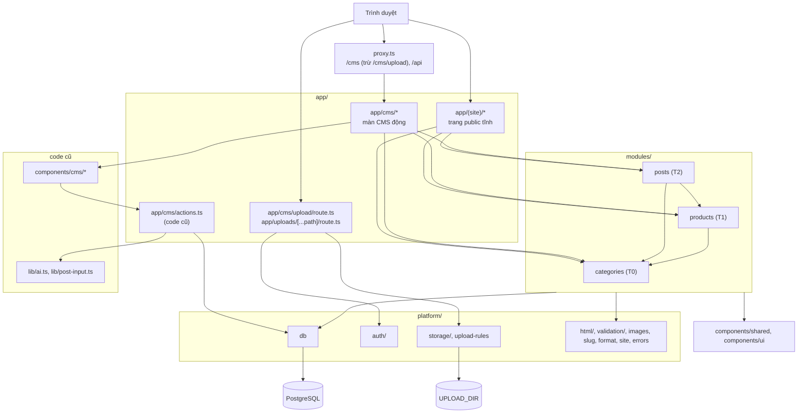

# Kiến trúc codebase

> Phiên bản: Next.js 16.4.3, React 19.3.0, Prisma 7.10 (`@prisma/adapter-pg`), Zod 4.6, OpenAI SDK 7.47, Tailwind 4, Vitest 5.1 (`package.json`) · Nguồn: mã nguồn repo, spine `_bmad-output/planning-artifacts/architecture/architecture-affiliate-project-2026-11-03/ARCHITECTURE-SPINE.md`, `node_modules/next/dist/docs/` · Kiểm lần cuối: 2026-11-05 (lượt gộp Story 2.4–2.8, trên 2d7b976)

Tài liệu này là bản đồ của code **đang có**. Cấu trúc đích (spine AD-2, AD-17, Structural Seed) nằm ở mục [Dự kiến](#dự-kiến); spine thắng tài liệu này khi mâu thuẫn. Quy ước viết code xem `docs/quy-uoc-code.md`.

## Tóm tắt cho agent

Tài liệu chỉ trỏ tới **file + tên hàm/hằng**, không ghi số dòng (file đổi thường xuyên làm số dòng lệch).

- Ứng dụng là một Next.js App Router duy nhất, hai mặt: **site public** (`app/(site)/`) và **CMS** (`app/cms/`). Không có `app/api/`. Hai route handler: `app/cms/upload/route.ts` (POST upload) và `app/uploads/[...path]/route.ts` (GET file đã upload).
- Repo đang chuyển dần sang `app → modules → platform` (spine AD-2, AD-17). Đã có `modules/categories` (T0), `modules/products` (T1), `modules/posts` (T2, phần site + một phần CMS). Code cũ còn lại: `lib/` (`ai`, `post-input`), `components/cms/`, `app/cms/actions.ts`, `app/cms/page.tsx`, `app/cms/new/`, `app/cms/posts/[id]/` — trình soạn bài, chuyển ở Epic 3 (ngoại lệ AD-17 trong `docs/cong-thuc/chuyen-code-cu.md`). `components/site/` đã xoá.
- Bật `cacheComponents` và `partialPrefetching` (`next.config.ts`). Trang public chỉ đọc qua hàm `"use cache"` trong `modules/<miền>/queries.ts`; không truy vấn `db` trong trang.
- Ghi dữ liệu: Server Action trong `modules/<miền>/actions.ts` (Danh mục, Sản phẩm) hoặc `app/cms/actions.ts` (Bài web, code cũ), bọc `run()` (`platform/auth/run.ts`, gọi `requireAdmin()`), rồi `updateTag` tag của module có dữ liệu đổi.
- Auth là HTTP Basic: `proxy.ts` chặn `/cms` (trừ `/cms/upload`) + `/api`; Server Action và route upload tự kiểm lại. Realm chung `BASIC_AUTH_CHALLENGE` (`platform/auth/basic-auth.ts`).
- Prisma client sinh ra ở `generated/prisma`; import `db` từ `@/platform/db`, kiểu từ `@/generated/prisma/client`, enum từ `@/generated/prisma/enums`.
- HTML bài viết luôn qua `sanitizePostHtml` (`platform/html/sanitize.ts`) khi ghi và khi render — AD-22.
- Host ảnh cho phép khai báo một chỗ: `IMAGE_HOSTS` (`platform/images.ts`), cùng `UPLOADS_PATH` cho file upload.
- Sản phẩm public luôn lọc qua `visibleProductWhere` + `publicProductSelect` (`modules/products/queries.ts`) — Sản phẩm ẩn biến khỏi mọi trang.
- Lớp AI duy nhất là `lib/ai.ts` (code cũ, đích `platform/ai` — chưa có); chỉ `app/cms/actions.ts` gọi nó.

## Tổng quan tầng

Ghi chú: `app/cms/page.tsx`, `app/cms/posts/[id]/page.tsx` (code cũ) gọi `db` trực tiếp; được miễn luật ESLint qua `LEGACY_APP_FILES` (`eslint.config.mjs`). Route mới trong `app/` không import `@/platform/db` hay `service.ts`.

## Bảng trách nhiệm module

### platform/

Hạ tầng chung, không chứa nghiệp vụ, không import `modules/` hay `app/` (`eslint.config.mjs`). Test `*.test.ts` đặt cạnh file nguồn.

| File | Sở hữu | Ai gọi |
|---|---|---|
| `platform/db.ts` | `import "server-only"`; singleton `PrismaClient` với adapter `PrismaPg`, giữ trên `globalThis` ngoài production | `queries.ts`/`cms-queries.ts`/`service.ts` của module; code cũ `app/cms/actions.ts`, `app/cms/page.tsx`, `app/cms/posts/[id]/page.tsx` |
| `platform/auth/basic-auth.ts` | `isAuthorized()` so Basic Auth bằng `timingSafeEqual` trên SHA-256, fail closed khi thiếu env; `BASIC_AUTH_CHALLENGE` (realm "CMS") | `proxy.ts`, `platform/auth/require-admin.ts`, `app/cms/upload/route.ts` |
| `platform/auth/require-admin.ts` | `requireAdmin()` đọc header `authorization` qua `headers()`, ném `UserError("Bạn cần đăng nhập CMS")` | `run()` |
| `platform/auth/run.ts` | `run(fn)`: `requireAdmin()` → chạy → trả `Result<T>`; `UserError` trả nguyên văn, lỗi khác `console.error` + `UNEXPECTED_ERROR` | mọi Server Action |
| `platform/errors.ts` | `UserError`, kiểu `Result<T>`, hằng `UNEXPECTED_ERROR` = "Có lỗi xảy ra, thử lại sau" | `run()`, `lib/ai.ts`, `app/cms/actions.ts` |
| `platform/validation/fields.ts` | Trường Zod dùng chung: `optionalText`, `requiredText`, `slugField`, `imageUrl` (theo `isAllowedImageUrl`), `shopeeAffiliateUrl` (chỉ `https` + `shopee.vn`, `s.shopee.vn`, `shope.ee`) | `schema.ts` của module, `lib/post-input.ts` |
| `platform/validation/errors.ts` | `firstError()` lấy thông báo lỗi Zod đầu tiên | `app/cms/actions.ts` |
| `platform/html/sanitize.ts` | `sanitizePostHtml()` — allowlist thẻ định dạng, **không** `a`, `img`, không thuộc tính (AD-22) | `createPost`/`savePost` (`app/cms/actions.ts`), trang bài `app/(site)/bai-viet/[slug]/page.tsx` |
| `platform/html/content.ts` | `readingMinutes()` (200 từ/phút), `withHeadingIds()` gắn id cho `<h2>` làm mục lục; dùng trên HTML đã sanitize | `modules/posts/queries.ts`, trang bài |
| `platform/slug.ts` | `RESERVED_ROOT_SLUGS` (đường dẫn hệ thống, test so với thư mục `app/` và `app/(site)`), `slugify()` | `modules/categories/schema.ts`, `uniqueSlug()` trong `app/cms/actions.ts` |
| `platform/images.ts` | `IMAGE_HOSTS`, `UPLOADS_PATH` (`/uploads/`) và `isAllowedImageUrl()` (chỉ `https` + host trong danh sách, hoặc đường dẫn `/` cùng origin; từ chối `//host`) | `next.config.ts`, `platform/validation/fields.ts`, `platform/storage/local-disk.ts`, UploadField |
| `platform/format.ts` | `formatDate()` (ngày dài), `formatShortDate()` (dd/mm/yyyy) theo `vi-VN`, `Asia/Ho_Chi_Minh`, trả `""` khi `null` | trang chủ, trang bài, ProductCard, CMS Sản phẩm |
| `platform/upload-rules.ts` | Luật upload dùng chung server + client: `UPLOAD_ENDPOINT`, loại nhận (`UPLOAD_TYPES` ảnh JPG/PNG/WebP/GIF/AVIF, video MP4/WebM/MOV), `IMAGE_MAX_BYTES` 25 MB, `VIDEO_MAX_BYTES` 100 MB, `uploadError()` | `app/cms/upload/route.ts`, `components/shared/upload-field.client.tsx` |
| `platform/storage/local-disk.ts` | `import "server-only"`; `put({ type, body }, maxBytes) → { url }` ghi luồng vào `UPLOAD_DIR` (tên = sha256 + đuôi, file tạm rồi đổi tên, vượt cỡ ném `UploadTooLargeError`), `openStoredFile(name)`; thiếu `UPLOAD_DIR` hoặc trỏ vào `public/`/`.next/` → ném lỗi (AD-24) | hai route handler upload |
| `platform/site.ts` | `SITE_NAME`, `SITE_URL` (từ `NEXT_PUBLIC_SITE_URL`, bỏ `/` cuối) | root layout, sitemap, robots, trang bài, `runThreads` |

`platform/ai` là **đích, chưa có** (dựng ở story AI đầu tiên).

### modules/

Hợp đồng file theo spine AD-5 (`schema`, `types`, `constants`, `tags`, `queries` public có cache, `cms-queries` không cache, `service` ghi DB, `actions`, `components/`). Test `*.test.ts` (unit) và `*.db.test.ts` (Postgres test) cạnh nguồn.

| Module | Sở hữu | Ai gọi |
|---|---|---|
| `modules/categories/` (T0) | `Category`, `CategorySlugRedirect`; `CATEGORIES_TAG` (`tags.ts`); `categoryInputSchema`; `saveCategoryRecord` (đổi slug thì ghi `CategorySlugRedirect`, slug dùng lại thì xoá bản ghi trùng), `deleteCategoryRecord`, `moveCategoryRecord`; `queries.ts`: `getPublicCategory`, `getCategorySlugRedirect` (tag `categories`); `cms-queries.ts`: `getCategoryForCms`, `listCategoryOptionsForCms` | `/cms/danh-muc`, trang `/[danh-muc]` |
| `modules/products/` (T1) | `Product`; `PRODUCTS_TAG`; `productInputSchema`, `setProductHiddenInputSchema`; `saveProductRecord`, `setProductHiddenRecord`; actions `saveProduct`, `setProductHidden` (`updateTag(PRODUCTS_TAG)`); `queries.ts`: `visibleProductWhere`, `publicProductSelect`; `cms-queries.ts`: `listProductsForCms` (kẹp trang), `getProductForCms`; components `AffiliateLink`, `AffiliateDisclosure`, `ProductCard`, `ProductForm`, `ProductStatusBadge`, `ProductVisibilityButton` | `/cms/san-pham`, trang bài, `modules/posts/queries.ts` |
| `modules/posts/` (T2) | `POSTS_TAG` (`tags.ts`); `POST_TYPES`, `POST_TYPE_KEYS`, `PAGE_SIZE` (`constants.ts`); `queries.ts`: `getLatestPosts`, `getPostsByType`, `getRelatedPosts`, `getPostBySlug`, `getPublishedSlugs`, `listCategoriesWithPostCounts`, `listNavCategories`, `listPostsByCategory`, `listPostsByType`; `cms-queries.ts`: `listCategoriesForCms`, `listPostsUsingProductForCms`; components `PostCard`, `PostListItem`, `PostTypeBadge` | mọi trang `app/(site)`, `app/sitemap.ts`, `/cms/danh-muc`, `/cms/san-pham/[id]` |

### lib/ (code cũ chờ chuyển)

Không tạo file mới ở đây (Policy trong `AGENTS.md`, spine AD-17). Vị trí đích theo `docs/cong-thuc/chuyen-code-cu.md`.

| File | Sở hữu | Ai gọi |
|---|---|---|
| `lib/ai.ts` | Client OpenAI lười khởi tạo, hàm `ask()` structured output, `generatePost`, `toThreads`, `analyzeSeo` và prompt hệ thống `WRITER_SYSTEM` | `app/cms/actions.ts`; kiểu `SeoReport` ở `components/cms/post-editor.tsx` |
| `lib/post-input.ts` | Schema zod `postInputSchema`, `newPostSchema`; kiểu `PostInput`/`NewPostInput`. Khoá `category` = Loại bài (`[NO-20]`) | `app/cms/actions.ts`, `components/cms/*` |

### app/

| File | Sở hữu | Ai gọi / phụ thuộc |
|---|---|---|
| `app/layout.tsx` | Root layout: font Be Vietnam Pro, `metadata` gốc, `Toaster` | Next.js |
| `app/globals.css` | Tailwind 4, token DESIGN.md, alias shadcn và alias cũ `meo-vat*`/`chart-3` (còn cho `components/cms/status-badge`, `seo-score`) | `platform/design-tokens.ts` đọc màu |
| `app/robots.ts`, `app/sitemap.ts` | robots chặn `/cms`, `/api/`; sitemap: trang chủ, `/meo-vat`, `/gom-link`, mọi Danh mục, mọi Bài web đã xuất bản — không có `/…/trang/n` (AD-26) | `getPublishedSlugs`, `listCategoriesWithPostCounts` |
| `app/(site)/layout.tsx` | `ensureStatic = "navigation"`; SiteHeader, SiteFooter, BottomTabBar (trong `<Suspense>`), dữ liệu `listNavCategories()` | mọi trang site |
| `app/(site)/_components/` | `HomeScreen`, SiteHeader (+ `more-menu.client.tsx` "Thêm"), BottomTabBar, CategorySheet, SiteFooter, Breadcrumb, Pagination (+ `pagination-items.ts`), `PostListScreen`, `post-type-route.ts`, `post-type-screen.tsx`, `list-page-metadata.ts`, `SectionHeading`, `JsonLd` | trang site; styleguide |
| `app/(site)/page.tsx` | Trang chủ | `getLatestPosts`, `getPostsByType` |
| `app/(site)/[danh-muc]/page.tsx`, `trang/[n]/page.tsx` | Trang Danh mục có phân trang; `loadCategory()` (`_components/load-category.ts`) tra slug → lịch sử → 308/404 **trước** `<Suspense>` (AD-12, AD-20) | `getPublicCategory`, `getCategorySlugRedirect`, `listPostsByCategory` |
| `app/(site)/meo-vat/`, `app/(site)/gom-link/` (+ `trang/[n]`) | Trang Loại bài, lọc `PostType` | `post-type-route.ts`, `post-type-screen.tsx`, `listPostsByType` |
| `app/(site)/bai-viet/[slug]/page.tsx` + `_components/post-screen.tsx` | Trang Bài web: `page.tsx` tra bài + `notFound()` trước `<Suspense>`, `PostScreen` render: metadata, JSON-LD (breadcrumb theo Danh mục), AffiliateDisclosure dưới dòng meta, danh sách ProductCard *row*, mục lục, bài liên quan | `getPostBySlug`, `getRelatedPosts`, `getPublishedSlugs` |
| `app/cms/upload/route.ts` | POST upload: `requireAdmin()` trước khi đọc body (401 + `BASIC_AUTH_CHALLENGE`), kiểm loại/dung lượng, `put()` (AD-6 ngoại lệ 3, AD-24) | UploadField |
| `app/uploads/[...path]/route.ts` | GET file upload, `Cache-Control` immutable; tên sai dạng → 404 | `next/image`, trình duyệt |
| `app/cms/layout.tsx` | CmsShell, `noindex`, `maxDuration = 120` (AD-18) | trang CMS |
| `app/cms/danh-muc/**`, `app/cms/san-pham/**` | Màn Danh mục, Kho Sản phẩm (Screen + skeleton trong `_components/`) | module tương ứng |
| `app/cms/page.tsx`, `new/`, `posts/[id]/`, `actions.ts` | Trình soạn bài cũ (ngoại lệ AD-17 tới Epic 3), có chọn Danh mục (`categoryId`, lỗi FK → `UserError`); `savePost`/`setPostStatus`/`deletePost` `updateTag` `posts` + `categories`; `actions.ts`: `createPost`, `savePost`, `setPostStatus`, `deletePost`, `runSeoCheck`, `runThreads` — không ghi `Product`/`PostProduct` | `components/cms/*` |
| `app/cms/styleguide/` | `/cms/styleguide` (noindex): token + component | — |

### Khác

- `proxy.ts` — kiểm Basic Auth cho `matcher: ["/cms", "/cms/((?!upload$).*)", "/api/:path*"]`; `/cms/upload` nằm ngoài proxy và tự `requireAdmin()` (AD-24).
- `next.config.ts` — `remotePatterns` từ `IMAGE_HOSTS`, `cacheComponents`, `partialPrefetching`. Ảnh `/uploads/…` là ảnh nội bộ, không cần `localPatterns` (mặc định cho mọi đường dẫn nội bộ không query).
- `prisma/schema/` — `_base.prisma`, `categories.prisma` (`Category`, `CategorySlugRedirect`), `posts.prisma` (`Post`, `PostProduct`, enum `PostType`, `Status`), `products.prisma` (`Product`, có `hidden`). `prisma/seed.ts` upsert 8 Danh mục, xoá bài rồi tạo lại bài mẫu; Sản phẩm mẫu nhận diện bằng Link affiliate placeholder (`[NO-08]`).
- `eslint.config.mjs` — luật ranh giới module (`TIERS`, `no-restricted-imports`, `import/no-cycle`); file cũ miễn qua `LEGACY_APP_FILES`.
- `vitest.config.ts` (unit), `vitest.db.config.ts` + `vitest.db.setup.ts` + `vitest.db.helpers.ts` + `vitest.db.mocks.ts` (test DB và khung test Server Action — `docs/kiem-chung.md` [KC-08]).
- `components/shared/` — `CmsForm`, `ConfirmDialog`, `UnsavedChangesGuard`, `callAction`, `ImageFallback`, `UploadField`. `components/ui/` — shadcn base-ui.

## Read path — trang public

Ví dụ `/bai-viet/<slug>`:

1. Request không khớp `matcher` của `proxy.ts` → không qua auth.
2. `(site)` có `ensureStatic = "navigation"`: trang prerender lúc build từ `generateStaticParams()`; URL chưa prerender chờ bản tĩnh để `notFound()`/`permanentRedirect()` trả đúng mã.
3. `generateMetadata` và trang cùng gọi `getPostBySlug()` (`modules/posts/queries.ts`, `"use cache"` + `cacheTag(posts, products)`, chỉ bài `PUBLISHED`).
4. Sản phẩm của bài: `postProducts` lọc `product: visibleProductWhere`, chọn `publicProductSelect`, theo `sortOrder`. Ảnh đại diện fallback = ảnh Sản phẩm **đang hiện** đầu tiên (cùng bộ lọc), rồi `/placeholder.svg` ở component.
5. Render: `sanitizePostHtml` → `withHeadingIds`; `AffiliateDisclosure` ngay dưới dòng meta khi có ≥ 1 Sản phẩm đang hiện; danh sách `ProductCard` *row* (mỗi thẻ là một `AffiliateLink`).

Trang Danh mục `/[danh-muc]`: `page.tsx` gọi `loadCategory(slug)` — `getPublicCategory` → không thấy thì `getCategorySlugRedirect` → `permanentRedirect` (308) hoặc `notFound()`, rồi `listPostsByCategory(id, page)`; `trang/[n]` thêm `n=1` → 308 về gốc, `n` vượt trang cuối → 404. Trang Loại bài theo cùng mẫu với `listPostsByType`.

## Write path — CMS

Mẫu chuẩn (module, ví dụ ẩn Sản phẩm):

1. **Client** — `ProductVisibilityButton` gọi `setProductHidden({ id, hidden })` qua `callAction`, Toast kết quả kèm "Hoàn tác".
2. **Action** (`modules/products/actions.ts`) — `run()` (`requireAdmin()`) → `setProductHiddenInputSchema.safeParse` → `setProductHiddenRecord` (`service.ts`) → `updateTag(PRODUCTS_TAG)`.
3. **Cache** — mọi query public trả Sản phẩm gắn tag `products` nên trang bài, danh sách bài làm mới ngay.

Form (Danh mục, Sản phẩm): RHF + `zodResolver(<x>InputSchema)` trong `CmsForm`; server parse lại bằng cùng schema. Lỗi người dùng là `UserError` tiếng Việt.

Trình soạn bài cũ (`components/cms/post-editor.tsx` → `savePost` trong `app/cms/actions.ts`): `run()` → `postInputSchema` → `sanitizePostHtml` → `uniqueSlug()` → `db.post.update` (không chạm `PostProduct`/`Product`) → `updateTag(POSTS_TAG)`. `setPostStatus` chặn xuất bản bài rỗng, giữ `publishedAt` gốc. `createPost` không `updateTag` vì bài mới luôn nháp.

Upload: UploadField gửi file thô (XHR, `Content-Type` = loại file) tới `/cms/upload`; route trả `{ ok, url }`; form chỉ lưu `url`.

## AI path

1. Client gọi `createPost({ useAi: true })`, `runSeoCheck` hoặc `runThreads` (`components/cms/new-post-form.tsx`, `components/cms/post-editor.tsx`).
2. Action qua `run()` → gọi `generatePost` / `analyzeSeo` / `toThreads` trong `lib/ai.ts`.
3. `ask(schema, name, system, user)` (`lib/ai.ts`) gọi `client.responses.parse` với `zodTextFormat` — structured output phía OpenAI. Không có `output_parsed` → `UserError` tiếng Việt. Model từ `OPENAI_MODEL`, mặc định `gpt-4o-mini`.
4. Hậu xử lý: `analyzeSeo` kẹp điểm 0–100; `createPost` cắt `excerpt` 500 ký tự, cho bản nháp AI qua cùng `postInputSchema`, `sanitizePostHtml(content)`, tạo slug duy nhất. Chủ đề rỗng + AI → `UserError` "Nhập chủ đề để AI viết bài".
5. Kết quả AI lưu thẳng thành bài **nháp**. Kết quả SEO và Threads không lưu DB.
6. Thời gian chạy: `maxDuration = 120` cho route CMS (`app/cms/layout.tsx`, AD-18).

## Ranh giới auth

- **Tầng request**: `proxy.ts` trả 401 + `WWW-Authenticate: BASIC_AUTH_CHALLENGE` khi `isAuthorized` sai.
- **Tầng action**: `requireAdmin()` trong `run()`. Server Action được gọi qua POST tới chính URL trang; không coi proxy là đủ.
- **Route upload**: `app/cms/upload/route.ts` ngoài proxy, gọi `requireAdmin()` trước khi đọc body, sai thì 401 + cùng realm.
- **Tầng hiển thị**: `app/cms/layout.tsx` đặt `noindex`; `app/robots.ts` chặn `/cms`.

## Ranh giới cache

- **Cache**: mọi hàm trong `modules/*/queries.ts` có `"use cache"` + `cacheLife("days")` + `cacheTag` của mọi module có bảng nó đọc: bài + ảnh Sản phẩm → `posts`, `products`; Danh mục + bài → `posts`, `categories`; danh sách bài theo Danh mục → `posts`, `categories`, `products`; Danh mục / lịch sử slug → `categories`.
- **Huỷ cache**: `updateTag(POSTS_TAG)` + `updateTag(CATEGORIES_TAG)` trong `savePost`, `setPostStatus`, `deletePost`; `updateTag(CATEGORIES_TAG)` trong `saveCategory`, `deleteCategory`, `moveCategory`; `updateTag(PRODUCTS_TAG)` trong `saveProduct`, `setProductHidden`. `updateTag` chỉ gọi được trong Server Action.
- **Không cache**: Screen CMS đọc `cms-queries.ts` trong `<Suspense>` (`connection()` hoặc `params`/`searchParams` động); route upload.
- `sitemap.ts` dùng `getPublishedSlugs()` + `listCategoriesWithPostCounts()` nên theo tag `posts`, `categories`.

## Bề mặt SEO

| Bề mặt | Vị trí |
|---|---|
| Metadata gốc, title template `%s \| Mẹo Vặt Cuộc Sống`, `metadataBase` | `app/layout.tsx` |
| Metadata trang Danh mục / Loại bài: title, meta description = mô tả, canonical chính nó (kể cả `/trang/n`) | `listPageMetadata` (`app/(site)/_components/list-page-metadata.ts`) |
| Metadata trang bài | `generateMetadata` trong `app/(site)/bai-viet/[slug]/page.tsx` |
| JSON-LD `Article` + `BreadcrumbList` (bài), `BreadcrumbList` (Danh mục / Loại bài) | trang bài; `PostListScreen`; component `app/(site)/_components/json-ld.tsx` |
| Sitemap (không có `/trang/n`) | `app/sitemap.ts` |
| Robots | `app/robots.ts` |
| `noindex` cho CMS, styleguide | `app/cms/layout.tsx`, `app/cms/styleguide/page.tsx` |
| Link affiliate `rel="sponsored nofollow noopener"`, `target="_blank"` | `AffiliateLink` (`modules/products/components/affiliate-link.tsx`) |
| Chuyển hướng 308 khi đổi slug Danh mục | `loadCategory` (`app/(site)/[danh-muc]/_components/load-category.ts`) + `CategorySlugRedirect` |

## Bảng thuật ngữ code ↔ PRD

| Code | Thuật ngữ PRD (§3) | Ghi chú |
|---|---|---|
| `Post` | Bài web | |
| `Post.status` `DRAFT` / `PUBLISHED` | Bài web *nháp* / *đã xuất bản* | |
| enum `PostType` `MEO_VAT` / `GOM_LINK`, `POST_TYPES` (`modules/posts/constants.ts`) | Loại bài (*Mẹo vặt* / *Gom link*) | Trang `/meo-vat`, `/gom-link`; `PostTypeBadge`. Trình soạn bài cũ còn gọi là `category` / "Chuyên mục" (`[NO-20]`) |
| model `Category`, `Post.categoryId`, `Product.categoryId` | Danh mục | CMS `/cms/danh-muc`; site `/[danh-muc]`, CategorySheet, nav, footer; đổi slug ghi `CategorySlugRedirect` (308) |
| `Product` | Sản phẩm | Kho độc lập `/cms/san-pham`; Bài web chỉ tham chiếu qua `PostProduct`; `hidden` = ẩn khỏi website (FR-5) |
| `Product.affiliateUrl` | Link affiliate | Chỉ ra website qua `AffiliateLink` |
| `Product.priceText` + `priceUpdatedAt` | giá tham khảo + ngày cập nhật | "Giá tham khảo ~89.000đ · cập nhật dd/mm/yyyy" |
| `AffiliateDisclosure` | Nhãn công khai affiliate | `modules/products/components/affiliate-disclosure.tsx` |
| `generatePost` / `PostDraft` | Gợi ý AI (cho Bài web) | Lưu thẳng thành bài nháp |
| `toThreads` | Bài Threads (dạng chuỗi) | Không lưu DB |
| `WRITER_SYSTEM` (`lib/ai.ts`) | Hồ sơ phong cách (Website) | Đang cứng trong code |
| Basic Auth `ADMIN_USERNAME` | Người vận hành | |

## Bất biến liên module

- **[KT-01] Ghi phải huỷ cache.** Mọi action thay đổi dữ liệu public gọi `updateTag` tag của **mọi** module có dữ liệu thay đổi, sau khi ghi; mọi query có cache gắn tag của mọi module có bảng nó đọc (spine AD-7). Tag: `POSTS_TAG` (`modules/posts/tags.ts`), `CATEGORIES_TAG` (`modules/categories/tags.ts`), `PRODUCTS_TAG` (`modules/products/tags.ts`). Không dùng `revalidatePath`.
- **[KT-02] Mọi Server Action phải qua `run()`.** Trừ ba ngoại lệ có tên của `[QD-20]` (route upload là một).
- **[KT-03] Nguồn duy nhất của host ảnh là `IMAGE_HOSTS`** (`platform/images.ts`); `next.config.ts` và `platform/validation/fields.ts` tự theo.
- **[KT-04] HTML bài luôn sanitize** khi ghi (`createPost`, `savePost`) và khi render (trang bài).
- **[KT-05] Trang public chỉ đọc qua hàm `"use cache"` có `cacheTag`** trong `modules/*/queries.ts`, chỉ dữ liệu đã xuất bản; Sản phẩm chỉ qua `visibleProductWhere` + `publicProductSelect`. Không gọi `db` trong `app/(site)/*` (ESLint chặn).
- **[KT-06] Route public phải tĩnh.** `ensureStatic = "navigation"` (`app/(site)/layout.tsx`): không `cookies()`, `headers()`, `connection()`, `searchParams` hay dữ liệu chưa cache trong `app/(site)/*`; tra slug/redirect/404 trước `<Suspense>`.
- **[KT-07] Slug bài duy nhất qua `uniqueSlug()`** (`app/cms/actions.ts`); slug Danh mục kiểm `RESERVED_ROOT_SLUGS` (`platform/slug.ts`) trong `modules/categories/schema.ts`.
- **[KT-08] Loại bài khai báo một chỗ.** `POST_TYPES` (`modules/posts/constants.ts`) khoá bằng enum `PostType` (`satisfies Record<PostType, …>`); `z.enum` trong `lib/post-input.ts` vẫn gõ lại giá trị (`[NO-19]`).
- **[KT-09] Lớp AI chỉ gọi từ Server Action.** `lib/ai.ts` chỉ import ở phía server; client chỉ `import type`.
- **[KT-10] Trang có Sản phẩm phải hiện Nhãn công khai affiliate** (`AffiliateDisclosure`) và mọi link Shopee qua `AffiliateLink`.

## Dự kiến

Theo spine (AD-2, AD-17, Structural Seed), PRD và `addendum.md` A1, A4. Chỉ liệt kê vị trí đích.

- **Trình soạn bài** (Epic 3): `app/cms/actions.ts`, `lib/post-input.ts`, `components/cms/*`, `app/cms/{page,new,posts}` chuyển sang `modules/posts/` và `app/cms/bai-viet/`; gắn Sản phẩm có sẵn vào bài; `PostSlugRedirect` cho đổi slug bài (`[NO-07]`).
- **Lớp AI** (A1, A3): `lib/ai.ts` → `platform/ai` + `modules/<miền>/prompts/`.
- **Seed** (A4): link `https://shopee.vn/search?...` qua được `shopeeAffiliateUrl` (đúng domain) — câu hỏi mở ở `addendum.md` §A4.
- **Bộ nội dung, Gợi ý AI, Cảnh báo rủi ro, Trang bio, Lượt xem, Tìm kiếm**: module và route mới theo spine; `/bio`, `/tim-kiem` hiện 404.

## Checklist khi review thay đổi kiến trúc

- [ ] Action mới bọc `run()` và gọi `updateTag` tag của mọi module có dữ liệu public thay đổi; query có cache gắn tag của mọi module có bảng nó đọc ([KT-01], [KT-02], AD-7).
- [ ] Trang public mới đọc qua hàm `"use cache"` có `cacheTag`, không gọi `db`, không dùng API request-time ([KT-05], [KT-06]).
- [ ] Mọi HTML từ người dùng hoặc AI qua `sanitizePostHtml` ([KT-04]).
- [ ] Host ảnh mới chỉ thêm ở `platform/images.ts` ([KT-03]).
- [ ] Loại bài mới đồng bộ `CATEGORIES`, enum Prisma và `z.enum` ([KT-08]).
- [ ] `lib/ai.ts` không bị import vào component client ngoài `import type` ([KT-09]).
- [ ] Route mới cần auth nằm dưới `/cms` hoặc `/api` để khớp `proxy.ts` matcher; ngoại lệ `/cms/upload` không qua proxy, phải tự `requireAdmin()` (AD-24).
- [ ] File mới nằm ở `modules/<miền>/`, `platform/`, `components/ui|shared/` hoặc `app/` theo spine, không ở `lib/`, `components/site|cms/`; `npm run lint` sạch (luật ranh giới).
- [ ] Bảng module trong tài liệu này được cập nhật khi thêm/xoá/chuyển file trong `platform/`, `lib/` hoặc `app/`.

## Tham khảo

- `node_modules/next/dist/docs/01-app/03-api-reference/03-file-conventions/02-route-segment-config/ensureStatic.md`
- `node_modules/next/dist/docs/01-app/03-api-reference/04-functions/updateTag.md`
- `node_modules/next/dist/docs/01-app/03-api-reference/01-directives/use-cache.md`
- `node_modules/next/dist/docs/01-app/03-api-reference/03-file-conventions/proxy.md`
- `_bmad-output/planning-artifacts/prds/prd-affiliate-project-2026-11-03/prd.md`, `addendum.md`
