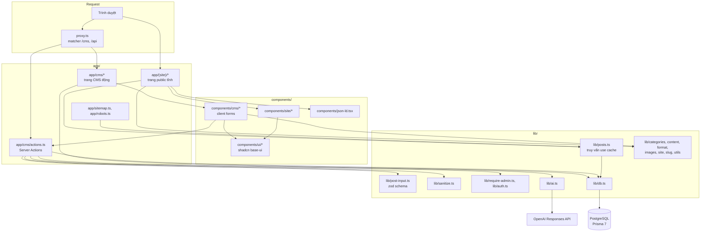

# Kiến trúc codebase

> Phiên bản: Next.js 16.4.3, React 19.3.0, Prisma 7.10 (`@prisma/adapter-pg`), Zod 4.6, OpenAI SDK 7.47, Tailwind 4 (`package.json:13-46`) · Nguồn: mã nguồn repo, `node_modules/next/dist/docs/` · Kiểm lần cuối: 2026-11-03 @ dfd7e8f

Tài liệu này là bản đồ của code **đang có**. Thay đổi theo PRD nằm ở mục [Dự kiến](#dự-kiến). Quy ước viết code xem `docs/quy-uoc-code.md`.

## Tóm tắt cho agent

- Ứng dụng là một Next.js App Router duy nhất, hai mặt: **site public** (`app/(site)/`) và **CMS** (`app/cms/`). Không có `app/api/`.
- Bật `cacheComponents` và `partialPrefetching` (`next.config.ts:9-10`). Đọc dữ liệu public bằng hàm `"use cache"` trong `lib/posts.ts`, không truy vấn `db` trực tiếp trong trang public.
- Mọi ghi dữ liệu đi qua Server Action trong `app/cms/actions.ts`, bọc bởi `run()` (gọi `requireAdmin()`), rồi `updateTag(POSTS_TAG)` (`app/cms/actions.ts:21-29`, `:88`).
- Auth là HTTP Basic: `proxy.ts` chặn `/cms` + `/api` ở tầng request; Server Action tự kiểm lại vì có thể bị POST thẳng (`lib/require-admin.ts:4`).
- Prisma client sinh ra ở `generated/prisma` (`prisma/schema.prisma:1-4`); import `db` từ `@/lib/db`, kiểu từ `@/generated/prisma/client`.
- HTML bài viết luôn đi qua `sanitizePostHtml` khi ghi (`app/cms/actions.ts:56`, `:82`) và lại lần nữa khi render (`app/(site)/bai-viet/[slug]/page.tsx:47`).
- Host ảnh cho phép khai báo một chỗ: `IMAGE_HOSTS` (`lib/images.ts:3`), dùng cho cả `next.config.ts:7` và validate form (`lib/post-input.ts:8`).
- Lớp AI duy nhất là `lib/ai.ts`; chỉ `app/cms/actions.ts` gọi nó.

## Tổng quan tầng

Ghi chú: trang CMS server (`app/cms/page.tsx:24`, `app/cms/posts/[id]/page.tsx:17`) gọi `db` trực tiếp, không qua `lib/posts.ts`, vì CMS cần cả bài nháp và không được cache.

## Bảng trách nhiệm module

### lib/

| File | Sở hữu | Ai gọi |
|---|---|---|
| `lib/ai.ts` | Client OpenAI lười khởi tạo (`:8-14`), hàm `ask()` structured output (`:18-29`), `generatePost`, `toThreads`, `analyzeSeo` và prompt hệ thống (`:46-55`) | `app/cms/actions.ts:5`; kiểu `SeoReport` dùng ở `components/cms/post-editor.tsx:13` |
| `lib/auth.ts` | `isAuthorized()` so Basic Auth bằng `timingSafeEqual` trên SHA-256, fail closed khi thiếu env (`:7-13`) | `proxy.ts:5`, `lib/require-admin.ts:6` |
| `lib/categories.ts` | Kiểu `CategoryKey`, map `CATEGORIES` (label, slug URL, mô tả), `categoryFromSlug()` | route `[category]`, sitemap, nav, badge, form CMS, `lib/ai.ts` |
| `lib/content.ts` | `readingMinutes()` (200 từ/phút, `:5-8`), `withHeadingIds()` gắn id cho `<h2>` làm mục lục (`:11-21`) | `lib/posts.ts:4`, `app/(site)/bai-viet/[slug]/page.tsx:47` |
| `lib/db.ts` | Singleton `PrismaClient` với adapter `PrismaPg`, giữ trên `globalThis` ngoài production (`:4-12`) | `lib/posts.ts`, `app/cms/actions.ts`, `app/cms/page.tsx`, `app/cms/posts/[id]/page.tsx` |
| `lib/format.ts` | `formatDate()` theo `vi-VN`, trả `""` khi `null` | trang chủ, trang bài, danh sách CMS |
| `lib/images.ts` | `IMAGE_HOSTS` và `isAllowedImageUrl()` (chỉ `https`, hỗ trợ wildcard `*.`, cho phép đường dẫn `/`) | `next.config.ts:2`, `lib/post-input.ts:2` |
| `lib/post-input.ts` | Schema zod `productInputSchema`, `postInputSchema`, `newPostSchema`; kiểu `PostInput`/`ProductInput`/`NewPostInput` (dạng `z.input`); `firstError()` | `app/cms/actions.ts:7-13`, `components/cms/*` (kiểu) |
| `lib/posts.ts` | Mọi truy vấn bài **public**: `getLatestPosts`, `getPostsByCategory`, `getRelatedPosts`, `getPostBySlug`, `getPublishedSlugs`; hằng `POSTS_TAG`; ánh xạ thẻ bài `toCard` | trang `app/(site)/*`, `app/sitemap.ts`; `POSTS_TAG` ở `app/cms/actions.ts:6` |
| `lib/require-admin.ts` | `requireAdmin()` đọc header `authorization` qua `headers()` và ném `Unauthorized` | `run()` trong `app/cms/actions.ts:23` |
| `lib/sanitize.ts` | `sanitizePostHtml()` — danh sách thẻ/thuộc tính cho phép, ép `rel="noopener"` cho `<a>` | `app/cms/actions.ts:56`, `:82`; `app/(site)/bai-viet/[slug]/page.tsx:47` |
| `lib/site.ts` | `SITE_NAME`, `SITE_URL` (từ `NEXT_PUBLIC_SITE_URL`, bỏ `/` cuối) | root layout, sitemap, robots, trang bài, `runThreads` |
| `lib/slug.ts` | `slugify()` bỏ dấu tiếng Việt, `đ→d` | `lib/content.ts:1`, `uniqueSlug()` trong `app/cms/actions.ts:32` |
| `lib/utils.ts` | Re-export `cn` từ package `cn` | components site/cms |

### app/

| File | Sở hữu | Ai gọi / phụ thuộc |
|---|---|---|
| `app/layout.tsx` | Root layout: font Be Vietnam Pro, `metadata` gốc (`metadataBase`, title template, OpenGraph `vi_VN`), `ThemeProvider`, `Toaster` | Next.js; dùng `lib/site.ts` |
| `app/globals.css` | Tailwind 4, token màu (`--meo-vat`, `--gom-link`), plugin typography, biến thể `dark` | `app/layout.tsx:6` |
| `app/robots.ts` | `robots.txt`: chặn `/cms`, `/api/`, `/styleguide` | Next.js |
| `app/sitemap.ts` | `sitemap.xml`: trang chủ, 2 trang Loại bài, mọi bài đã xuất bản | `getPublishedSlugs()` |
| `app/(site)/layout.tsx` | Header/footer site; `ensureStatic = "navigation"` bắt toàn bộ route public phải tĩnh (`:4-6`) | mọi trang trong `(site)` |
| `app/(site)/page.tsx` | Trang chủ: bài nổi bật, mới cập nhật, khối Gom link, khối Mẹo vặt | `getLatestPosts`, `getPostsByCategory` |
| `app/(site)/[category]/page.tsx` | Trang Loại bài `/meo-vat`, `/gom-link`; `generateStaticParams` từ `CATEGORIES` | `getPostsByCategory`, `categoryFromSlug` |
| `app/(site)/bai-viet/[slug]/page.tsx` | Trang Bài web: metadata, JSON-LD, mục lục, Sản phẩm, bài liên quan | `getPostBySlug`, `getRelatedPosts`, `getPublishedSlugs` |
| `app/(site)/not-found.tsx` | Trang 404 cho site | `notFound()` ở các trang site |
| `app/cms/layout.tsx` | Khung CMS, `robots: noindex`, `maxDuration = 60` cho lời gọi AI | trang CMS |
| `app/cms/page.tsx` | Danh sách mọi bài (kể cả nháp), động qua `connection()` trong `Suspense` | `db` trực tiếp |
| `app/cms/new/page.tsx` | Trang tạo bài, render `NewPostForm` | — |
| `app/cms/posts/[id]/page.tsx` | Nạp bài + Sản phẩm, đổi `null` thành `""` cho form, render `PostEditor` với `key=updatedAt` | `db` trực tiếp |
| `app/cms/actions.ts` | Server Action: `createPost`, `savePost`, `setPostStatus`, `deletePost`, `runSeoCheck`, `runThreads`; helper `run()`, `uniqueSlug()`, `productRows()` | `components/cms/new-post-form.tsx:7`, `components/cms/post-editor.tsx:8` |
| `app/styleguide/page.tsx` | Trang duyệt design system, nằm ngoài `(site)` và ngoài matcher proxy | không ai link tới |

### Khác

- `proxy.ts` — kiểm Basic Auth cho `matcher: ["/cms", "/cms/((?!upload$).*)", "/api/:path*"]` (`proxy.ts`; riêng `/cms/upload` nằm ngoài proxy, route đó tự `requireAdmin()` — AD-24). Next.js 16 dùng file `proxy.ts` (xem `node_modules/next/dist/docs/01-app/03-api-reference/03-file-conventions/proxy.md`).
- `next.config.ts` — `remotePatterns` từ `IMAGE_HOSTS`, `cacheComponents`, `partialPrefetching`, loader Tailwind cho Turbopack.
- `prisma/schema.prisma` — model `Post`, `Product`, enum `Category`, `Status`. `prisma.config.ts` dùng `DIRECT_URL` cho CLI (`:10-13`). `prisma/seed.ts` xoá sạch bài rồi tạo lại bài mẫu đã xuất bản (`:163`).
- `components/json-ld.tsx` — render `<script type="application/ld+json">`, escape `<` (`:1-8`).

## Read path — trang public

Ví dụ `/bai-viet/<slug>`:

1. Request không khớp `matcher` của `proxy.ts:13` → không qua auth.
2. Route `(site)` có `ensureStatic = "navigation"` (`app/(site)/layout.tsx:6`): trang được prerender lúc build từ `generateStaticParams()` (`app/(site)/bai-viet/[slug]/page.tsx:18-21`); slug chưa prerender chờ bản tĩnh để `notFound()` trả đúng 404 (`app/(site)/layout.tsx:4-5`).
3. `generateMetadata` và `PostPage` cùng gọi `getPostBySlug()` (`app/(site)/bai-viet/[slug]/page.tsx:24`, `:44`). Hàm này là `"use cache"` + `cacheLife("days")` + `cacheTag(POSTS_TAG)` và chỉ lấy `status: "PUBLISHED"` (`lib/posts.ts:83-97`).
4. Ảnh đại diện fallback: `featuredImage ?? products[0].image ?? null` (`lib/posts.ts:94`), rồi `/placeholder.svg` ở component.
5. Render: `sanitizePostHtml` → `withHeadingIds` (`page.tsx:47`) → `dangerouslySetInnerHTML` (`page.tsx:111`); `getRelatedPosts` cùng Loại bài (`page.tsx:48`); `AffiliateDisclosure` chỉ khi có Sản phẩm (`page.tsx:108`); `ProductCard` mở Link affiliate với `rel="sponsored nofollow noopener"` (`components/site/product-card.tsx:37`).

Trang chủ và trang Loại bài theo cùng mẫu, dùng `getLatestPosts`/`getPostsByCategory` trả `PostCard` đã bỏ `content` (`lib/posts.ts:31-37`).

## Write path — CMS

1. **Form client** — `components/cms/post-editor.tsx` giữ state `PostInput`; tag/từ khoá nhập dạng chuỗi phẩy, đổi bằng `toList` khi gửi (`:21`, `:41`). Gọi action trong `startTransition`, báo lỗi bằng `toast.error(res.error)` (`:55-63`).
2. **Server Action** — `savePost(id, input)` (`app/cms/actions.ts:72`) bọc trong `run()`.
3. **`run()` / `requireAdmin()`** — `run` gọi `requireAdmin()` trước mọi thứ, bắt mọi lỗi, `console.error`, trả `{ ok: false, error }` (`app/cms/actions.ts:21-29`).
4. **zod** — `postInputSchema.safeParse(input)`; lỗi đầu tiên ném ra bằng `firstError` (`app/cms/actions.ts:74-75`, `lib/post-input.ts:43-45`). Schema chuyển chuỗi rỗng thành `null` (`lib/post-input.ts:4`, `:9`) và kiểm host ảnh (`:8`).
5. **sanitize** — `content: sanitizePostHtml(content)` (`app/cms/actions.ts:82`).
6. **Slug** — `uniqueSlug(slug || title, id)` thêm hậu tố `-2`, `-3`... khi trùng (`app/cms/actions.ts:31-38`).
7. **Prisma** — `db.post.update`, Sản phẩm thay toàn bộ bằng `deleteMany: {}` + `create` theo thứ tự (`app/cms/actions.ts:84`, `:40-41`).
8. **Cache** — `updateTag(POSTS_TAG)` (`app/cms/actions.ts:88`), làm mọi truy vấn `lib/posts.ts` hết hạn ngay (read-your-own-writes).

`setPostStatus` chặn xuất bản bài rỗng và giữ `publishedAt` gốc khi đăng lại (`app/cms/actions.ts:96-104`). `createPost` không gọi `updateTag` vì bài mới luôn là nháp (`Status @default(DRAFT)`, `prisma/schema.prisma:22`).

## AI path

1. Client gọi `createPost({ useAi: true })`, `runSeoCheck` hoặc `runThreads` (`components/cms/new-post-form.tsx:27`, `components/cms/post-editor.tsx:89`, `:101`).
2. Action qua `run()` → gọi `generatePost` / `analyzeSeo` / `toThreads` trong `lib/ai.ts`.
3. `ask(schema, name, system, user)` gọi `client.responses.parse` với `text.format = zodTextFormat(schema, name)` — structured output phía OpenAI (`lib/ai.ts:18-26`). Không có `output_parsed` → ném lỗi tiếng Việt (`:27`). Model lấy từ `OPENAI_MODEL`, mặc định `gpt-4o-mini` (`:16`).
4. Hậu xử lý: `analyzeSeo` kẹp điểm 0–100 (`lib/ai.ts:128`); `createPost` cắt `excerpt` 500 ký tự, `sanitizePostHtml(draft.content)`, tạo slug duy nhất từ title (`app/cms/actions.ts:53-58`).
5. Kết quả AI lưu thẳng thành bài **nháp**; người vận hành duyệt trong editor rồi mới xuất bản. Kết quả SEO và Threads không lưu DB, chỉ nằm trong state client (`components/cms/post-editor.tsx:35-36`).
6. Thời gian chạy: `maxDuration = 60` cho route CMS (`app/cms/layout.tsx:10-11`).

## Ranh giới auth

- **Tầng request**: `proxy.ts` trả 401 + `WWW-Authenticate: Basic` khi `isAuthorized` sai (`proxy.ts:4-10`).
- **Tầng action**: `requireAdmin()` trong `run()` (`lib/require-admin.ts:5-9`). Server Action được gọi qua POST tới chính URL trang; không được coi proxy là đủ.
- **Tầng hiển thị**: `app/cms/layout.tsx:7` đặt `noindex`; `app/robots.ts:6` chặn `/cms`.
- Ngoài ranh giới: `app/styleguide/page.tsx` công khai (chỉ `noindex`, `:14`).

## Ranh giới cache

- **Cache**: chỉ 5 hàm trong `lib/posts.ts`, đều `"use cache"` + `cacheLife("days")` + `cacheTag("posts")` (`lib/posts.ts:44-108`). Chỉ có **một** tag cho toàn bộ bài public.
- **Huỷ cache**: `updateTag(POSTS_TAG)` trong `savePost`, `setPostStatus`, `deletePost` (`app/cms/actions.ts:88`, `:107`, `:115`). `updateTag` chỉ gọi được trong Server Action (`node_modules/next/dist/docs/01-app/03-api-reference/04-functions/updateTag.md:12`).
- **Không cache**: trang CMS dùng `await connection()` trong `Suspense` (`app/cms/page.tsx:15-23`) hoặc `params` động trong `Suspense` (`app/cms/posts/[id]/page.tsx:9-16`).
- `sitemap.ts` dùng `getPublishedSlugs()` nên cũng theo tag `posts`.

## Bề mặt SEO

| Bề mặt | Vị trí |
|---|---|
| Metadata gốc, title template `%s \| Mẹo Vặt Cuộc Sống`, `metadataBase` | `app/layout.tsx:14-23` |
| Metadata trang Loại bài + canonical | `app/(site)/[category]/page.tsx:11-20` |
| Metadata trang bài: `seoTitle ?? title`, `seoDescription ?? excerpt`, keywords, canonical, OpenGraph article | `app/(site)/bai-viet/[slug]/page.tsx:23-41` |
| JSON-LD `Article` + `BreadcrumbList` | `app/(site)/bai-viet/[slug]/page.tsx:54-79`, component `components/json-ld.tsx` |
| Sitemap | `app/sitemap.ts:6-22` |
| Robots | `app/robots.ts:4-9` |
| `noindex` cho CMS, styleguide | `app/cms/layout.tsx:7`, `app/styleguide/page.tsx:14` |
| Link affiliate `rel="sponsored nofollow noopener"` | `components/site/product-card.tsx:37` |
| Mục lục neo `#id` từ h2 | `lib/content.ts:11-21` |

## Bảng thuật ngữ code ↔ PRD

| Code | Thuật ngữ PRD (§3) | Ghi chú |
|---|---|---|
| `Post` (`prisma/schema.prisma:10`) | Bài web | |
| `Post.status` `DRAFT` / `PUBLISHED` | Bài web *nháp* / *đã xuất bản* | UI ghi "Nháp" / "Đã đăng" (`components/cms/status-badge.tsx:11`) |
| `Category` enum `MEO_VAT` / `GOM_LINK`, `CategoryKey` | Loại bài (*Mẹo vặt* / *Gom link*) | Hiện cũng đóng vai Danh mục (route, menu, breadcrumb); UI gọi là "Chuyên mục" (`app/(site)/[category]/page.tsx:31`) |
| — | Danh mục | Chưa có trong code |
| `Product` (`prisma/schema.prisma:31`) | Sản phẩm | Hiện thuộc riêng một `Post`, không phải bản ghi dùng chung |
| `Product.affiliateUrl` | Link affiliate | |
| `Product.price` (chuỗi) | giá tham khảo | |
| `AffiliateDisclosure` | Nhãn công khai affiliate | `components/site/affiliate-disclosure.tsx` |
| `generatePost` / `PostDraft` | Gợi ý AI (cho Bài web) | Lưu thẳng thành bài nháp, chưa có trạng thái *chờ duyệt* |
| `toThreads` / tab Threads | Bài Threads (dạng chuỗi) | Không lưu DB |
| `WRITER_SYSTEM` (`lib/ai.ts:46`) | Hồ sơ phong cách (Website) | Đang cứng trong code |
| Basic Auth `ADMIN_USERNAME` | Người vận hành | |

## Bất biến liên module

- **[KT-01] Ghi bài phải huỷ cache.** Mọi action thay đổi dữ liệu bài đã/đang xuất bản phải gọi `updateTag(POSTS_TAG)` sau khi ghi (`app/cms/actions.ts:88`, `:107`, `:115`). Không dùng `revalidatePath`; không đặt tag khác cho truy vấn bài.
- **[KT-02] Mọi Server Action phải qua `run()`.** `run()` gọi `requireAdmin()` (`app/cms/actions.ts:21-24`). Không export action nào trong `app/cms/actions.ts` mà không bọc `run()`.
- **[KT-03] Nguồn duy nhất của host ảnh là `IMAGE_HOSTS`.** Thêm host chỉ sửa `lib/images.ts:3`; `next.config.ts:7` và `lib/post-input.ts:8` tự theo.
- **[KT-04] HTML bài luôn sanitize.** Khi ghi (`app/cms/actions.ts:56`, `:82`) và khi render (`app/(site)/bai-viet/[slug]/page.tsx:47`). Không render `post.content` mà không qua `sanitizePostHtml`.
- **[KT-05] Trang public chỉ đọc qua `lib/posts.ts`.** Các hàm ở đó lọc `status: "PUBLISHED"` (`lib/posts.ts:41`) và gắn tag. Không gọi `db` trong `app/(site)/*`.
- **[KT-06] Route public phải tĩnh.** `ensureStatic = "navigation"` (`app/(site)/layout.tsx:6`): không dùng `cookies()`, `headers()`, `connection()` hay dữ liệu chưa cache trong `app/(site)/*`.
- **[KT-07] Slug bài duy nhất qua `uniqueSlug()`.** Mọi đường tạo/sửa slug đi qua `uniqueSlug` (`app/cms/actions.ts:31-38`) dùng `slugify` (`lib/slug.ts`); cột `slug` là `@unique` (`prisma/schema.prisma:13`).
- **[KT-08] Loại bài khai báo một chỗ.** Nhãn, slug URL, mô tả lấy từ `CATEGORIES` (`lib/categories.ts:3-17`); route, menu, sitemap, form đều duyệt map này. Enum Prisma và `z.enum` trong `lib/post-input.ts:23`, `:36` phải khớp.
- **[KT-09] Lớp AI chỉ gọi từ Server Action.** `lib/ai.ts` đọc `OPENAI_API_KEY` và chỉ được import ở phía server (`app/cms/actions.ts:5`); component client chỉ import kiểu (`import type`).
- **[KT-10] Mỗi trang có Sản phẩm phải hiện Nhãn công khai affiliate** (`app/(site)/bai-viet/[slug]/page.tsx:108`) và link Sản phẩm mang `rel="sponsored nofollow noopener"`.

## Dự kiến

Theo PRD (`_bmad-output/planning-artifacts/prds/prd-affiliate-project-2026-11-03/prd.md` §4, §8) và `addendum.md` A1, A4. Chỉ liệt kê module bị ảnh hưởng, không thiết kế.

- **Lớp AI** (A1, A3; NFR-1, NFR-2): `lib/ai.ts` bỏ `openai` + `responses.parse` + `zodTextFormat`; cần validate zod sau khi parse JSON và thử lại. Ảnh hưởng `app/cms/actions.ts`, `app/cms/layout.tsx` (`maxDuration`), `.env.example`, `package.json`.
- **Kho sản phẩm dùng chung** (A4; FR-3 → FR-5): `prisma/schema.prisma` (`Product` thôi `onDelete: Cascade` theo `Post`, thêm trạng thái hiện/ẩn, Danh mục, Dữ liệu thô), `app/cms/actions.ts` (`productRows`, `deleteMany` trong `savePost`), `lib/post-input.ts`, `components/cms/fields.tsx`, `lib/posts.ts`.
- **Tách Loại bài / Danh mục** (A4; FR-28, FR-29): `lib/categories.ts`, `app/(site)/[category]/page.tsx`, `components/site/nav-links.tsx`, `components/site/category-badge.tsx` (màu gắn Loại bài), breadcrumb và `getRelatedPosts` trong trang bài, `app/sitemap.ts`, `lib/post-input.ts`. Cần chặn slug Danh mục trùng đường dẫn hệ thống.
- **Host ảnh upload** (A4): `lib/images.ts` `IMAGE_HOSTS`.
- **Tab Threads** (A4; FR-14, FR-16): `components/cms/post-editor.tsx` tab Threads, `toThreads` trong `lib/ai.ts`, `runThreads` trong `app/cms/actions.ts`.
- **Hồ sơ phong cách** (A4; FR-18): prompt `WRITER_SYSTEM` (`lib/ai.ts:46-55`) chuyển thành dữ liệu; thêm bảng mới.
- **Seed** (A4): `prisma/seed.ts` link `shopee.vn/search` sẽ bị quy tắc Link affiliate (FR-25) từ chối.
- **Bộ nội dung, Gợi ý AI, Cảnh báo rủi ro** (FR-12 → FR-23): bảng mới trong schema, action mới, màn hình CMS mới.
- **Chuyển hướng 301 khi đổi slug** (FR-27, FR-28): `savePost`/`uniqueSlug` hiện đổi slug không lưu lịch sử.
- **Trang bio, Lượt xem, thống kê** (FR-30, FR-31, FR-33, FR-38): route public mới trong `app/(site)/`, ảnh hưởng `proxy.ts` matcher nếu thêm `/api`, `app/sitemap.ts`, ranh giới cache [KT-06].

## Checklist khi review thay đổi kiến trúc

- [ ] Action mới bọc `run()` và gọi `updateTag(POSTS_TAG)` nếu đụng bài public ([KT-01], [KT-02]).
- [ ] Trang public mới đọc qua hàm `"use cache"` có `cacheTag`, không gọi `db`, không dùng API request-time ([KT-05], [KT-06]).
- [ ] Mọi HTML từ người dùng hoặc AI qua `sanitizePostHtml` ([KT-04]).
- [ ] Host ảnh mới chỉ thêm ở `lib/images.ts` ([KT-03]).
- [ ] Loại bài mới đồng bộ `CATEGORIES`, enum Prisma và `z.enum` ([KT-08]).
- [ ] `lib/ai.ts` không bị import vào component client ngoài `import type` ([KT-09]).
- [ ] Route mới cần auth nằm dưới `/cms` hoặc `/api` để khớp `proxy.ts` matcher; ngoại lệ `/cms/upload` không qua proxy, phải tự `requireAdmin()` (AD-24).
- [ ] Bảng module trong tài liệu này được cập nhật khi thêm/xoá file trong `lib/` hoặc `app/`.

## Tham khảo

- `node_modules/next/dist/docs/01-app/03-api-reference/03-file-conventions/02-route-segment-config/ensureStatic.md`
- `node_modules/next/dist/docs/01-app/03-api-reference/04-functions/updateTag.md`
- `node_modules/next/dist/docs/01-app/03-api-reference/01-directives/use-cache.md`
- `node_modules/next/dist/docs/01-app/03-api-reference/03-file-conventions/proxy.md`
- `_bmad-output/planning-artifacts/prds/prd-affiliate-project-2026-11-03/prd.md`, `addendum.md`
