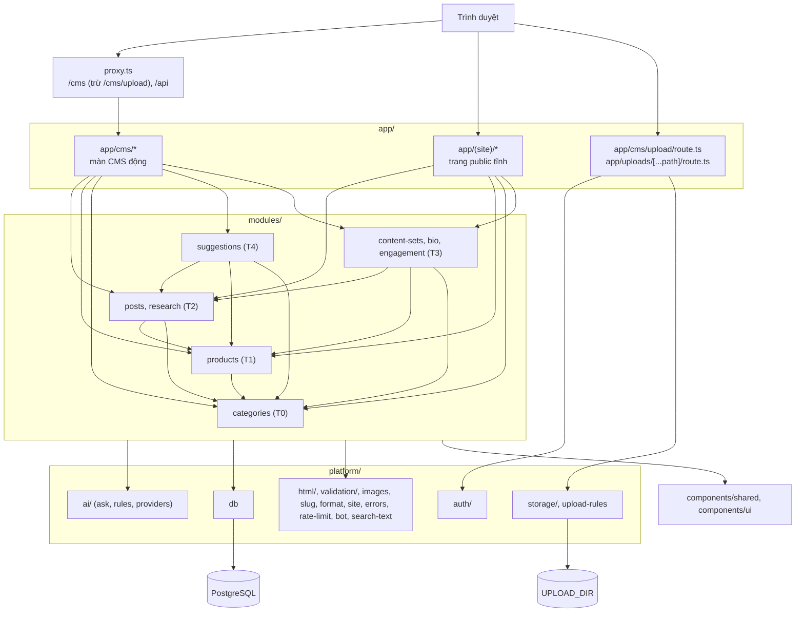

# Kiến trúc codebase

> Phiên bản: Next.js 16.4.3, React 19.3.0, Prisma 7.10 (`@prisma/adapter-pg`), Zod 4.6, Claude Code CLI (`claude -p`, lớp `platform/ai`), Tailwind 4, Tiptap 3, Vitest 5.1 (`package.json`) · Nguồn: mã nguồn repo, spine `_bmad-output/planning-artifacts/architecture/architecture-affiliate-project-2026-11-03/ARCHITECTURE-SPINE.md`, `node_modules/next/dist/docs/` · Kiểm lần cuối: 2026-11-06 (lượt gộp Epic 7, Story 7.1–7.2)

Tài liệu này là bản đồ của code **đang có**. Cấu trúc đích (spine AD-2, AD-17, Structural Seed) nằm ở mục [Dự kiến](#dự-kiến); spine thắng tài liệu này khi mâu thuẫn. Quy ước viết code xem `docs/quy-uoc-code.md`.

## Tóm tắt cho agent

Tài liệu chỉ trỏ tới **file + tên hàm/hằng**, không ghi số dòng (file đổi thường xuyên làm số dòng lệch).

- Ứng dụng là một Next.js App Router duy nhất, hai mặt: **site public** (`app/(site)/`) và **CMS** (`app/cms/`). Không có `app/api/`. Hai route handler: `app/cms/upload/route.ts` (POST upload) và `app/uploads/[...path]/route.ts` (GET file đã upload).
- Repo đang chuyển dần sang `app → modules → platform` (spine AD-2, AD-17). Đã có `modules/categories`, `modules/style-profiles` (T0), `modules/products` (T1), `modules/posts`, `modules/research` (T2), `modules/content-sets`, `modules/bio`, `modules/engagement` (T3, Bộ nội dung — Epic 5, Trang bio — Epic 6, Lượt xem — Epic 7, Lượt tim / Xem nhiều — Epic 8), `modules/suggestions` (T4). Không còn code cũ: `lib/` và `app/cms/actions.ts` đã chuyển/xoá ở Epic 4, `LEGACY_APP_FILES` rỗng.
- Bật `cacheComponents` và `partialPrefetching` (`next.config.ts`). Trang public chỉ đọc qua hàm `"use cache"` trong `modules/<miền>/queries.ts`; không truy vấn `db` trong trang.
- Ghi dữ liệu: Server Action trong `modules/<miền>/actions.ts` (Danh mục, Sản phẩm, Bài web), bọc `run()` (`platform/auth/run.ts`, gọi `requireAdmin()`), rồi `updateTag` tag của module có dữ liệu đổi.
- Auth là HTTP Basic: `proxy.ts` chặn `/cms` (trừ `/cms/upload`) + `/api`; Server Action và route upload tự kiểm lại. Realm chung `BASIC_AUTH_CHALLENGE` (`platform/auth/basic-auth.ts`).
- Prisma client sinh ra ở `generated/prisma`; import `db` từ `@/platform/db`, kiểu từ `@/generated/prisma/client`, enum từ `@/generated/prisma/enums`.
- HTML bài viết luôn qua `sanitizePostHtml` (`platform/html/sanitize.ts`) khi ghi và khi render — AD-22.
- Host ảnh cho phép khai báo một chỗ: `IMAGE_HOSTS` (`platform/images.ts`), cùng `UPLOADS_PATH` cho file upload.
- Sản phẩm public luôn lọc qua `visibleProductWhere` + `publicProductSelect` (`modules/products/queries.ts`) — Sản phẩm ẩn biến khỏi mọi trang.
- Lớp AI duy nhất là `platform/ai` (`ask()`, nhà chính `claude -p`); xem `docs/nen-tang-ky-thuat/lop-ai.md`.

## Tổng quan tầng

Ghi chú: `LEGACY_APP_FILES` (`eslint.config.mjs`) rỗng từ Epic 4. Route trong `app/` không import `@/platform/db` hay `service.ts`. `modules/suggestions/actions.ts` là ngoại lệ AD-9 duy nhất: import `service.ts`, `prompts/` của `posts`, `products`, `content-sets`, `research`.

## Bảng trách nhiệm module

### platform/

Hạ tầng chung, không chứa nghiệp vụ, không import `modules/` hay `app/` (`eslint.config.mjs`). Test `*.test.ts` đặt cạnh file nguồn.

| File | Sở hữu | Ai gọi |
|---|---|---|
| `platform/db.ts` | `import "server-only"`; singleton `PrismaClient` với adapter `PrismaPg`, giữ trên `globalThis` ngoài production | `queries.ts`/`cms-queries.ts`/`service.ts` của module |
| `platform/auth/basic-auth.ts` | `isAuthorized()` so Basic Auth bằng `timingSafeEqual` trên SHA-256, fail closed khi thiếu env; `BASIC_AUTH_CHALLENGE` (realm "CMS") | `proxy.ts`, `platform/auth/require-admin.ts`, `app/cms/upload/route.ts` |
| `platform/auth/require-admin.ts` | `requireAdmin()` đọc header `authorization` qua `headers()`, ném `UserError("Bạn cần đăng nhập CMS")` | `run()` |
| `platform/auth/run.ts` | `run(fn)`: `requireAdmin()` → chạy → trả `Result<T>`; `UserError` trả nguyên văn, lỗi khác `console.error` + `UNEXPECTED_ERROR` | mọi Server Action |
| `platform/errors.ts` | `UserError`, kiểu `Result<T>`, hằng `UNEXPECTED_ERROR` = "Có lỗi xảy ra, thử lại sau" | `run()`, `platform/ai`, `actions.ts`/`service.ts` của module |
| `platform/validation/fields.ts` | Trường Zod dùng chung: `optionalText`, `requiredText`, `slugField`, `imageUrl` (theo `isAllowedImageUrl`), `shopeeAffiliateUrl` (chỉ `https` + `shopee.vn`, `s.shopee.vn`, `shope.ee`) | `schema.ts` của module |
| `platform/validation/errors.ts` | `firstError()` lấy thông báo lỗi Zod đầu tiên | `actions.ts` của module |
| `platform/html/sanitize.ts` | `sanitizePostHtml()` — allowlist đúng định dạng trình soạn (h2, h3, p, br, strong, em, ul, ol, li, blockquote), **không** `a`, `img`, bảng, không thuộc tính; `b/i/h1/h4–h6/div` đổi sang thẻ tương đương (AD-22). Hàm thuần, chạy cả ở client | `modules/posts/service.ts` (ghi), `modules/posts/queries.ts` (phút đọc), trang bài `post-screen.tsx`, PreviewSheet và PostEditor (dán) |
| `platform/html/content.ts` | `visibleText()`, `readingMinutes()` (200 từ/phút), `withHeadingIds(html, reservedIds)` gắn id cho `<h2>` làm mục lục, tránh id dành riêng (`ARTICLE_RESERVED_IDS`); dùng trên HTML đã sanitize | `modules/posts/queries.ts`, `service.ts`, trang bài, PreviewSheet |
| `platform/slug.ts` | `RESERVED_ROOT_SLUGS` (đường dẫn hệ thống, test so với thư mục `app/` và `app/(site)`), `slugify()` | `modules/categories/schema.ts`, `freePostSlug()` trong `modules/posts/service.ts` |
| `platform/images.ts` | `IMAGE_HOSTS`, `UPLOADS_PATH` (`/uploads/`) và `isAllowedImageUrl()` (chỉ `https` + host trong danh sách, hoặc đường dẫn `/` cùng origin; từ chối `//host`) | `next.config.ts`, `platform/validation/fields.ts`, `platform/storage/local-disk.ts`, UploadField |
| `platform/format.ts` | `formatDate()` (ngày dài), `formatShortDate()` (dd/mm/yyyy) theo `vi-VN`, `Asia/Ho_Chi_Minh`, trả `""` khi `null`; `formatCount()` (số đếm vi-VN, `1.234`); `vietnamDay()` (ngày lịch Việt Nam cho cột `@db.Date`) | trang chủ, trang bài, ProductCard, CMS Sản phẩm, CMS Bài web (Lượt xem), `engagement/service.ts` |
| `platform/search-text.ts` | Tìm kiếm không dấu (FR-36): `toSearchText(...phần)` (bỏ dấu, đ → d, chữ thường, ký tự lạ → khoảng trắng — giá trị cột `Post.searchText`), `searchTerms(q)` (từ đã gấp), `highlightParts(text, terms)` (tô đoạn khớp trên chữ gốc có dấu); hàm thuần, dùng cả ở trình duyệt | `posts/service.ts`, `posts/schema.ts`, `PostCard` (highlight), `prisma/seed.ts` |
| `platform/rate-limit.ts` | Giới hạn tần suất cho action công khai (AD-6, AD-23): `createRateLimiter({ limit, windowMs })` đếm trong bộ nhớ tiến trình theo cửa sổ cố định, dọn khoá hết hạn tối đa một lần mỗi cửa sổ, trần `MAX_KEYS` khoá (đầy thì bỏ khoá cũ nhất); `clientKey(headers)` = băm SHA-256 IP ở mục cuối `x-forwarded-for` (mục do reverse proxy một tầng nối; mục đầu client giả được, không đọc `x-real-ip`) với muối ngẫu nhiên mỗi lần khởi động — không lưu/log IP | `modules/engagement/actions.ts`, `modules/posts/actions.ts` (`searchPosts`) |
| `platform/bot.ts` | `isBotUserAgent()` — bot tìm kiếm, trình xem trước link, công cụ đo, thư viện HTTP, thiếu user-agent; không coi trình duyệt trong app (Zalo, Facebook, Threads) là bot | `modules/engagement/actions.ts` |
| `platform/upload-rules.ts` | Luật upload dùng chung server + client: `UPLOAD_ENDPOINT`, loại nhận (`UPLOAD_TYPES` ảnh JPG/PNG/WebP/GIF/AVIF, video MP4/WebM/MOV), `IMAGE_MAX_BYTES` 25 MB, `VIDEO_MAX_BYTES` 100 MB, `uploadError()` | `app/cms/upload/route.ts`, `components/shared/upload-field.client.tsx` |
| `platform/storage/local-disk.ts` | `import "server-only"`; `put({ type, body }, maxBytes) → { url }` ghi luồng vào `UPLOAD_DIR` (tên = sha256 + đuôi, file tạm rồi đổi tên, vượt cỡ ném `UploadTooLargeError`), `openStoredFile(name) → { size, type, read(start?, end?) }` (đọc cả file hoặc một đoạn byte cho `Range`); thiếu `UPLOAD_DIR` hoặc trỏ vào `public/`/`.next/` → ném lỗi (AD-24) | hai route handler upload |
| `platform/storage/range.ts` | `parseByteRange(header, size)`: một khoảng byte của header `Range` → `{ start, end }`, `"unsatisfiable"` (416) hoặc null (trả cả file) | route `/uploads/[...path]` |
| `platform/search-params.ts` | `first(v)`, `pageParam(v)` (`?trang` ≥ 1, lạ → 1) cho màn danh sách CMS | màn danh sách Bài web, Sản phẩm, Cảm hứng |
| `platform/site.ts` | `SITE_NAME`, `SITE_URL` (từ `NEXT_PUBLIC_SITE_URL`, bỏ `/` cuối), `DEFAULT_OG_IMAGE` (`/og-default.png`), `MAIN_CONTENT_ID` (đích link "Bỏ qua tới nội dung") | root layout, sitemap, robots, trang bài, `content-sets.runThreads`, `platform/ai` (URL ảnh tương đối), layout site/CMS |

`platform/ai` là **đích, chưa có** (dựng ở story AI đầu tiên).

### modules/

Hợp đồng file theo spine AD-5 (`schema`, `types`, `constants`, `tags`, `queries` public có cache, `cms-queries` không cache, `service` ghi DB, `actions`, `components/`). Test `*.test.ts` (unit) và `*.db.test.ts` (Postgres test) cạnh nguồn.

| Module | Sở hữu | Ai gọi |
|---|---|---|
| `modules/categories/` (T0) | `Category`, `CategorySlugRedirect`; `CATEGORIES_TAG` (`tags.ts`); `categoryInputSchema`; `saveCategoryRecord` (đổi slug thì ghi `CategorySlugRedirect`, slug dùng lại thì xoá bản ghi trùng), `deleteCategoryRecord`, `moveCategoryRecord`; `queries.ts`: `getPublicCategory`, `getCategorySlugRedirect` (tag `categories`); `cms-queries.ts`: `getCategoryForCms`, `listCategoryOptionsForCms` | `/cms/danh-muc`, trang `/[danh-muc]` |
| `modules/style-profiles/` (T0) | `StyleProfile` (một bản ghi mỗi `Platform`, tạo lười khi lưu); `constants.ts`: `STYLE_PROFILE_DEFAULTS` (giá trị khởi tạo duy nhất — FR-18), `STYLE_PLATFORMS`, `STYLE_HARD_LIMITS` (chép giới hạn cứng của `posts`/`content-sets`, test `modules/content-sets/style-limits.test.ts`); `styleProfileInputSchema`; `saveStyleProfileRecord`; action `saveStyleProfile`; `cms-queries.ts`: `listStyleProfilesForCms`, `getStyleProfileForCms(platform)` (thiếu bản ghi → giá trị khởi tạo); component `StyleProfileForm` | `/cms/phong-cach`, prompt nội dung (qua `suggestions/actions.ts`) |
| `modules/products/` (T1) | `Product`; `PRODUCTS_TAG`; `productInputSchema`, `setProductHiddenInputSchema`; `saveProductRecord`, `setProductHiddenRecord`; actions `saveProduct`, `setProductHidden` (`updateTag(PRODUCTS_TAG)`); `queries.ts`: `visibleProductWhere`, `publicProductSelect`; `cms-queries.ts`: `listProductsForCms` (kẹp trang), `getProductForCms`, `listPickerProductsForCms(q, excludeIds)` (chỉ Sản phẩm đang hiện); components `AffiliateLink`, `AffiliateDisclosure`, `ProductCard`, `ProductForm`, `ProductStatusBadge`, `ProductVisibilityButton`, `ProductPicker` (`?sp=` trên URL) | `/cms/san-pham`, trình soạn bài, trang bài, `modules/posts/queries.ts` |
| `modules/inspirations/` (T1) | `Inspiration` (`url?` / `mediaUrl?` / `note?`, CHECK có ít nhất một nguồn; `status` lưu chỉ *Mới* / *Bỏ qua* — *Đã dùng* suy ra từ `ContentSet.inspirationId`, không lưu cột); `INSPIRATIONS_TAG`; `constants.ts`: giới hạn `INSPIRATION_*_MAX`, `INSPIRATION_FILTERS` (`?trang-thai=`), `INSPIRATION_PARAM` (`?cam-hung=`), `VIDEO_LINK_HOSTS`; `schema.ts`: `extractLink` (lấy link http(s) đầu tiên trong đoạn chữ chia sẻ), `inspirationInputSchema` (link **hoặc** file upload), `setInspirationStatusInputSchema`; `service.ts`: `saveInspirationRecord`, `setInspirationStatusRecord`; actions `saveInspiration`, `setInspirationStatus`; `cms-queries.ts`: `getInspirationForCms` (kèm `label`, `mediaKind`, `videoLink`), `inspirationLabel`; components `InspirationForm`, `InspirationStatusBadge`, `InspirationStatusActions` (Bỏ qua + Hoàn tác / Đưa lại vào Mới), `InspirationMedia`, `InspirationStrip` (dải "Từ Cảm hứng: …"). Danh sách lọc (`listInspirationsForCms`) và bộ theo Cảm hứng (`listContentSetsForInspirationForCms`) nằm ở `content-sets/cms-queries.ts` (đọc cả `ContentSet` — AD-2); nghiên cứu Cảm hứng (`researchInspiration`, prompt `research/prompts/research-inspiration.prompt.ts`) ở `suggestions` | `/cms/cam-hung`, Chi tiết Sản phẩm / Tạo Sản phẩm kèm `?cam-hung=`, `/cms/bo-noi-dung/[id]` |
| `modules/content-sets/` (T3) | `ContentSet` (Góc viết, Người đọc chụp lúc tạo + bản sửa; `postId` khoá đích `WEB_POST`), `ContentSetProduct`, `SocialPost` (`@@unique([contentSetId, platform])`, `linkComment`, `firstCopiedAt`, `postedAt`, `postUrl`); enum `Platform` khai báo ở `content-sets.prisma`; `CONTENT_SETS_TAG`; `constants.ts`: `PLATFORM_LABEL`, giới hạn cứng `THREADS_POST_MAX` (500)…; prompts `threads-post`, `facebook-post`, `link-comment` (+ `to…Payload`: bỏ link khỏi thân bài, giữ nguyên Link affiliate và câu công khai trong Bình luận); `service.ts`: `createContentSetRecord`, `setContentSetPostRecord`, `upsertSocialPostRecord`, `setLinkCommentRecord` (gọi từ Duyệt), `saveSocialPostRecord`, `saveLinkCommentRecord`, `recordCopyRecord`, `markPostedRecord`; actions `saveSocialPost`, `saveLinkComment`, `recordCopy`, `markPosted`, `unmarkPosted`; `cms-queries.ts`: `getContentSetForCms`, `getContentSetIdForPostForCms`, `listPostedPlatformsByProductForCms`, `listContentSetsForProductForCms`, `parse…Payload`; components `PlatformToggle`, `ThreadsPartsField`, `SocialTextField`, `SocialPostEditor`, `LinkCommentEditor`, `MarkPostedRow` | `/cms/bo-noi-dung/[id]`, Chi tiết Sản phẩm, `/cms/san-pham`, Soạn Bài web |
| `modules/bio/` (T3) | `BioSettings` (một bản ghi, thiếu = `BIO_SETTINGS_DEFAULTS`), `BioItem` (tạo lười: thiếu = hiện, không ghim; `sortAt` khoá thứ tự nhóm còn lại, `pinnedAt` khoá nhóm "Đang ghim"); `BIO_TAG`; `order.ts` (thuần): `orderBioEntries`, `flattenBioEntries`, `planBioMove` — một luật thứ tự cho query public, CMS và ghi; `browse.ts` (thuần): nhóm/chip của `/bio` (`bioGroupsOf`, `bioChipsOf`, `bioItemsOfCategory`); `service.ts`: `saveBioSettingsRecord`, `setBioItemVisibleRecord`, `setBioItemPinnedRecord`, `moveBioItemRecord`; actions `saveBioSettings`, `setBioItemVisible`, `setBioItemPinned`, `moveBioItem` (`updateTag(BIO_TAG)`); `queries.ts`: `getBioPage` (tag `bio`, `products`, `categories`), `getBioHighlights(limit)` (tag `bio`, `products`); `cms-queries.ts`: `getBioForCms`; components `BioBrowser` (lọc chip phía client), `BioHighlights`, `BioSettingsForm`, `BioProductList` | `/bio`, `/cms/bio`, Trang chủ |
| `modules/engagement/` (T3) | `PostStat` (`postId` khoá chính, `views`, `likes`; tạo lười bằng upsert, thiếu = 0), `PostViewDaily` (`postId` + `day` theo ngày Việt Nam); `constants.ts`: `VIEW_RATE_LIMIT` (60/phút/nguồn), `LIKE_RATE_LIMIT` (30/phút), `LIKE_COUNT_RATE_LIMIT` (120/phút), khoá `localStorage` `VIEWED_POST_KEY_PREFIX`, `LIKED_POST_KEY_PREFIX`, `OWNER_BROWSER_KEY`, `POPULAR_DAYS` (30), `POPULAR_POSTS_LIMIT` (5); `service.ts`: `recordPostViewRecord`, `getPostLikesRecord`, `setPostLikeRecord` (chỉ bài đã xuất bản, qua `publishedPostWhere` của `posts`; bỏ tim không âm); action công khai `recordPostView`, `getPostLikes`, `setPostLike` (ngoại lệ số 1 AD-6: không `run()`, validate, giới hạn tần suất, không `updateTag`, không log); `queries.ts`: `getPopularPosts(limit)` ("Xem nhiều" 30 ngày, `cacheLife("days")`, tag `engagement` + `posts` + `products`, thẻ bài qua `postCardSelect`/`toPostCard` của `posts`); `cms-queries.ts`: `getPostStatsForCms(ids)`, `listPostsByStatForCms({ by: "views" | "likes" })` (dùng `cmsPostListWhere`/`cmsPostListSelect`/`cmsPostListOrder` của `posts`); components `PostViewTracker`, `OwnerBrowserMark` (đặt ở `app/cms/layout.tsx`), `PostLikeProvider` + `LikeButton` (một trạng thái cho mọi LikeButton của trang bài), `PopularPostList` (PostCard *rank* trong `<ol>`) | trang bài `post-screen.tsx`, Trang chủ, 404, `/tim-kiem`, layout CMS, `/cms/bai-viet` |
| `modules/banners/` (T2) | `Banner` (đứng riêng; lịch `startsAt`/`endsAt` tuỳ chọn, CHECK `endsAt` > `startsAt`); `BANNERS_TAG`; `constants.ts`: giới hạn `BANNER_*_MAX`, `BANNER_STATUS_LABEL`, `BANNER_IMAGE_RATIO_LABEL` (2:1), `LIVE_BANNERS_CACHE_LIFE`; `status.ts` (thuần): `bannerStatus(banner, now)` — hàm duy nhất tính Tắt / Chờ lịch / Hết hạn / Đang hiện cho site và CMS (AD-7); `link.ts`: `bannerLinkKind` (Shopee chính chủ hoặc đường dẫn trong site); `bannerInputSchema` (ô lịch là giờ Việt Nam qua `parseVietnamDateTime`); `service.ts`: `saveBannerRecord`, `moveBannerRecord`, `deleteBannerRecord`; actions `saveBanner`, `moveBanner`, `deleteBanner` (`updateTag(BANNERS_TAG)`); `queries.ts`: `bannerOrderBy`, `getLiveBanners` (`cacheLife(LIVE_BANNERS_CACHE_LIFE)` — revalidate 30 giây, expire 5 phút; "now" lấy trong hàm; bỏ dòng có link đích không hợp lệ; tag `banners`); `strip.ts` (thuần): `visibleSlideIndex` — chấm vị trí của `BannerStrip`; `cms-queries.ts`: `listBannersForCms`, `getBannerForCms` (kèm `status`); components `BannerForm`, `BannerStatusBadge`, `BannerCard` (Shopee qua `AffiliateLink` của `products`), `BannerStrip` (dải cuộn ngang + chấm, không tự chạy), `BannerSection` | `/cms/banner`, Trang chủ |
| `modules/posts/` (T2) | `Post` (cột `searchText` tìm kiếm không dấu, ghi ở mọi lần ghi bài), `PostProduct`, `PostSlugRedirect`; `POSTS_TAG` (`tags.ts`); `constants.ts`: `POST_TYPES`, giới hạn `POST_*_MAX` (= `@db.VarChar` hoặc chỉ Zod), `POST_STATUS_FILTERS`, `PAGE_SIZE`, `CMS_POST_PAGE_SIZE`, `ARTICLE_RESERVED_IDS`; `schema.ts`: `postInputSchema`, `postDraftInputSchema`, `newPostInputSchema`, `setPostStatusInputSchema`, `deletePostInputSchema`; `service.ts`: `savePostRecord` (ghi `PostProduct` theo thứ tự, chỉ gắn mới Sản phẩm đang hiện; đổi slug bài đã từng xuất bản → `PostSlugRedirect`), `createPostDraftRecord`, `applyWebPostSuggestionRecord` (Duyệt `WEB_POST`: tạo nháp gắn Sản phẩm của bộ hoặc ghi vào bài còn `DRAFT`), `setPostStatusRecord`, `deletePostRecord`, `searchPostsRecord` (đọc không cache cho action công khai); actions `savePost`, `createPostDraft`, `setPostStatus`, `deletePost`, `searchPosts` (công khai chỉ đọc — ngoại lệ số 2 AD-6, `SEARCH_RATE_LIMIT` 60/phút/nguồn); `queries.ts`: `publishedPostWhere`, `postCardSelect` + `toPostCard` (thẻ bài dùng chung cho `engagement`), `getLatestPosts`, `getPostsByType`, `getRelatedPosts` (cùng Danh mục), `getPostBySlug`, `getPostSlugRedirect`, `getPublishedSlugs`, `listCategoriesWithPostCounts`, `listNavCategories`, `listPostsByCategory`, `listPostsByType`; `cms-queries.ts`: `listPostsForCms`, `getPostForCms`, `listCategoriesForCms`, `listPostsUsingProductForCms`; components `PostCard` (*featured*/*grid*/*row*/*rank*, highlight từ khoá), `SearchBox`, `PostSearch` (+ `PostSearchFromUrl`), `PostTypeBadge`, `PostStatusBadge`, `PostArticle` (thân trang bài dùng chung site + PreviewSheet), `ArticleBody`, `TableOfContents`, `PostTags`, `RelatedPosts`, `PostForm`, `NewPostForm`, `PostBodyEditor` (Tiptap), `PreviewSheet`, `PostActionBar`, `PostSeoCheck`, `SeoScore`, `RiskWarningList`, `WebPostSuggestionForm`; prompt `web-post.prompt.ts` (gợi ý `WEB_POST`, Hồ sơ phong cách Website); `types.ts`: `RiskWarning`, `PublishLock` (màn soạn nhận qua props) | mọi trang `app/(site)` (gồm `/tim-kiem`), `app/sitemap.ts`, `/cms/bai-viet`, `/cms/danh-muc`, `/cms/san-pham/[id]` |

### lib/

Đã xoá ở Epic 4 (không tạo lại — spine AD-1). Lịch sử chuyển ở `docs/cong-thuc/chuyen-code-cu.md`.

### app/

| File | Sở hữu | Ai gọi / phụ thuộc |
|---|---|---|
| `app/layout.tsx` | Root layout: font Be Vietnam Pro, `metadata` gốc (title template, OpenGraph mặc định kèm `DEFAULT_OG_IMAGE`), link "Bỏ qua tới nội dung", `Toaster` | Next.js |
| `app/globals.css` | Tailwind 4, token DESIGN.md, alias shadcn; utility `article-body` (ArticleBody/PostEditor); `body:has([data-article-action-bar]) [data-bottom-tab-bar]` ẩn BottomTabBar khi trang bài có ArticleActionBar; tắt `animate-pulse`/`animate-spin` khi reduced-motion | `platform/design-tokens.ts` đọc màu |
| `app/robots.ts`, `app/sitemap.ts` | robots chặn `/cms`, `/api/`; sitemap: trang chủ, `/bio`, `/meo-vat`, `/gom-link`, mọi Danh mục, mọi Bài web đã xuất bản — không có `/…/trang/n` (AD-26) | `getPublishedSlugs`, `listCategoriesWithPostCounts` |
| `app/(site)/layout.tsx` | `ensureStatic = "navigation"`; SiteHeader, SiteFooter, BottomTabBar (trong `<Suspense>`), dữ liệu `listNavCategories()` | mọi trang site |
| `app/(site)/_components/` | `HomeScreen` + `HomeSkeleton`, `NotFoundScreen`, SiteHeader (+ `more-menu.client.tsx` "Thêm"), BottomTabBar, CategorySheet, SiteFooter, Pagination (+ `pagination-items.ts`), `PostListScreen`, `post-type-route.ts`, `post-type-screen.tsx`, `list-page-metadata.ts`, `SectionHeading`, `JsonLd` | trang site; styleguide |
| `app/(site)/page.tsx` | Trang chủ (UX-DR62): Banner (ẩn khi rỗng; revalidate 1 phút), Bài nổi bật, Gom link đồ xinh (ẩn khi rỗng), Xem nhiều, Mới cập nhật, Mẹo vặt hay | `getLiveBanners`, `getLatestPosts`, `getPostsByType`, `getBioHighlights`, `getPopularPosts` |
| `app/(site)/bio/page.tsx` + `_components/{bio-screen,bio-skeleton}.tsx` | Trang bio (UX-DR66): giới thiệu, AffiliateDisclosure với câu từ CMS, `BioBrowser`; không JSON-LD | `getBioPage` |
| `app/(site)/[danh-muc]/page.tsx`, `trang/[n]/page.tsx` | Trang Danh mục có phân trang; `loadCategory()` (`_components/load-category.ts`) tra slug → lịch sử → 308/404 **trước** `<Suspense>` (AD-12, AD-20) | `getPublicCategory`, `getCategorySlugRedirect`, `listPostsByCategory` |
| `app/(site)/meo-vat/`, `app/(site)/gom-link/` (+ `trang/[n]`) | Trang Loại bài, lọc `PostType` | `post-type-route.ts`, `post-type-screen.tsx`, `listPostsByType` |
| `app/(site)/bai-viet/[slug]/page.tsx` + `_components/post-screen.tsx` | Trang Bài web: `page.tsx` gọi `loadPost()` (`_components/load-post.ts`: bài → lịch sử slug → 308/404 **trước** `<Suspense>`), `PostScreen` sanitize + `withHeadingIds`, JSON-LD `Article` + `BreadcrumbList`, render `PostArticle` + `ArticleActionBar` (mobile, khi có Sản phẩm) | `getPostBySlug`, `getPostSlugRedirect`, `getRelatedPosts`, `getPublishedSlugs` |
| `app/cms/upload/route.ts` | POST upload: `requireAdmin()` trước khi đọc body (401 + `BASIC_AUTH_CHALLENGE`), kiểm loại/dung lượng, `put()` (AD-6 ngoại lệ 3, AD-24) | UploadField |
| `app/uploads/[...path]/route.ts` | GET file upload, `Cache-Control` immutable; tên sai dạng → 404 | `next/image`, trình duyệt |
| `app/cms/layout.tsx` | CmsShell, `noindex`, `maxDuration = 120` (AD-18) | trang CMS |
| `app/cms/danh-muc/**`, `app/cms/san-pham/**`, `app/cms/cam-hung/**`, `app/cms/banner/**`, `app/cms/bio/` | Màn Danh mục, Kho Sản phẩm, Kho Cảm hứng, Banner, Trang bio (Screen + skeleton trong `_components/`) | module tương ứng |
| `app/cms/page.tsx` | `redirect("/cms/bai-viet")` (307 — sau này thành dashboard) | — |
| `app/cms/bai-viet/**` | Danh sách Bài web (lọc `?trang-thai=nhap\|da-xuat-ban`, `?q`, `?trang`), tạo (`moi/`), sửa (`[id]/`, ProductPicker đọc `?sp=`) — Screen + skeleton trong `_components/` | `modules/posts`, `modules/products`, `modules/content-sets` (`runThreads`) |
| `app/cms/error.tsx`, `app/(site)/error.tsx`, `app/global-error.tsx`; `app/not-found.tsx`, `app/(site)/not-found.tsx`, `app/cms/not-found.tsx` | Trang lỗi (`ErrorScreen`, `components/shared/error-screen.client.tsx`) và 404 | Next.js |
| `app/cms/styleguide/` | `/cms/styleguide` (noindex): token + component | — |

### Khác

- `proxy.ts` — kiểm Basic Auth cho `matcher: ["/cms", "/cms/((?!upload$).*)", "/api/:path*"]`; `/cms/upload` nằm ngoài proxy và tự `requireAdmin()` (AD-24).
- `next.config.ts` — `remotePatterns` từ `IMAGE_HOSTS`, `cacheComponents`, `partialPrefetching`. Ảnh `/uploads/…` là ảnh nội bộ, không cần `localPatterns` (mặc định cho mọi đường dẫn nội bộ không query).
- `prisma/schema/` — `_base.prisma`, `categories.prisma` (`Category`, `CategorySlugRedirect`), `posts.prisma` (`Post`, `PostProduct`, `PostSlugRedirect`, enum `PostType`, `Status`), `products.prisma` (`Product`, có `hidden`), `bio.prisma` (`BioSettings`, `BioItem`). `prisma/seed.ts` upsert 8 Danh mục, xoá bài rồi tạo lại bài mẫu; Sản phẩm mẫu nhận diện bằng Link affiliate placeholder (`[NO-08]`).
- `eslint.config.mjs` — luật ranh giới module (`TIERS`, `no-restricted-imports`, `import/no-cycle`); file cũ miễn qua `LEGACY_APP_FILES` (rỗng từ Epic 4).
- `vitest.config.ts` (unit), `vitest.db.config.ts` + `vitest.db.setup.ts` + `vitest.db.helpers.ts` + `vitest.db.mocks.ts` (test DB và khung test Server Action — `docs/kiem-chung.md` [KC-08]).
- `components/shared/` — `CmsForm`, `ConfirmDialog`, `FilterChips` (+ `chip-styles.ts` dùng chung với chip link), `UnsavedChangesGuard`, `callAction`, `ImageFallback`, `UploadField`, `Breadcrumb`, `EmptyState`, `ErrorScreen`, `ShareButtons` (Facebook, Threads, Sao chép link / chia sẻ gốc — FR-37; URL ở `share-links.ts`). `components/ui/` — shadcn base-ui.

## Read path — trang public

Ví dụ `/bai-viet/<slug>`:

1. Request không khớp `matcher` của `proxy.ts` → không qua auth.
2. `(site)` có `ensureStatic = "navigation"`: trang prerender lúc build từ `generateStaticParams()`; URL chưa prerender chờ bản tĩnh để `notFound()`/`permanentRedirect()` trả đúng mã.
3. `generateMetadata` và `loadPost()` cùng gọi `getPostBySlug()` (`modules/posts/queries.ts`, `"use cache"` + `cacheTag(posts, products, categories)`, chỉ bài `PUBLISHED`); không thấy thì `getPostSlugRedirect()` → `permanentRedirect` (308) hoặc `notFound()`.
4. Sản phẩm của bài: `postProducts` lọc `product: visibleProductWhere`, chọn `publicProductSelect`, theo `sortOrder`. Ảnh đại diện fallback = ảnh Sản phẩm **đang hiện** đầu tiên (cùng bộ lọc); OpenGraph không có ảnh nào thì `DEFAULT_OG_IMAGE`.
5. Render: `sanitizePostHtml` → `withHeadingIds`; `PostArticle` theo thứ tự Story 3.5 (Breadcrumb → badge + H1 + meta → AffiliateDisclosure khi có ≥ 1 Sản phẩm đang hiện → ảnh 16:9 → TOC → ArticleBody → khối Sản phẩm *row* → PostTags → RelatedPosts).

Trang Danh mục `/[danh-muc]`: `page.tsx` gọi `loadCategory(slug)` — `getPublicCategory` → không thấy thì `getCategorySlugRedirect` → `permanentRedirect` (308) hoặc `notFound()`, rồi `listPostsByCategory(id, page)`; `trang/[n]` thêm `n=1` → 308 về gốc, `n` vượt trang cuối → 404. Trang Loại bài theo cùng mẫu với `listPostsByType`.

## Write path — CMS

Mẫu chuẩn (module, ví dụ ẩn Sản phẩm):

1. **Client** — `ProductVisibilityButton` gọi `setProductHidden({ id, hidden })` qua `callAction`, Toast kết quả kèm "Hoàn tác".
2. **Action** (`modules/products/actions.ts`) — `run()` (`requireAdmin()`) → `setProductHiddenInputSchema.safeParse` → `setProductHiddenRecord` (`service.ts`) → `updateTag(PRODUCTS_TAG)`.
3. **Cache** — mọi query public trả Sản phẩm gắn tag `products` nên trang bài, danh sách bài làm mới ngay.

Form (Danh mục, Sản phẩm): RHF + `zodResolver(<x>InputSchema)` trong `CmsForm`; server parse lại bằng cùng schema. Lỗi người dùng là `UserError` tiếng Việt.

Trình soạn bài (`modules/posts/components/post-form.client.tsx` → `savePost` trong `modules/posts/actions.ts`): `run()` → `postInputSchema` → `savePostRecord` (sanitize, slug + `PostSlugRedirect`, `PostProduct` theo thứ tự, không đụng `Product`) → `updateTag(POSTS_TAG, CATEGORIES_TAG)`. `setPostStatus` chặn xuất bản bài không có chữ, giữ `publishedAt` gốc. `createPostDraft` không `updateTag` vì bài mới luôn nháp.

Upload: UploadField gửi file thô (XHR, `Content-Type` = loại file) tới `/cms/upload`; route trả `{ ok, url }`; form chỉ lưu `url`.

## AI path

1. **Nghiên cứu Sản phẩm** (Chi tiết Sản phẩm, `ResearchButton` / `RegenerateDialog`): `suggestions.researchProduct` qua `run()` → `startResearchRecords` ghi `RESEARCH` + `PRODUCT_CATEGORY` ở `GENERATING` (bản đang chờ → `SUPERSEDED`, bản đang tạo quá 120 giây → `FAILED`) → trả ngay → `after()` gọi `ask()` (`research-product.prompt.ts`, tìm web + ảnh) → `toResearchPayloads` → `completeResearchRecords` (`PENDING`) hoặc `failSuggestionsRecord` (`FAILED`, tiếng Việt). Màn có một `GeneratingPoller` (`router.refresh()` mỗi 3 giây, dừng sau 120 giây); `getProductSuggestionsForCms` trả `GENERATING` quá hạn là `FAILED`.
2. **Duyệt**: `suggestions.approveSuggestion` → transaction: `research/service.upsertResearchProfileRecord` (khoá `productId`) hoặc `products/service.setProductCategoryRecord`, rồi `APPROVED` (+ `editedBeforeApproval`) → `updateTag(research | products)`. Sửa hồ sơ sau Duyệt: `research.saveResearchProfile`.
3. **Bộ nội dung** (Epic 5): CreateContentSetPanel ở Chi tiết Sản phẩm → `suggestions.createContentSet` (mọi Sản phẩm có hồ sơ đã Duyệt) → một transaction tạo `ContentSet` + một gợi ý `GENERATING` mỗi phần (`WEB_POST`; `THREADS_POST`/`FACEBOOK_POST` + `LINK_COMMENT` mỗi nền tảng) → `after()` chạy mỗi phần một lần `ask()` song song, độc lập (`runContentSetParts`; phần lỗi chỉ phần đó `FAILED`). Thêm nền tảng: `addContentSetPlatform`; từ Bài web có sẵn: `createSocialFromPost` (FR-16); Tạo lại một phần (kể cả đã Duyệt): `regenerateSuggestion`. Duyệt `WEB_POST` → `posts/service.applyWebPostSuggestionRecord` + `content-sets/service.setContentSetPostRecord`; bài/Bình luận → `SocialPost`. Sao chép chưa Duyệt: `suggestions.recordSuggestionCopy`. Màn soạn bài: `suggestions/cms-queries.getPostAiStateForCms` → khoá Xuất bản + Cảnh báo rủi ro qua props.
4. **Đồng bộ**: `posts.checkPostSeo` (`seo-review.prompt.ts`, kẹp điểm 0–100, không lưu — ngoại lệ AD-9). `createPost` chỉ còn bản nháp trống (nhánh AI cũ gỡ ở Story 5.2); `runThreads` đã gỡ ([NO-10] đóng).
5. `ask()` (`platform/ai/ask.ts`): ghép `AI_COMMON_RULES`, sinh JSON Schema từ Zod, gọi nhà theo `AI_PROVIDERS` (chuyển nhà + cooldown), parse bằng Zod (thử lại một lần), hạn 90 giây; lỗi → `UserError` tiếng Việt.
6. Cảnh báo rủi ro (FR-23): mọi prompt nội dung đăng ghép `RISK_WARNING_RULES` và trường `riskWarnings` (`platform/ai/rules.ts`); `cleanRiskWarnings` → cột `Suggestion.riskWarnings`. Đo độ chính xác bằng `scripts/risk-eval/` (chạy tay, AI thật — `docs/kiem-chung.md` §7).
7. Thời gian chạy: `maxDuration = 120` cho route CMS (`app/cms/layout.tsx`, AD-18).

## Ranh giới auth

- **Tầng request**: `proxy.ts` trả 401 + `WWW-Authenticate: BASIC_AUTH_CHALLENGE` khi `isAuthorized` sai.
- **Tầng action**: `requireAdmin()` trong `run()`. Server Action được gọi qua POST tới chính URL trang; không coi proxy là đủ.
- **Route upload**: `app/cms/upload/route.ts` ngoài proxy, gọi `requireAdmin()` trước khi đọc body, sai thì 401 + cùng realm.
- **Tầng hiển thị**: `app/cms/layout.tsx` đặt `noindex`; `app/robots.ts` chặn `/cms`.

## Ranh giới cache

- **Cache**: mọi hàm trong `modules/*/queries.ts` có `"use cache"` + `cacheLife("days")` + `cacheTag` của mọi module có bảng nó đọc: bài + ảnh Sản phẩm → `posts`, `products`; Danh mục + bài → `posts`, `categories`; danh sách bài theo Danh mục → `posts`, `categories`, `products`; Danh mục / lịch sử slug → `categories`.
- **Huỷ cache**: `updateTag(POSTS_TAG)` + `updateTag(CATEGORIES_TAG)` trong `savePost`, `setPostStatus`, `deletePost` (`modules/posts/actions.ts`); `updateTag(CATEGORIES_TAG)` trong `saveCategory`, `deleteCategory`, `moveCategory`; `updateTag(PRODUCTS_TAG)` trong `saveProduct`, `setProductHidden`. `updateTag` chỉ gọi được trong Server Action.
- **Không cache**: Screen CMS đọc `cms-queries.ts` trong `<Suspense>` (`connection()` hoặc `params`/`searchParams` động); route upload.
- `sitemap.ts` dùng `getPublishedSlugs()` + `listCategoriesWithPostCounts()` nên theo tag `posts`, `categories`.

## Bề mặt SEO

| Bề mặt | Vị trí |
|---|---|
| Metadata gốc, title template `%s \| Mẹo Vặt Cuộc Sống`, `metadataBase` | `app/layout.tsx` |
| Metadata trang Danh mục / Loại bài: title, meta description = mô tả, canonical chính nó (kể cả `/trang/n`) | `listPageMetadata` (`app/(site)/_components/list-page-metadata.ts`) |
| Metadata trang bài | `generateMetadata` trong `app/(site)/bai-viet/[slug]/page.tsx` |
| JSON-LD `Article` + `BreadcrumbList` (bài), `BreadcrumbList` (Danh mục / Loại bài) | trang bài; `PostListScreen`; component `app/(site)/_components/json-ld.tsx` |
| Sitemap (không có `/trang/n`) | `app/sitemap.ts` |
| Robots | `app/robots.ts` |
| `noindex` cho CMS, styleguide | `app/cms/layout.tsx`, `app/cms/styleguide/page.tsx` |
| Link affiliate `rel="sponsored nofollow noopener"`, `target="_blank"` | `AffiliateLink` (`modules/products/components/affiliate-link.tsx`) |
| Chuyển hướng 308 khi đổi slug Danh mục / Bài web | `loadCategory` (`app/(site)/[danh-muc]/_components/load-category.ts`) + `CategorySlugRedirect`; `loadPost` (`app/(site)/bai-viet/[slug]/_components/load-post.ts`) + `PostSlugRedirect` |

## Bảng thuật ngữ code ↔ PRD

| Code | Thuật ngữ PRD (§3) | Ghi chú |
|---|---|---|
| `Post` | Bài web | |
| `Post.status` `DRAFT` / `PUBLISHED` | Bài web *nháp* / *đã xuất bản* | |
| enum `PostType` `MEO_VAT` / `GOM_LINK`, `POST_TYPES` (`modules/posts/constants.ts`) | Loại bài (*Mẹo vặt* / *Gom link*) | Trang `/meo-vat`, `/gom-link`; `PostTypeBadge`. Trình soạn bài cũ còn gọi là `category` / "Chuyên mục" (`[NO-20]`) |
| model `Category`, `Post.categoryId`, `Product.categoryId` | Danh mục | CMS `/cms/danh-muc`; site `/[danh-muc]`, CategorySheet, nav, footer; đổi slug ghi `CategorySlugRedirect` (308) |
| `Product` | Sản phẩm | Kho độc lập `/cms/san-pham`; Bài web chỉ tham chiếu qua `PostProduct`; `hidden` = ẩn khỏi website (FR-5) |
| `Product.affiliateUrl` | Link affiliate | Chỉ ra website qua `AffiliateLink` |
| `Product.priceText` + `priceUpdatedAt` | giá tham khảo + ngày cập nhật | "Giá tham khảo ~89.000đ · cập nhật dd/mm/yyyy" |
| `AffiliateDisclosure` | Nhãn công khai affiliate | `modules/products/components/affiliate-disclosure.tsx` |
| `Suggestion` kind `WEB_POST` | Gợi ý AI (cho Bài web) | Duyệt → `Post` nháp của Bộ nội dung |
| `ContentSet`, `ContentSetProduct` | Bộ nội dung | `/cms/bo-noi-dung/[id]` |
| `SocialPost` (`THREADS` / `FACEBOOK`), `linkComment` | Bài Threads, Bài Facebook, Bình luận kèm link | `postedAt` + `postUrl` = đã đăng (FR-20) |
| `StyleProfile` | Hồ sơ phong cách | `/cms/phong-cach`; thiếu bản ghi → giá trị khởi tạo |
| `Suggestion.riskWarnings` | Cảnh báo rủi ro | |
| Basic Auth `ADMIN_USERNAME` | Người vận hành | |

## Bất biến liên module

- **[KT-01] Ghi phải huỷ cache.** Mọi action thay đổi dữ liệu public gọi `updateTag` tag của **mọi** module có dữ liệu thay đổi, sau khi ghi; mọi query có cache gắn tag của mọi module có bảng nó đọc (spine AD-7). Tag: `POSTS_TAG` (`modules/posts/tags.ts`), `CATEGORIES_TAG` (`modules/categories/tags.ts`), `PRODUCTS_TAG` (`modules/products/tags.ts`). Không dùng `revalidatePath`.
- **[KT-02] Mọi Server Action phải qua `run()`.** Trừ ba ngoại lệ có tên của `[QD-20]` (route upload là một).
- **[KT-03] Nguồn duy nhất của host ảnh là `IMAGE_HOSTS`** (`platform/images.ts`); `next.config.ts` và `platform/validation/fields.ts` tự theo.
- **[KT-04] HTML bài luôn sanitize** khi ghi (`createPostDraft`, `savePost`, `applyWebPostSuggestionRecord`; payload `WEB_POST` sanitize ngay khi AI trả) và khi render (trang bài).
- **[KT-05] Trang public chỉ đọc qua hàm `"use cache"` có `cacheTag`** trong `modules/*/queries.ts`, chỉ dữ liệu đã xuất bản; Sản phẩm chỉ qua `visibleProductWhere` + `publicProductSelect`. Không gọi `db` trong `app/(site)/*` (ESLint chặn).
- **[KT-06] Route public phải tĩnh.** `ensureStatic = "navigation"` (`app/(site)/layout.tsx`): không `cookies()`, `headers()`, `connection()`, `searchParams` hay dữ liệu chưa cache trong `app/(site)/*`; tra slug/redirect/404 trước `<Suspense>`.
- **[KT-07] Slug bài duy nhất qua `freePostSlug()`** (`modules/posts/service.ts`, tránh cả slug cũ còn chuyển hướng của bài khác; slug nhập tay trùng → `UserError`); slug Danh mục kiểm `RESERVED_ROOT_SLUGS` (`platform/slug.ts`) trong `modules/categories/schema.ts`.
- **[KT-08] Loại bài khai báo một chỗ.** `POST_TYPES` (`modules/posts/constants.ts`) khoá bằng enum `PostType` (`satisfies Record<PostType, …>`); `modules/posts/schema.ts` dùng `z.enum(PostType)`, `z.enum(Status)` từ enum Prisma.
- **[KT-09] Lớp AI chỉ gọi từ Server Action** (hoặc `after()` của action). `platform/ai` mở đầu `import "server-only"`.
- **[KT-10] Trang có Sản phẩm phải hiện Nhãn công khai affiliate** (`AffiliateDisclosure`) và mọi link Shopee qua `AffiliateLink`.

## Dự kiến

Theo spine (AD-2, AD-17, Structural Seed), PRD và `addendum.md` A1, A4. Chỉ liệt kê vị trí đích.

- **Nhà AI dự phòng** theo spine Deferred (`deferred-work.md`).
- **Seed** (A4): link `https://shopee.vn/search?...` qua được `shopeeAffiliateUrl` (đúng domain) — câu hỏi mở ở `addendum.md` §A4.
- **Đọc nội dung video Cảm hứng** (FR-2): `claude -p` chưa đọc được video nên `skipped` có `video`; nhà AI đọc được video theo spine Deferred.

## Checklist khi review thay đổi kiến trúc

- [ ] Action mới bọc `run()` và gọi `updateTag` tag của mọi module có dữ liệu public thay đổi; query có cache gắn tag của mọi module có bảng nó đọc ([KT-01], [KT-02], AD-7).
- [ ] Trang public mới đọc qua hàm `"use cache"` có `cacheTag`, không gọi `db`, không dùng API request-time ([KT-05], [KT-06]).
- [ ] Mọi HTML từ người dùng hoặc AI qua `sanitizePostHtml` ([KT-04]).
- [ ] Host ảnh mới chỉ thêm ở `platform/images.ts` ([KT-03]).
- [ ] Loại bài mới đồng bộ `CATEGORIES`, enum Prisma và `z.enum` ([KT-08]).
- [ ] `platform/ai` không bị import vào component client ([KT-09]).
- [ ] Route mới cần auth nằm dưới `/cms` hoặc `/api` để khớp `proxy.ts` matcher; ngoại lệ `/cms/upload` không qua proxy, phải tự `requireAdmin()` (AD-24).
- [ ] File mới nằm ở `modules/<miền>/`, `platform/`, `components/ui|shared/` hoặc `app/` theo spine, không ở `lib/`, `components/site|cms/`; `npm run lint` sạch (luật ranh giới).
- [ ] Bảng module trong tài liệu này được cập nhật khi thêm/xoá/chuyển file trong `platform/`, `lib/` hoặc `app/`.

## Tham khảo

- `node_modules/next/dist/docs/01-app/03-api-reference/03-file-conventions/02-route-segment-config/ensureStatic.md`
- `node_modules/next/dist/docs/01-app/03-api-reference/04-functions/updateTag.md`
- `node_modules/next/dist/docs/01-app/03-api-reference/01-directives/use-cache.md`
- `node_modules/next/dist/docs/01-app/03-api-reference/03-file-conventions/proxy.md`
- `_bmad-output/planning-artifacts/prds/prd-affiliate-project-2026-11-03/prd.md`, `addendum.md`
