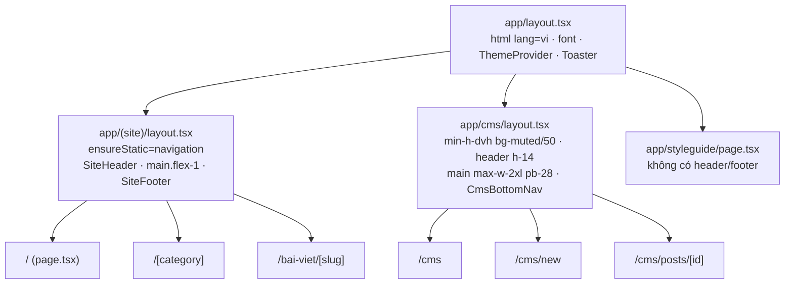

# Giao diện: React 19.3 · Tailwind CSS 4 · shadcn (base-nova / Base UI)

> Phiên bản: react / react-dom 19.3.0 · next 16.4.3 · tailwindcss 4.3.3 · @tailwindcss/turbopack 4.3.3 · @tailwindcss/typography 0.5.20 · shadcn 4.23.0 (style `base-nova`) · @base-ui/react 1.9.0 · cn 0.5.2 · class-variance-authority 0.7.1 · tw-animate-css 1.4.0 · lucide-react 1.66.0 · sonner 2.0.8 · next-themes 0.4.6
> Nguồn: `node_modules/next/dist/docs/01-app/` · `node_modules/@base-ui/react/docs/react/` · `node_modules/cn/README.md` · `node_modules/shadcn/dist/tailwind.css` · `npx shadcn --help` · `node_modules/@tailwindcss/turbopack/README.md`
> Kiểm lần cuối: 2026-11-03 @ dfd7e8f

Liên quan: Next.js (`docs/nen-tang-ky-thuat/nextjs-16.md`: caching `[NX-01]`–`[NX-06]`, `ensureStatic` `[NX-03]`, proxy `[NX-09]`), kiểm tra & bảo mật (`docs/nen-tang-ky-thuat/kiem-tra-va-bao-mat.md`: Server Action `[BM-11]`, `[BM-18]`). Tài liệu này chỉ nói phần giao diện; khi cần quyết định về cache hay quyền truy cập, trỏ sang tài liệu kia.

## Tóm tắt cho agent

### [GD-01] Những điều PHẢI biết trước khi đụng vào giao diện

- **shadcn ở đây dựng trên Base UI, không phải Radix.** Không dùng `asChild`; dùng prop `render` (`components/site/mobile-nav.tsx:15`). Không chép mẫu shadcn/Radix từ trí nhớ; xem `[GD-04]`.
- **Không có `tailwind.config.*`, không có `postcss.config.*`.** Mọi token, biến thể, plugin khai báo trong `app/globals.css`. Tailwind chạy qua loader `@tailwindcss/turbopack` trong `next.config.ts:11-18`. Xem `[GD-03]`.
- **`cn` là package `cn`, không phải clsx + tailwind-merge.** `lib/utils.ts:1` chỉ re-export `cn` từ `"cn"`. Không cài `clsx`/`tailwind-merge`. Xem `[GD-05]`.
- **Toàn bộ site public phải tĩnh hoàn toàn:** `app/(site)/layout.tsx:6` đặt `ensureStatic = "navigation"`. Trong `app/(site)/**` không đọc `cookies()`, `headers()`, `searchParams` phía server, không truy vấn DB ngoài hàm `"use cache"`. Dữ liệu theo từng người đọc (tim, đã xem…) chỉ tải trong Client Component. Xem `[GD-18]`, `[GD-24]`.
- **Đặt `"use client"` ở lá, không đặt ở page/layout.** Page/layout là Server Component; chỉ nút, form, widget tương tác mới là Client Component. Xem `[GD-02]`.
- **Gọi Server Action từ client theo mẫu của dự án:** `useTransition` + action trả `{ ok: true, ... } | { ok: false, error }` + `toast` từ `sonner`. Xem `[GD-12]`, `[GD-17]`.
- **Chuỗi giao diện bằng tiếng Việt có dấu**, kể cả `aria-label`, toast, placeholder. Font Be Vietnam Pro (subset `vietnamese`). Xem `[GD-08]`, `[GD-14]`.
- **Mobile-first, kiểm ở bề rộng 360px.** Nút mặc định của shadcn chỉ cao 32px (`h-8`); trong CMS và trên site luôn nâng lên `h-10` trở lên cho vùng chạm. Xem `[GD-14]`, `[GD-35]`.
- **Ảnh dùng `next/image`, host phải nằm trong `IMAGE_HOSTS`** (`lib/images.ts:3`). Không dùng prop `priority` (đã deprecated ở Next 16). Xem `[GD-13]`, `[GD-30]`.
- **`/styleguide` là bản tham chiếu sống** của token và component (`app/styleguide/page.tsx`). Thêm token/component dùng chung thì thêm mẫu vào đó. Xem `[GD-15]`.

## Khái niệm cốt lõi

### [GD-02] Server Component, Client Component và ranh giới `"use client"`

- Mọi file trong `app/` và `components/` mặc định là **Server Component**: chạy trên server, được prerender, không có state, không có event handler, không dùng hook trình duyệt.
- `"use client"` ở dòng đầu file đánh dấu **ranh giới**: file đó và mọi thứ nó import trở thành code client. Ví dụ ranh giới hiện có: `components/theme-toggle.tsx:1`, `components/site/mobile-nav.tsx:1`, `components/cms/*` (trừ `seo-score.tsx`, `status-badge.tsx`), `components/ui/{dialog,sheet,tabs,label,sonner}.tsx`.
- Server Component được import và render Client Component; ngược lại thì không (Client Component chỉ nhận Server Component qua `children`/props JSX).
- Props từ server sang client phải tuần tự hóa được (chuỗi, số, mảng, object thuần, `Date`, Promise, JSX). Không truyền hàm, trừ Server Action. Ví dụ: `PostEditor` nhận `initial` là object thuần (`app/cms/posts/[id]/page.tsx:24-46`).
- Server Action (`"use server"`, `app/cms/actions.ts:1`) được import thẳng vào Client Component và gọi như hàm async (`components/cms/new-post-form.tsx:7,27`).
- Component không có tương tác (badge, card, heading) giữ là Server Component, không thêm `"use client"` "cho chắc": `components/cms/status-badge.tsx`, `components/cms/seo-score.tsx` không có directive và vẫn được dùng trong Client Component `post-editor.tsx` (khi đó chúng chạy ở client vì được import từ file client).
- React 19.3 có `useActionState`, `useOptimistic`, `useTransition`, và API `browser()` từ `react-dom` (đã kiểm `node_modules/react-dom/cjs/react-dom.production.js:74`, `node_modules/@types/react-dom/index.d.ts:189`). Repo hiện chỉ dùng `useTransition`; `useActionState` và `useOptimistic` chưa dùng ở đâu.

### [GD-03] Tailwind CSS 4: cấu hình bằng CSS

- Điểm vào duy nhất là `app/globals.css`, import một lần trong `app/layout.tsx:6`.
- `@import "tailwindcss"` (`app/globals.css:1`), `@import "tw-animate-css"` (dòng 2, lớp `animate-in`/`fade-in-0`… dùng trong dialog/sheet), `@import "shadcn/tailwind.css"` (dòng 3, biến thể `data-open`, `data-closed`, `data-checked`, `data-active`, `data-horizontal`… và utility `no-scrollbar`, `scroll-fade-*`, `shimmer`; xem `node_modules/shadcn/dist/tailwind.css:28-90`), `@plugin "@tailwindcss/typography"` (dòng 4, lớp `prose`).
- `@custom-variant dark (&:is(.dark *));` (`app/globals.css:6`): `dark:` khớp mọi phần tử **nằm trong** phần tử có class `.dark`. next-themes gắn `.dark` lên `<html>`.
- `@theme inline { ... }` (`app/globals.css:8-53`) ánh xạ biến CSS sang token Tailwind: `--color-primary: var(--primary)` sinh ra `bg-primary`, `text-primary`, `ring-primary`… Từ khóa `inline` làm utility tham chiếu thẳng `var(--primary)`, nên đổi giá trị trong `.dark` là đủ để đổi màu.
- Giá trị thật nằm ở `:root` (sáng, dòng 55-92) và `.dark` (tối, dòng 94-130), dạng `oklch(...)`.
- Tailwind quét mã nguồn để tìm tên lớp **nguyên văn**. Tên lớp ghép chuỗi (`` `text-${x}` ``) không được sinh CSS.
- Cú pháp v4 đang dùng trong repo: dấu `!` ở cuối để `!important` (`h-10!`, `components/cms/post-editor.tsx:138`), biến CSS trong ngoặc tròn (`gap-(--card-spacing)`, `components/ui/card.tsx:14`), `--spacing(4)` (cùng dòng), `has-data-[slot=...]`, `in-data-[slot=...]`, `field-sizing-content` (`components/ui/textarea.tsx:9`).

### [GD-04] shadcn style `base-nova` trên `@base-ui/react`

- `components.json`: `"style": "base-nova"`, `"rsc": true`, `"tailwind.config": ""` (không có file config), `"css": "app/globals.css"`, `"baseColor": "neutral"`, `"iconLibrary": "lucide"`, alias `ui` → `@/components/ui`, `utils` → `@/lib/utils`.
- Primitive đến từ `@base-ui/react/<tên>` (ví dụ `components/ui/button.tsx:1`, `components/ui/dialog.tsx:4`, `components/ui/tabs.tsx:3`). Không có `@radix-ui/*` trong `package.json`.
- Khác biệt với shadcn/Radix mà agent hay nhớ nhầm:

| Việc | Radix (KHÔNG dùng ở đây) | Base UI (đang dùng) |
|---|---|---|
| Đổi phần tử được render | `asChild` + con duy nhất | `render={<Button ... />}` hoặc `render={(props, state) => <el {...props} />}` (`components/ui/dialog.tsx:65-71`, `components/site/mobile-nav.tsx:15`) |
| Overlay | `Dialog.Overlay` | `Dialog.Backdrop` (`components/ui/dialog.tsx:31`) |
| Nội dung popup | `Dialog.Content` | `Dialog.Popup` (`components/ui/dialog.tsx:53`) |
| Tab | `Tabs.Trigger` / `Tabs.Content` | `Tabs.Tab` / `Tabs.Panel` (`components/ui/tabs.tsx:57,73`); wrapper shadcn vẫn tên `TabsTrigger`/`TabsContent` |
| Thuộc tính trạng thái | `data-state="open"` | `data-open`, `data-closed`, `data-active`, `data-checked`; transition dùng `data-starting-style` / `data-ending-style` (`components/ui/sheet.tsx:31`) |
| `onOpenChange` | `(open) => void` | `(open, eventDetails) => void` (`node_modules/@base-ui/react/dialog/root/DialogRoot.d.ts:40`) |
| Component tự viết có `render` | `Slot` | `useRender` + `mergeProps` (`components/ui/badge.tsx:1-2,35-48`) |
| Button render thành thẻ khác | — | phải đặt `nativeButton={false}`; Base UI cấm render `<a>` thành button (`node_modules/@base-ui/react/docs/react/components/button.md:137-150`) |

- Biến thể `data-open`/`data-closed` trong `shadcn/tailwind.css` khớp cả `[data-state="open"]` lẫn `[data-open]`, nên lớp `data-open:animate-in` chạy được với Base UI.
- Mỗi wrapper gắn `data-slot="..."` (ví dụ `data-slot="button"`, `components/ui/button.tsx:50`); style cha có thể chọn con qua `has-data-[slot=...]` / `in-data-[slot=...]`.

### [GD-05] `cn` và `class-variance-authority`

- `cn` (package `cn` 0.5.2, do shadcn phát hành) = clsx + tailwind-merge, cùng API (`node_modules/cn/README.md`). Ghép có điều kiện và giải xung đột: lớp sau thắng lớp trước cùng nhóm.
- Đã chạy thử: `cn("h-8 px-2","h-10")` → `"px-2 h-10"`; `cn("text-xs text-muted-foreground","text-meo-vat")` → `"text-xs text-meo-vat"` (token màu tùy biến được nhận là màu, không đè cỡ chữ).
- File trong `components/ui/*` import `cn` từ `"cn"` (CLI sinh như vậy, kể cả component mới; đã kiểm bằng `npx shadcn add switch --view`). Code của dự án import từ `"@/lib/utils"` (`components/cms/bottom-nav.tsx:7`). Hai đường cùng một hàm.
- `cva` định nghĩa biến thể: `buttonVariants` (`components/ui/button.tsx:5-40`) có `variant` (`default`, `outline`, `secondary`, `ghost`, `destructive`, `link`) và `size` (`default`=h-8, `xs`, `sm`, `lg`=h-9, `icon`=size-8, `icon-xs`, `icon-sm`, `icon-lg`=size-9). `badgeVariants` (`components/ui/badge.tsx:6-27`), `tabsListVariants` (`components/ui/tabs.tsx:25-38`).
- Dùng `buttonVariants(...)` để tạo kiểu nút cho `<a>`/`<Link>` (`components/site/product-card.tsx:38`).

## Dự án dùng như thế nào

### [GD-06] Cấu hình build CSS và trang

- `next.config.ts:11-18`: rule Turbopack cho `*.css` chạy loader `@tailwindcss/turbopack`. Turbopack là bundler mặc định cho cả `next dev` và `next build` ở Next 16 (`node_modules/next/dist/docs/01-app/03-api-reference/08-turbopack.md:39`), nên rule này áp dụng cả hai.
- `next.config.ts:9-10`: `cacheComponents: true`, `partialPrefetching: true`.
- `next.config.ts:5-8`: `images.remotePatterns` sinh từ `IMAGE_HOSTS` (`lib/images.ts:3`: `down-vn.img.susercontent.com`, `cf.shopee.vn`, `*.supabase.co`).
- `app/(site)/layout.tsx:6`: `ensureStatic = "navigation"` cho mọi trang public.
- `app/cms/layout.tsx:11`: `maxDuration = 60` (gọi AI mất 20–40 giây); `metadata.robots` noindex (dòng 5-8).
- `proxy.ts:12-14`: Basic auth chặn `/cms/:path*` **và** `/api/:path*`.

### [GD-07] Design token

Màu ngữ nghĩa (khai báo `app/globals.css:55-130`, ánh xạ dòng 8-45). Dùng tên token, không dùng màu Tailwind thô (`bg-orange-500`) hay mã màu cứng.

| Token (utility) | Vai trò | Ví dụ dùng |
|---|---|---|
| `background` / `foreground` | nền trang / chữ chính (nền kem ấm, chữ nâu đậm) | `app/globals.css:137` |
| `card`, `popover` (+ `-foreground`) | thẻ, popup, toast | `components/ui/card.tsx:14`, `components/ui/sonner.tsx:33` |
| `primary` (+ `-foreground`) | màu thương hiệu cam đất: nút chính, link, điểm nhấn | `components/site/site-header.tsx:11` |
| `secondary`, `accent`, `muted` (+ `-foreground`) | nền phụ, chữ phụ | `components/cms/status-badge.tsx:8`, `app/cms/layout.tsx:15` |
| `destructive` | lỗi, xóa | `components/cms/post-editor.tsx:26,181` |
| `border`, `input`, `ring` | viền, ô nhập, focus ring | `app/globals.css:134` |
| `meo-vat`, `meo-vat-soft` | màu xanh lá của loại bài Mẹo vặt; còn dùng cho trạng thái "Đã đăng" và điểm SEO tốt | `components/site/category-badge.tsx:5`, `components/cms/status-badge.tsx:8`, `components/cms/seo-score.tsx:7` |
| `gom-link`, `gom-link-soft` | màu cam của loại bài Gom link; giá sản phẩm | `components/site/category-badge.tsx:6`, `components/site/product-card.tsx:29` |
| `chart-1..5` | biểu đồ; `chart-3` (vàng) đang dùng cho điểm SEO trung bình | `components/cms/seo-score.tsx:7` |
| `sidebar-*` | sinh sẵn bởi shadcn, chưa dùng | — |

Khác:

- Bo góc: `--radius: 0.375rem` (`app/globals.css:83`); `rounded-sm|md|lg|xl|2xl...` tính từ `--radius` (dòng 46-52). Site dùng `rounded-sm` cho ảnh/thẻ (phong cách tạp chí); component shadcn dùng `rounded-lg`/`rounded-xl`.
- Font: `--font-sans` và `--font-heading` đều trỏ `var(--font-body)` (dòng 11-12). Dùng `font-heading` cho tiêu đề và logo để sau này đổi font tiêu đề chỉ cần sửa một dòng.
- Base layer (dòng 132-145): `body` có `leading-relaxed`; `h1–h4` tự có `font-heading font-bold leading-snug tracking-tight`. Không lặp lại `font-bold` cho thẻ tiêu đề trừ khi cần đổi.

### [GD-08] Font và typography

- `app/layout.tsx:2,8-12`: `Be_Vietnam_Pro` từ `next/font/google`, `subsets: ["latin", "vietnamese"]`, `weight: ["400","500","600","700"]`, biến `--font-body`, gắn class lên `<html>` (dòng 30). Chỉ có 4 độ đậm này; `font-light`/`font-extrabold` sẽ bị trình duyệt giả lập.
- `<html lang="vi">` (`app/layout.tsx:28`).
- Thân Bài web render HTML đã lọc bằng lớp `prose` (`app/(site)/bai-viet/[slug]/page.tsx:109-112`): `prose max-w-none sm:prose-lg text-foreground prose-headings:font-heading prose-headings:text-foreground prose-h2:scroll-mt-24 prose-a:text-primary prose-strong:text-foreground prose-li:marker:text-primary`. Dự án **không** dùng `dark:prose-invert`; màu được ghi đè từng phần tử bằng token. Thẻ được phép trong thân bài: `lib/sanitize.ts:6-10` (có `blockquote`, `table`, `hr`, `figure`, `figcaption`, `img`). Xem bẫy `[GD-32]`.
- `prose-h2:scroll-mt-24` để mục lục (`withHeadingIds`, `lib/content.ts:11-22`) nhảy tới h2 không bị header sticky (h-16) che.
- Ngày tháng định dạng tiếng Việt bằng `formatDate` (`lib/format.ts:1-3`, `Intl.DateTimeFormat("vi-VN")`). Không tự định dạng ngày.

### [GD-09] Dark mode

- `ThemeProvider attribute="class" defaultTheme="system" enableSystem` (`app/layout.tsx:33`), `<html suppressHydrationWarning>` (dòng 29) vì next-themes đổi class trước khi hydrate.
- `ThemeToggle` (`components/theme-toggle.tsx`): đọc `resolvedTheme` **chỉ trong `onClick`** (dòng 14); biểu tượng đổi bằng CSS `dark:hidden` / `hidden dark:block` (dòng 16-17). Đây là cách tránh lệch hydrate: không render nội dung phụ thuộc theme từ giá trị JS.
- `Toaster` lấy `theme` từ `useTheme()` và dùng biến màu `--popover`, `--border`, `--radius` (`components/ui/sonner.tsx:8,31-38`); gắn ở root layout với `richColors position="top-center"` (`app/layout.tsx:35`).
- ThemeToggle có trên header site (`components/site/site-header.tsx:21`) và `/styleguide`; header CMS không có.

### [GD-10] Kiểm kê component

`components/ui/` (sinh bởi shadcn CLI, style base-nova; sửa ít, ghi lý do khi sửa):

- `components/ui/button.tsx`: `Button`, `buttonVariants` (Base UI Button + cva).
- `components/ui/badge.tsx`: `Badge`, `badgeVariants` (dùng `useRender`, nhận `render`).
- `components/ui/card.tsx`: `Card`, `CardHeader`, `CardTitle`, `CardDescription`, `CardAction`, `CardContent`, `CardFooter` (div thuần, `size` `default|sm`).
- `components/ui/dialog.tsx`: `Dialog*` (client; `showCloseButton`).
- `components/ui/sheet.tsx`: `Sheet*` (client; dựng từ Base UI Dialog, `side` `top|right|bottom|left`).
- `components/ui/tabs.tsx`: `Tabs`, `TabsList` (`variant` `default|line`), `TabsTrigger`, `TabsContent` (client).
- `components/ui/input.tsx`: `Input` (Base UI Input; `text-base md:text-sm`, cao `h-8`).
- `components/ui/textarea.tsx`: `Textarea` (`field-sizing-content`, tự giãn).
- `components/ui/label.tsx`: `Label` (`<label>` thuần, client).
- `components/ui/skeleton.tsx`: `Skeleton` (`animate-pulse bg-muted`).
- `components/ui/sonner.tsx`: `Toaster` (client; icon lucide, màu theo token).

`components/` gốc:

- `components/theme-toggle.tsx`: nút đổi sáng/tối (client).
- `components/json-ld.tsx`: thẻ `<script type="application/ld+json">`, escape `<` (server).

`components/site/` (site public; tất cả là Server Component trừ `mobile-nav`):

- `components/site/site-header.tsx`: header sticky `h-16`, logo, nav desktop (`md:flex`), `ThemeToggle`, `MobileNav`.
- `components/site/mobile-nav.tsx`: menu Sheet bên phải cho mobile (client, `md:hidden`).
- `components/site/nav-links.tsx`: mảng `NAV_LINKS` (Trang chủ + mỗi loại bài trong `CATEGORIES`).
- `components/site/site-footer.tsx`: footer, mô tả, link điều hướng, câu công khai affiliate ngắn.
- `components/site/post-card.tsx`: `PostCard` (ảnh 4:3 + tiêu đề) và `PostListItem` (ảnh vuông nhỏ bên trái); kiểu `PostCardData`.
- `components/site/product-card.tsx`: `ProductCard`: ảnh, tên, giá, nút "Xem trên Shopee" (`rel="sponsored nofollow noopener"`, `target="_blank"`).
- `components/site/category-badge.tsx`: nhãn loại bài kiểu tạp chí (chữ hoa nhỏ, không nền), màu theo `STYLES`.
- `components/site/section-heading.tsx`: tiêu đề khối + link "Xem tất cả →".
- `components/site/affiliate-disclosure.tsx`: Nhãn công khai affiliate đặt đầu thân bài khi bài có Sản phẩm.

`components/cms/` (CMS):

- `components/cms/bottom-nav.tsx`: thanh điều hướng cố định đáy (Bài viết / Tạo mới), `usePathname` trong `Suspense` (client).
- `components/cms/fields.tsx`: `Field` (label + hint + control), `CategoryPicker` (lưới 2 cột nút chọn), `ProductFields` (danh sách Sản phẩm thêm/xóa), `emptyProduct` (client).
- `components/cms/new-post-form.tsx`: form tạo bài (AI viết hoặc nháp trống) gọi `createPost` (client).
- `components/cms/post-editor.tsx`: trình sửa bài: thanh thao tác sticky, tab Nội dung/SEO/Sản phẩm/Threads, xem trước trong `iframe sandbox` (client).
- `components/cms/seo-score.tsx`: vòng tròn điểm SEO (SVG), màu theo ngưỡng 80/50.
- `components/cms/status-badge.tsx`: nhãn "Đã đăng" / "Nháp".

### [GD-11] Bố cục site và CMS



Site public (`app/(site)`):

- Khung: `body` là `min-h-full flex flex-col` (`app/layout.tsx:32`), `main.flex-1` đẩy footer xuống đáy (`app/(site)/layout.tsx:12`).
- Vùng nội dung: `mx-auto max-w-6xl px-4` (header, footer, trang chủ, trang loại bài, trang bài). Khối chữ hẹp hơn: `max-w-5xl` (đầu bài, ảnh lớn), `max-w-3xl` (h1), cột thân bài + mục lục `lg:grid-cols-[1fr_14rem]` (`app/(site)/bai-viet/[slug]/page.tsx:106`).
- Lưới thẻ: `grid gap-x-6 gap-y-10 sm:grid-cols-2 lg:grid-cols-3` (`app/(site)/page.tsx:50`, `app/(site)/[category]/page.tsx:38`). Dải cuộn ngang trên mobile: `-mx-4 flex snap-x snap-mandatory overflow-x-auto px-4` (`app/(site)/page.tsx:60`).
- Header sticky `z-40` (`components/site/site-header.tsx:8`); nav desktop ẩn dưới `md`, menu Sheet hiện dưới `md`.
- Khoảng dọc: `py-8 sm:py-12`, giữa các khối `space-y-16`.

CMS (`app/cms`):

- Một cột, `max-w-2xl px-4` (`app/cms/layout.tsx:17,26`), nền `bg-muted/50`, khối nội dung nền `bg-background` có viền.
- Header sticky `h-14 z-30` (dòng 16-25); thanh thao tác của editor sticky ngay dưới: `sticky top-14 z-20 -mx-4` (`components/cms/post-editor.tsx:114`).
- Bottom nav cố định `fixed inset-x-0 bottom-0 z-30`, có `pb-[env(safe-area-inset-bottom)]` cho iPhone (`components/cms/bottom-nav.tsx:26`); vì vậy `main` có `pb-28` (`app/cms/layout.tsx:26`). Màn CMS mới phải giữ khoảng đệm đáy này.
- Trang CMS đọc DB **không cache**: bọc phần đọc trong `<Suspense fallback={<Skeleton…/>}>` và gọi `await connection()` hoặc `await params` bên trong (`app/cms/page.tsx:15-24`, `app/cms/posts/[id]/page.tsx:9-17`).
- Không có thanh bên (sidebar) cho CMS; điều hướng chính là bottom nav.

### [GD-12] Mẫu gọi Server Action từ client (đang dùng)

- Mọi action CMS bọc trong `run()` (`app/cms/actions.ts:21-29`): gọi `requireAdmin()`, bắt lỗi, trả `Result<T> = ({ ok: true } & T) | { ok: false; error: string }` (dòng 19). Lỗi là câu tiếng Việt lấy từ Zod (`firstError`, `lib/post-input.ts:43-45`) hoặc `throw new Error("…")`.
- Client gọi trong `startTransition(async () => { ... })`, đọc `res.ok`, báo bằng `toast.error(res.error)` / `toast.success("…")`, rồi `router.push(...)` (`components/cms/new-post-form.tsx:19-35`).
- Khi một màn có nhiều action, dùng một state `busy: string | null` để khóa mọi nút và hiện spinner ở đúng nút (`components/cms/post-editor.tsx:37-53,126-133`).
- Trạng thái chờ: `disabled={pending}` + `<Loader2 className="animate-spin" />` thay icon + đổi nhãn ("AI đang viết… (20–40 giây)", `components/cms/new-post-form.tsx:56-59`).
- Sau khi action thay đổi Bài web công khai, action gọi `updateTag(POSTS_TAG)` (`app/cms/actions.ts:88,107,115`). Client không tự làm mới cache.
- Trang sửa truyền `key={post.updatedAt.toISOString()}` cho `PostEditor` (`app/cms/posts/[id]/page.tsx:25`) để state client khởi tạo lại khi dữ liệu server mới về.

### [GD-13] Ảnh với `next/image`

- Ảnh trong khung tỉ lệ: cha `relative aspect-[4/3] overflow-hidden rounded-sm bg-muted`, ảnh `fill` + `sizes` + `object-cover` (`components/site/post-card.tsx:18-25`). `bg-muted` làm nền chờ.
- Luôn có `sizes` đúng bố cục: lưới 3 cột `"(max-width: 640px) 100vw, (max-width: 1024px) 50vw, 33vw"`; thumbnail cố định `"112px"` (`components/site/product-card.tsx:21`).
- `alt` = tên Sản phẩm hoặc tiêu đề bài (tiếng Việt). Ảnh trang trí thuần thì `alt=""`.
- Ảnh thiếu thì dùng `"/placeholder.svg"` (`public/placeholder.svg`); Next tự `unoptimized` khi `src` kết thúc bằng `.svg` (`node_modules/next/dist/docs/01-app/03-api-reference/02-components/image.md:940`).
- Ảnh LCP (hero trang chủ, ảnh đầu Bài web) hiện dùng `priority` (`app/(site)/page.tsx:31`, `app/(site)/bai-viet/[slug]/page.tsx:100`). Prop này deprecated từ Next 16 (`image.md:292-294`); code mới dùng `preload` cho đúng một ảnh LCP, hoặc `fetchPriority="high"`/`loading="eager"`.
- Ảnh bên trong thân bài là `` thô trong HTML đã lọc (`lib/sanitize.ts:8,13`), không qua `next/image`.

### [GD-14] Quy ước giao diện

Ngôn ngữ và thuật ngữ:

- Mọi chuỗi người dùng thấy hoặc nghe (nhãn, placeholder, toast, `aria-label`, `sr-only`, `title`, thông báo lỗi) viết tiếng Việt có dấu, giọng thân thiện ngắn gọn ("Đã lưu", "Xóa sản phẩm", "Mở menu").
- Dùng thuật ngữ PRD §3 cho đối tượng nghiệp vụ: Sản phẩm, Bài web, Loại bài, Danh mục, Gợi ý AI, Lượt tim, Banner, Nhãn công khai affiliate. Lưu ý lệch hiện tại: `CATEGORIES` (`lib/categories.ts:3-17`, `MEO_VAT`/`GOM_LINK`) chính là **Loại bài** theo PRD, nhưng UI đang ghi "Chuyên mục" (`components/cms/new-post-form.tsx:39`, `components/site/mobile-nav.tsx:20`). **Danh mục** theo PRD (nhóm chủ đề do Vinh tạo) chưa có trong code. Màn mới không gọi Loại bài là "Danh mục".
- Số tiền, ngày dùng định dạng vi-VN (`formatDate`, giá hiển thị nguyên chuỗi người nhập, ví dụ "89.000₫").

Truy cập (a11y):

- Nút chỉ có icon phải có `aria-label` tiếng Việt (`components/theme-toggle.tsx:13`, `components/cms/fields.tsx:76`); icon trang trí cạnh chữ thêm `aria-hidden` (`components/site/product-card.tsx:41`).
- Ký tự trang trí (`·`, `/`) bọc `aria-hidden` (`components/site/post-card.tsx:30`). Điều hướng phụ có `aria-label` ("Breadcrumb", "Mục lục", `app/(site)/bai-viet/[slug]/page.tsx:82,138`).
- Mỗi trang đúng một `h1`; thẻ/khối con dùng `h2`/`h3` theo thứ tự.
- Nút bấm là `<button type="button">` hoặc `Button`; điều hướng là `<Link>`/`<a>`. Không gắn `onClick` lên `div`.
- Focus: dùng sẵn `focus-visible:ring-*` của component shadcn; outline mặc định đã là `outline-ring/50` (`app/globals.css:134`). Không xóa `outline` mà không thay bằng ring.
- Link affiliate ra ngoài luôn `target="_blank" rel="sponsored nofollow noopener"`.

Vùng chạm và mobile-first:

- Viết lớp cho mobile trước, mở rộng bằng `sm:`/`md:`/`lg:`.
- Vùng chạm tối thiểu 40px (`h-10`/`size-10`); nút hành động chính trong CMS `h-11`–`h-12 w-full` (`components/cms/new-post-form.tsx:56`, `components/cms/post-editor.tsx:199`). Input trong CMS `className="h-10"` (`components/cms/fields.tsx:86`).
- Ô nhập giữ cỡ chữ 16px trên mobile (`Input`/`Textarea` có sẵn `text-base md:text-sm`) để iOS không tự phóng to khi focus.
- Dùng `inputMode="url"` cho ô link (`components/cms/fields.tsx:90`).
- Dùng `min-h-dvh` thay `min-h-screen` cho khung toàn màn hình (`app/cms/layout.tsx:15`).

Chuyển động:

- Mọi chuyển động trang trí thêm biến thể giảm chuyển động: `motion-reduce:transform-none` cho hiệu ứng phóng ảnh (`components/site/post-card.tsx:24`); `scroll-behavior` tắt khi `prefers-reduced-motion` (`app/globals.css:147-151`).
- Spinner `animate-spin` chỉ hiện trong lúc chờ, đi kèm chữ mô tả.

### [GD-15] `/styleguide`: tham chiếu sống

- `app/styleguide/page.tsx` hiển thị: bảng màu token (dòng 16-27, 40-50), typography có dấu chồng tiếng Việt (dòng 52-61), nút/badge/input (63-76), `PostCard` + `Skeleton` (78-106), `ProductCard` + `AffiliateDisclosure` (108-118), `SeoScore` ba ngưỡng (120-127), `ThemeToggle` để xem sáng/tối.
- Trang nằm ngoài nhóm `(site)` nên không chịu `ensureStatic`, không có header/footer site; `robots: { index: false }` (dòng 14). Ghi chú ở dòng 13 nói trang là tạm và cần xóa trước khi deploy; khi xóa phải sửa mục này.
- Mảng `SWATCHES` ghi tên lớp đầy đủ (`"bg-meo-vat"`) để Tailwind quét được.

## Công thức

### [GD-16] Thêm một component shadcn

1. Xem trước, không ghi file:

   ```bash
   npx shadcn add switch --dry-run
   npx shadcn add switch --view
   ```

   CLI đọc `components.json` và lấy bản `base-nova` (Base UI). Kết quả dry-run cho `switch`: tạo `components/ui/switch.tsx`, phụ thuộc `cn`.
2. Thêm thật: `npx shadcn add <tên>` (nhiều tên cách nhau dấu cách; `-y` bỏ hỏi; **không** dùng `-o` trên file đã có trừ khi muốn mất sửa đổi cục bộ).
3. Mở file mới, kiểm:
   - import primitive từ `@base-ui/react/...`, không có `@radix-ui`;
   - chuỗi người dùng thấy (`sr-only` "Close", nút "Close"…) đổi sang tiếng Việt;
   - kích thước mặc định có đủ vùng chạm cho chỗ dùng (nếu không, nâng ở chỗ dùng bằng `className`, không sửa biến thể chung).
4. Xem tài liệu API Base UI của primitive đó trong `node_modules/@base-ui/react/docs/react/components/<tên>.md` (hoặc `npx shadcn docs <tên>`) trước khi viết code dùng.
5. Thêm một mẫu dùng vào `app/styleguide/page.tsx`.
6. Chạy `npm run lint` và `npx tsc --noEmit`.

Dùng component có trigger với nút của dự án:

```tsx
// Đúng (Base UI): render prop
<SheetTrigger render={<Button variant="ghost" size="icon-lg" aria-label="Mở menu" />}>
  <Menu />
</SheetTrigger>

// Sai (Radix): asChild không tồn tại ở đây
<SheetTrigger asChild><Button>…</Button></SheetTrigger>
```

### [GD-17] Dựng màn hình CMS mobile-first gọi Server Action

Ví dụ: màn "Sửa Banner" ở `/cms/banners/[id]`.

1. **Action** trong file `"use server"` của CMS (`app/cms/actions.ts` hoặc file `actions.ts` cạnh route), bọc `run()` để có `requireAdmin()` và kiểu `Result`. Validate bằng schema Zod, ném lỗi tiếng Việt. Nếu dữ liệu hiện ra ở site public, gọi `updateTag(<tag tương ứng>)` sau khi ghi (quy tắc tag: `[NX-06]`, `[NX-54]`).

   ```ts
   export async function saveBanner(id: string, input: BannerInput) {
     return run(async () => {
       const parsed = bannerInputSchema.safeParse(input);
       if (!parsed.success) throw new Error(firstError(parsed.error));
       await db.banner.update({ where: { id }, data: parsed.data });
       updateTag(BANNERS_TAG);
       return {};
     });
   }
   ```

2. **Page** là Server Component, đọc DB trong component con bọc `Suspense` + `Skeleton` (theo `app/cms/posts/[id]/page.tsx:7-48`); `h1` text-2xl ở đầu; truyền object thuần cho form; đặt `key` theo `updatedAt`.

   ```tsx
   export default function EditBannerPage({ params }: PageProps<"/cms/banners/[id]">) {
     return (
       <>
         <h1 className="mb-4 text-2xl">Sửa Banner</h1>
         <Suspense fallback={<Skeleton className="h-64 w-full" />}>
           <Editor params={params} />
         </Suspense>
       </>
     );
   }
   ```

3. **Form** là Client Component trong `components/cms/`, dựng bằng `Field` (`components/cms/fields.tsx:13-31`):

   ```tsx
   "use client";

   import { useState, useTransition } from "react";
   import { Loader2 } from "lucide-react";
   import { toast } from "sonner";
   import { saveBanner } from "@/app/cms/actions";
   import { Button } from "@/components/ui/button";
   import { Input } from "@/components/ui/input";
   import { Field } from "./fields";

   export function BannerForm({ id, initial }: { id: string; initial: BannerInput }) {
     const [banner, setBanner] = useState(initial);
     const [pending, startTransition] = useTransition();

     const onSave = () =>
       startTransition(async () => {
         const res = await saveBanner(id, banner);
         if (!res.ok) return void toast.error(res.error);
         toast.success("Đã lưu Banner");
       });

     return (
       <div className="space-y-5">
         <Field label="Tiêu đề" hint={`${banner.title.length}/60`}>
           <Input
             value={banner.title}
             onChange={(e) => setBanner({ ...banner, title: e.target.value })}
             className="h-10 bg-background"
           />
         </Field>
         <Button size="lg" className="h-12 w-full text-base" disabled={pending} onClick={onSave}>
           {pending && <Loader2 className="animate-spin" />}
           {pending ? "Đang lưu…" : "Lưu"}
         </Button>
       </div>
     );
   }
   ```

4. **Điều hướng**: nếu màn là mục chính, thêm một `Link` vào `components/cms/bottom-nav.tsx` (tối đa khoảng 4–5 mục để mỗi mục vẫn đủ rộng ở 360px); điều kiện active dựa trên `pathname`.
5. **Kiểm** theo `[GD-40]`.

Biến thể với `<form action>`: dùng `useActionState` khi form chỉ gồm ô nhập gửi `FormData`, không có state client phức tạp (`node_modules/next/dist/docs/01-app/02-guides/forms.md:192-300`). Khi đó action nhận `(prevState, formData)`; vẫn phải gọi `requireAdmin()` và trả lỗi tiếng Việt. Không trộn hai mẫu trong cùng một form.

```tsx
const [state, formAction, pending] = useActionState(saveBannerForm, { ok: true } as Result);
useEffect(() => { if (!state.ok) toast.error(state.error); }, [state]);
return <form action={formAction}>… <Button type="submit" disabled={pending}>Lưu</Button></form>;
```

### [GD-18] Thêm widget client tương tác vào trang public tĩnh (nút tim, chia sẻ)

Bối cảnh: `app/(site)/**` có `ensureStatic = "navigation"`; với cấu hình này, build và `next dev` sẽ báo lỗi nếu server đọc dữ liệu chưa cache, `connection()`, `cookies()`, `headers()`, `searchParams` phía server, `use cache` có `revalidate: 0`/`expire` dưới 5 phút, hoặc truyền Promise dữ liệu phụ thuộc request cho Client Component, **kể cả khi bọc `Suspense`** (`node_modules/next/dist/docs/01-app/03-api-reference/03-file-conventions/02-route-segment-config/ensureStatic.md`, mục *Validation*). Client Component vẫn được tải dữ liệu riêng của người đọc **trong trình duyệt** (cùng file, mục *Client Components*).

Các bước:

1. Tạo `components/site/<widget>.tsx` có `"use client"`. Chỉ nhận props tĩnh từ server (`slug`, `postId`, `title`, `initialCount` lấy từ hàm `"use cache"`).
2. Đặt widget vào page server như mọi component khác. Không chuyển page thành client, không đọc request trong page.
3. Trạng thái riêng của người đọc (đã tim chưa, lấy từ `localStorage`): đọc sau khi mount, hoặc dùng `use(browser())` bên trong `<Suspense>` (React 19.3; `node_modules/next/dist/docs/01-app/02-guides/single-page-applications.md:219-261`). Không đọc `localStorage`/`window` trong lúc render đầu → lệch hydrate.
4. Ghi dữ liệu (thả tim): gọi một Server Action công khai đặt **ngoài** `app/cms` (ví dụ `app/(site)/actions.ts`, `"use server"`). Action này không gọi `requireAdmin()` nhưng phải validate đầu vào và giới hạn tần suất (xem `[BM-16]`, `[PR-32]`, công thức đếm view `[NX-35]`, `[NX-36]`). **Không** gọi `updateTag(POSTS_TAG)` trong action này (xem `[GD-25]`).
5. Phản hồi tức thì bằng `useOptimistic` trong transition:

   ```tsx
   "use client";

   import { useOptimistic, useState, useTransition } from "react";
   import { Heart } from "lucide-react";
   import { likePost } from "@/app/(site)/actions";
   import { Button } from "@/components/ui/button";
   import { cn } from "@/lib/utils";

   export function LikeButton({ postId, initialCount }: { postId: string; initialCount: number }) {
     const [count, setCount] = useState(initialCount);
     const [optimistic, addOptimistic] = useOptimistic(count, (c, d: number) => c + d);
     const [liked, setLiked] = useState(false);
     const [, startTransition] = useTransition();

     const onLike = () =>
       startTransition(async () => {
         addOptimistic(1);
         setLiked(true);
         const res = await likePost(postId);
         if (res.ok) setCount(res.count);
       });

     return (
       <Button variant="outline" className="h-11 px-4" disabled={liked} onClick={onLike}
         aria-label={liked ? "Đã thả tim" : "Thả tim bài viết"} aria-pressed={liked}>
         <Heart className={cn(liked && "fill-primary text-primary")} />
         {optimistic}
       </Button>
     );
   }
   ```

6. Số đếm "sống" theo từng lần tải: phải đọc trong trình duyệt. Không đặt route handler công khai dưới `/api/*` vì `proxy.ts:13` bắt Basic auth cho mọi `/api/:path*`. Vị trí endpoint công khai là quyết định kiến trúc; ghi vào tài liệu kiến trúc trước khi làm.
7. Nút chia sẻ: dùng `navigator.share` nếu có, nếu không thì `navigator.clipboard.writeText(url)` + `toast.success("Đã sao chép link")` (giống `components/cms/post-editor.tsx:106-109`). Chỉ gọi trong handler, không gọi lúc render. Icon dùng `Share2`, `Link2`; lucide-react 1.x **không có** icon thương hiệu (Facebook…), xem `[GD-31]`.
8. Kiểm `npm run build` không báo lỗi `ensureStatic`; mở trang khi tắt JavaScript vẫn thấy nội dung bài (widget chỉ thêm, không chặn nội dung cần index).

### [GD-19] Thêm component public thuần server (Banner, khối nội dung)

1. Tạo `components/site/<tên>.tsx` **không** có `"use client"`.
2. Dữ liệu lấy qua hàm trong `lib/` có `"use cache"` + `cacheLife("days")` + `cacheTag(...)` (mẫu `lib/posts.ts:44-55`); action CMS tương ứng gọi `updateTag` cùng tag.
3. Ảnh theo `[GD-13]`; nếu ảnh nằm trên host mới, thêm host vào `IMAGE_HOSTS` (`lib/images.ts:3`), danh sách này dùng chung cho `next.config.ts` và validate form CMS.
4. Màu theo token `[GD-07]`; nếu cần biến thể theo loại, dùng bảng ánh xạ tên lớp đầy đủ như `STYLES` (`components/site/category-badge.tsx:4-7`).
5. Thêm mẫu vào `/styleguide`, kiểm theo `[GD-40]`.

### [GD-20] Thêm hoặc đổi design token

1. Thêm biến giá trị vào **cả** `:root` và `.dark` trong `app/globals.css` (giá trị `oklch`).
2. Ánh xạ trong `@theme inline`: `--color-<tên>: var(--<tên>);`.
3. Dùng bằng utility `bg-<tên>`, `text-<tên>`, `border-<tên>`.
4. Thêm vào `SWATCHES` của `app/styleguide/page.tsx`, so độ tương phản chữ trên nền ở cả hai chế độ.
5. Cập nhật bảng `[GD-07]`.

### [GD-21] Ghép Base UI với `Link`, `<a>` và component tự viết

- Link trông như nút: áp `buttonVariants` lên `Link`/`<a>`, không bọc `<Button>` quanh link và không render `<a>` qua `Button render` (Base UI cấm, `button.md:150`):

  ```tsx
  <Link href="/cms/new" className={cn(buttonVariants({ size: "lg" }), "h-11 w-full")}>Tạo bài</Link>
  ```

- `Button` render thành phần tử không phải `<button>` (hiếm): thêm `nativeButton={false}`.
- Component tự viết đặt trong `render` phải nhận `ref` và rải mọi props xuống phần tử DOM (`node_modules/@base-ui/react/docs/react/handbook/composition.md`). Component hàm React 19 nhận `ref` như prop thường; chỉ cần `{...props}`.
- Muốn component tự viết có prop `render` giống Badge: dùng `useRender` + `mergeProps` (`components/ui/badge.tsx:29-49`).
- Điều khiển mở/đóng: `open` + `onOpenChange` (`components/site/mobile-nav.tsx:11-13`); đóng sheet khi bấm link bằng `onClick={() => setOpen(false)}` (dòng 26).

## Bẫy hay gặp

### [GD-22] Dùng `asChild` hoặc API Radix

- Triệu chứng: lỗi TypeScript "Property 'asChild' does not exist", hoặc trigger render hai nút lồng nhau (`<button><button>`), lỗi hydrate.
- Nguyên nhân: chép mẫu shadcn/Radix; dự án dùng Base UI.
- Cách đúng: `render={<Button … />}` (`[GD-04]`, `[GD-21]`); tra API trong `node_modules/@base-ui/react/docs/react/`.

### [GD-23] Tạo `tailwind.config.js` hoặc `postcss.config.mjs`

- Triệu chứng: token mới không có tác dụng; hoặc CSS bị xử lý hai lần, build lỗi sau khi làm theo hướng dẫn cài Tailwind trong docs Next (`01-getting-started/11-css.md` dùng `@tailwindcss/postcss`).
- Nguyên nhân: dự án cấu hình Tailwind bằng CSS và chạy qua loader Turbopack (`next.config.ts:11-18`), không qua PostCSS.
- Cách đúng: sửa `app/globals.css` (`@theme inline`, `@custom-variant`, `@plugin`, `@utility`); không thêm file config, không cài `@tailwindcss/postcss`.

### [GD-24] Đọc dữ liệu theo request trong trang public

- Triệu chứng: `next build`/`next dev` báo lỗi prerender ở route `(site)` (dữ liệu chưa cache, runtime data), kể cả khi đã bọc `Suspense`.
- Nguyên nhân: `ensureStatic = "navigation"` (`app/(site)/layout.tsx:6`) bắt cả route phải tĩnh.
- Cách đúng: dữ liệu chung đọc qua hàm `"use cache"`; dữ liệu riêng của người đọc tải trong Client Component phía trình duyệt (`[GD-18]`). Không thêm `connection()`, `cookies()`, `headers()` vào `(site)`.

### [GD-25] Làm mới cache toàn site trên mỗi lượt tương tác

- Triệu chứng: mỗi lượt tim/lượt xem làm mọi trang public render lại; tải DB tăng vọt.
- Nguyên nhân: action công khai gọi `updateTag(POSTS_TAG)`; tag `posts` gắn cho mọi truy vấn bài public (`lib/posts.ts:6-7`).
- Cách đúng: action công khai chỉ ghi số đếm; con số trên trang tĩnh chấp nhận cũ đến lần làm mới kế tiếp, phần "sống" đọc từ trình duyệt. Chỉ action CMS mới gọi `updateTag(POSTS_TAG)`.

### [GD-26] `"use client"` đặt quá cao

- Triệu chứng: page mất khả năng gọi hàm `"use cache"`/DB; lỗi "ensureStatic … Client Component"; bundle JS phình.
- Nguyên nhân: đặt `"use client"` ở page/layout hoặc ở component bọc ngoài. Next cấm export `ensureStatic` từ Client Component (`ensureStatic.md`, *Good to know*).
- Cách đúng: tách phần tương tác thành component lá có `"use client"`; phần còn lại giữ server.

### [GD-27] `usePathname`/`useSearchParams` không có `Suspense`

- Triệu chứng: build lỗi "encountered URL data in a Client Component outside of Suspense" ở route động.
- Nguyên nhân: `cacheComponents` bật; với tham số động chưa có trong `generateStaticParams`, hook suspend (`node_modules/next/dist/docs/01-app/03-api-reference/04-functions/use-pathname.md:72-77`).
- Cách đúng: bọc component dùng hook trong `Suspense` với fallback là bản tĩnh của chính nó (`components/cms/bottom-nav.tsx:9-20`).

### [GD-28] Lệch hydrate do theme hoặc API trình duyệt

- Triệu chứng: cảnh báo "Hydration failed", icon/chữ nháy sai khi tải trang.
- Nguyên nhân: render dựa vào `resolvedTheme`, `localStorage`, `window`, `Date.now()` ở lần render đầu; server không biết các giá trị này.
- Cách đúng: theme thì dùng biến thể CSS `dark:` (`components/theme-toggle.tsx:16-17`); API trình duyệt thì đọc sau mount hoặc `use(browser())` trong `Suspense` (`[GD-18]`).

### [GD-29] Ghép tên lớp động

- Triệu chứng: màu/kích thước không áp dụng dù tên lớp đúng trong DevTools.
- Nguyên nhân: Tailwind chỉ sinh CSS cho tên lớp xuất hiện nguyên văn trong mã (`` `text-${category}` `` không được quét).
- Cách đúng: bảng ánh xạ tên lớp đầy đủ (`components/site/category-badge.tsx:4-7`, `app/styleguide/page.tsx:16-27`).

### [GD-30] Ảnh lỗi hoặc làm chậm trang

- Triệu chứng: lỗi "hostname is not configured under images"; ảnh méo/không hiện; cảnh báo deprecated `priority`; LCP chậm.
- Nguyên nhân: host ngoài `IMAGE_HOSTS`; `fill` mà cha không `relative`/không có kích thước; thiếu `sizes`; dùng `priority` (deprecated Next 16) hoặc `preload` trên nhiều ảnh.
- Cách đúng: thêm host vào `lib/images.ts:3`; khung `relative aspect-* overflow-hidden` + `fill` + `sizes`; chỉ ảnh LCP dùng `preload` hoặc `fetchPriority="high"`. Hai chỗ `priority` hiện có (`app/(site)/page.tsx:31`, `app/(site)/bai-viet/[slug]/page.tsx:100`) không dùng làm mẫu.

### [GD-31] Icon thương hiệu không có trong lucide-react 1.x

- Triệu chứng: `import { Facebook } from "lucide-react"` lỗi không tìm thấy export.
- Nguyên nhân: lucide-react 1.66 không xuất icon thương hiệu (đã kiểm `node_modules/lucide-react/dist/lucide-react.d.ts`: không có `Facebook`).
- Cách đúng: dùng icon chung (`Share2`, `Link2`, `MessageSquareText`) hoặc SVG inline có `aria-hidden` và nhãn chữ bên cạnh. Icon lucide có hai tên (`X` và `XIcon`); trong một file dùng thống nhất một kiểu.

### [GD-32] Thân bài khó đọc ở chế độ tối

- Triệu chứng: `blockquote`, đường kẻ bảng, `hr`, `figcaption` trong Bài web gần như không thấy trên nền tối.
- Nguyên nhân: `prose` mặc định dùng thang xám cố định (ví dụ `--tw-prose-quotes` là gray-900, `node_modules/@tailwindcss/typography/src/styles.js:1109`); dự án chỉ ghi đè body, heading, link, strong, marker (`app/(site)/bai-viet/[slug]/page.tsx:110`) và không dùng `dark:prose-invert`.
- Cách đúng: khi thêm loại nội dung mới vào thân bài, ghi đè màu bằng token (`prose-blockquote:text-foreground prose-blockquote:border-primary/40 prose-th:border-border prose-hr:border-border prose-figcaption:text-muted-foreground`), xem thử bài có đủ các thẻ trong `lib/sanitize.ts:6-10` ở cả hai chế độ.

### [GD-33] Chuỗi tiếng Anh lọt vào giao diện

- Triệu chứng: trình đọc màn hình đọc "Close"; toast/nhãn tiếng Anh.
- Nguyên nhân: file shadcn sinh ra có chuỗi tiếng Anh: `sr-only` "Close" (`components/ui/dialog.tsx:75`, `components/ui/sheet.tsx:75`), nút "Close" trong `DialogFooter` (`components/ui/dialog.tsx:113`).
- Cách đúng: khi thêm/sửa component shadcn, đổi các chuỗi này sang tiếng Việt ("Đóng"); grep chuỗi tiếng Anh trước khi xong.

### [GD-34] Ô nhập chữ nhỏ làm iOS phóng to

- Triệu chứng: trên iPhone, chạm vào ô nhập thì trang tự zoom, lệch bố cục.
- Nguyên nhân: cỡ chữ ô nhập dưới 16px trên mobile. `Input`/`Textarea` mặc định `text-base md:text-sm` là đúng; ghi đè `text-sm`/`text-xs` không kèm tiền tố breakpoint sẽ phá điều này (đang có ở ô slug `components/cms/post-editor.tsx:153` và ô HTML `components/cms/post-editor.tsx:168`).
- Cách đúng: chỉ thu nhỏ chữ ô nhập từ `md:` trở lên; màn mới không chép hai chỗ trên.

### [GD-35] Vùng chạm quá nhỏ

- Triệu chứng: bấm nhầm trên điện thoại, đặc biệt nút icon trong danh sách.
- Nguyên nhân: kích thước mặc định của `Button` là `h-8` (32px), `icon-sm` là 28px, `Input` `h-8` (`components/ui/button.tsx:22-32`, `components/ui/input.tsx:11`).
- Cách đúng: nâng ở chỗ dùng (`h-10`, `h-11`, `size="icon-lg"` = 36px là mức tối thiểu cho nút icon); không sửa biến thể chung trong `components/ui/button.tsx`. Đặt khoảng cách `gap-2` trở lên giữa các nút cạnh nhau.

### [GD-36] Cài lại clsx/tailwind-merge hoặc viết lại `cn`

- Triệu chứng: hai bản cài cùng chức năng; khác biệt khi merge lớp giữa file `ui` và file dự án.
- Nguyên nhân: làm theo hướng dẫn shadcn cũ (`twMerge(clsx(...))`).
- Cách đúng: giữ `lib/utils.ts` là `export { cn } from "cn"`. Cần cấu hình nhóm lớp riêng thì dùng `createCn` từ `"cn/config"` (`node_modules/cn/README.md`, mục *Custom themes*).

### [GD-37] Hiệu ứng không tôn trọng giảm chuyển động

- Triệu chứng: người bật "Giảm chuyển động" vẫn thấy ảnh phóng, vòng điểm chạy.
- Nguyên nhân: thêm `transition`/`animate-*` trang trí mà không có `motion-reduce:`. Ví dụ hiện có: vòng `SeoScore` có `transition-[stroke-dashoffset] duration-700` không kèm `motion-reduce` (`components/cms/seo-score.tsx:22`).
- Cách đúng: thêm `motion-reduce:transition-none` / `motion-reduce:transform-none` / `motion-reduce:animate-none` cho mọi chuyển động trang trí mới.

## Checklist khi viết workflow / review

### [GD-40] Checklist review giao diện

Kiến trúc component

- [ ] `"use client"` chỉ ở component lá cần state/event/hook trình duyệt; page và layout không có `"use client"`.
- [ ] Props từ server sang client là dữ liệu thuần (không hàm, trừ Server Action).
- [ ] Trang trong `app/(site)` không đọc `cookies()`/`headers()`/`connection()`/`searchParams` phía server, không truy vấn DB ngoài hàm `"use cache"`; `npm run build` qua.
- [ ] `usePathname`/`useSearchParams` nằm trong `Suspense` có fallback.
- [ ] Action công khai không gọi `updateTag(POSTS_TAG)`; action CMS có `requireAdmin()` (qua `run()`).
- [ ] Không có `asChild`, không import `@radix-ui/*`; trigger dùng `render`; link dạng nút dùng `buttonVariants`.
- [ ] Không có `tailwind.config.*`, `postcss.config.*`, `clsx`, `tailwind-merge` mới.

Phản hồi và trạng thái

- [ ] Mọi thao tác gọi action: nút bị khóa khi chờ, có spinner `Loader2` + nhãn đang làm, `toast.success`/`toast.error` tiếng Việt.
- [ ] Có trạng thái rỗng (câu hướng dẫn + link hành động) và trạng thái tải (`Skeleton` đúng hình bố cục).
- [ ] Màn CMS giữ `pb-28` phía dưới để bottom nav không che nội dung; thanh sticky không chồng header.

Hiển thị và theme

- [ ] Chỉ dùng token màu (`bg-primary`, `text-muted-foreground`, `text-meo-vat`…), không mã màu cứng, không màu Tailwind thô.
- [ ] Xem ở chế độ sáng **và** tối: chữ đọc rõ, viền thấy được, toast đúng màu, thân bài (`prose`) đọc được kể cả blockquote/bảng.
- [ ] Không có tên lớp ghép chuỗi động.
- [ ] Token/component dùng chung mới đã có mẫu trong `/styleguide`.

Mobile và vùng chạm

- [ ] Kiểm ở bề rộng 360px: không cuộn ngang trang (trừ dải cuộn có chủ đích), chữ không tràn, nút không bị cắt.
- [ ] Mọi phần tử bấm được cao ít nhất 40px (`h-10`); nút chính CMS `h-11`–`h-12 w-full`; nút icon tối thiểu `size="icon-lg"`.
- [ ] Ô nhập giữ cỡ chữ 16px dưới `md` (không `text-sm`/`text-xs` không tiền tố).
- [ ] Ô link có `inputMode="url"`; khung toàn màn dùng `dvh`; phần tử cố định đáy có `env(safe-area-inset-bottom)`.

Tiếng Việt và nội dung

- [ ] Mọi chuỗi hiển thị, `aria-label`, `sr-only`, toast, lỗi là tiếng Việt có dấu; không còn "Close"/"Submit"/"Loading".
- [ ] Thuật ngữ đúng PRD §3 (Sản phẩm, Bài web, Loại bài, Danh mục, Lượt tim, Banner…); không gọi Loại bài là "Danh mục".
- [ ] Dấu chồng hiển thị đúng font Be Vietnam Pro (thử chuỗi "ẩm, ễnh, ộp, ướt, quẩy, nghiêng"); chỉ dùng độ đậm 400/500/600/700.
- [ ] Ngày dùng `formatDate`; link affiliate có `target="_blank" rel="sponsored nofollow noopener"`; bài có Sản phẩm hiện `AffiliateDisclosure`.

Truy cập và chuyển động

- [ ] Nút chỉ có icon có `aria-label`; icon trang trí có `aria-hidden`.
- [ ] Mỗi trang một `h1`, tiêu đề theo thứ tự; điều hướng phụ có `aria-label`.
- [ ] Tab bằng bàn phím tới được mọi điều khiển, thấy rõ focus ring.
- [ ] Chuyển động trang trí có biến thể `motion-reduce:`.

Ảnh

- [ ] Dùng `next/image` với `fill` + `sizes` trong khung `relative` có tỉ lệ, hoặc `width`/`height`.
- [ ] Host ảnh có trong `IMAGE_HOSTS`; có ảnh dự phòng `/placeholder.svg`; `alt` tiếng Việt có nghĩa.
- [ ] Không dùng `priority`; chỉ một ảnh LCP mỗi trang dùng `preload`/`fetchPriority="high"`.

## Tham khảo

- Chuẩn tài liệu: `docs/chuan-tai-lieu.md`
- Next.js (bản cài): `node_modules/next/dist/docs/01-app/01-getting-started/05-server-and-client-components.md`, `.../01-getting-started/12-images.md`, `.../01-getting-started/13-fonts.md`, `.../02-guides/forms.md`, `.../02-guides/keeping-pages-static.md`, `.../02-guides/single-page-applications.md`, `.../03-api-reference/03-file-conventions/02-route-segment-config/ensureStatic.md`, `.../03-api-reference/02-components/image.md`, `.../03-api-reference/04-functions/use-pathname.md`, `.../03-api-reference/08-turbopack.md`, `.../03-api-reference/01-directives/use-client.md`
- Base UI: `node_modules/@base-ui/react/docs/react/handbook/composition.md`, `.../handbook/animation.md`, `.../handbook/forms.md`, `.../components/*.md`
- shadcn: `components.json`, `npx shadcn --help`, `npx shadcn add --help`, `npx shadcn docs <component>`, `node_modules/shadcn/dist/tailwind.css`
- cn: `node_modules/cn/README.md`
- Tailwind: `node_modules/@tailwindcss/turbopack/README.md`, `node_modules/@tailwindcss/typography/src/styles.js`, https://tailwindcss.com/docs
- React 19.3: https://react.dev/reference/react/useOptimistic, https://react.dev/reference/react/useActionState, https://react.dev/reference/react-dom/browser
- PRD thuật ngữ: `_bmad-output/planning-artifacts/prds/prd-affiliate-project-2026-11-03/prd.md` §3
