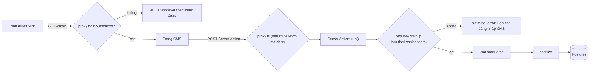

# Kiểm tra dữ liệu và bảo mật

> Phiên bản: `zod` 4.6.7, `sanitize-html` 2.18.1, `next` 16.4.3, `openai` 7.47.0 (theo `node_modules/*/package.json`) · Nguồn: `node_modules/zod/v4/` (`classic/schemas.d.ts`, `core/schemas.js`, `core/api.d.ts`, `core/errors.d.ts`), `node_modules/sanitize-html/README.md` + `index.js`, `node_modules/next/dist/docs/01-app/02-guides/data-security.md`, `03-api-reference/03-file-conventions/proxy.md`, `02-guides/environment-variables.md`, `03-api-reference/02-components/image.md` · Kiểm lần cuối: 2026-11-05 @ 8771851

Hành vi Zod và sanitize-html ghi trong tài liệu này đã được chạy thử bằng `npx tsx` (2026-11-03) và, với phần đã chuyển sang `platform/`, được khoá bằng unit test cạnh nguồn: `platform/html/sanitize.test.ts`, `platform/images.test.ts`, `platform/validation/fields.test.ts`, `platform/auth/basic-auth.test.ts`, `platform/auth/run.test.ts` (`npm test`).

## Tóm tắt cho agent

[BM-01]

- **Mọi** Server Action của CMS — kể cả action chỉ đọc hay gọi AI như `runSeoCheck`, `runThreads` — phải chạy qua `run()` (`platform/auth/run.ts`); `run()` gọi `requireAdmin()` trước mọi thứ. Mọi Route Handler quản trị tự gọi `requireAdmin()` ở đầu hàm. Không dựa vào `proxy.ts`: Server Action là POST tới route đang dùng nó, đổi route hoặc matcher là mất bảo vệ. Chỉ ba ngoại lệ có tên của `[QD-20]` (spine AD-6).
- Mọi dữ liệu từ client vào action phải `safeParse` bằng schema Zod (đích `modules/<miền>/schema.ts`; code cũ `lib/post-input.ts`) ghép từ trường dùng chung `platform/validation/fields.ts`, rồi `throw new UserError(firstError(parsed.error))` khi lỗi. Không tin kiểu TypeScript của tham số.
- Dùng cú pháp **Zod 4**: `z.url({ protocol, error })` (không `z.string().url()`), tham số `error` (không `message`, không `errorMap`), `z.input<>` cho kiểu form, `z.infer<>`/`z.output<>` cho kiểu sau parse.
- HTML thân bài phải qua `sanitizePostHtml()` (`platform/html/sanitize.ts`) khi **ghi** (`savePost`, `createPost`) và khi **hiển thị** (`app/(site)/bai-viet/[slug]/page.tsx:47`). Allowlist không có `a`, `img` (spine AD-22).
- Ảnh từ URL chỉ chấp nhận host trong `IMAGE_HOSTS` (`platform/images.ts:2`). Danh sách này dùng chung cho validate Zod và `next.config.ts` `images.remotePatterns` — chỉ sửa ở một chỗ.
- Link affiliate chỉ nhận domain Shopee chính chủ (`shopeeAffiliateUrl`, `platform/validation/fields.ts:12-25`). Trên website: nguyên link, `target="_blank"`, `rel="sponsored nofollow noopener"` (hiện `components/site/product-card.tsx:34-39`; đích `AffiliateLink` của `modules/products/components`). Không chuyển hướng qua domain của site.
- `.env` không bao giờ commit (`.gitignore:34-35`). Biến mới: thêm vào `.env.example` với giá trị giả. Không đặt bí mật trong biến `NEXT_PUBLIC_*`.
- Website không thu thập dữ liệu cá nhân người đọc (NFR-7). Không thêm analytics, cookie theo dõi, pixel hay ảnh từ host lạ.

## Khái niệm cốt lõi

### [BM-02] Zod 4 khác Zod 3 ở những điểm repo dùng

`import { z } from "zod"` trỏ tới bản classic v4 (`node_modules/zod/index.d.ts`).

| Việc | Zod 4 (dùng) | Zod 3 (không dùng) |
|---|---|---|
| URL | `z.url({ protocol: /^https?$/, error: "..." })` (`classic/schemas.d.ts:216`) | `z.string().url()` — v4 đánh dấu `@deprecated Use z.url()` (`:115-116`) |
| URL http(s) có domain | `z.httpUrl()` (`:217`) | — |
| Thông báo lỗi | `{ error: "..." }` hoặc chuỗi trực tiếp | `message` — v4 `@deprecated` (`core/api.d.ts:8-10`); `errorMap` không còn |
| Enum từ object | `z.enum(obj)` (`:611`) | `z.nativeEnum(obj)` — v4 vẫn có nhưng đã gộp vào `z.enum` |
| Kiểu đầu vào/ra | `z.input<T>`, `z.output<T>` = `z.infer<T>` (`core/core.d.ts:53-63`) | giống |
| Gom lỗi | `z.flattenError`, `z.treeifyError`, `z.prettifyError` (`core/errors.d.ts:157-224`) | `err.flatten()`, `err.format()` — v4 `@deprecated` |

Hành vi `z.url` ở 4.6.7 (`core/schemas.js:225-330`, đã chạy thử):

- Tự `trim()` đầu vào và bỏ tab/xuống dòng; output là chuỗi đã trim, **không** chuẩn hoá trừ khi `normalize: true`.
- Có `protocol` khớp `/^https?$/` thì bắt buộc dạng `http://`/`https://` — `http:x.com`, `javascript:alert(1)`, `ftp://...`, chuỗi rỗng đều bị từ chối.
- **Không** giới hạn hostname nếu không truyền `hostname`.

### [BM-03] Hai lớp kiểm tra quyền CMS



- Lớp 1, `proxy.ts` (Next 16 đổi tên `middleware` thành Proxy, chạy Node.js runtime — `proxy.md:255`): chặn **trang** `/cms`, `/cms/*` trừ đúng `/cms/upload`, và `/api/:path*` (`proxy.ts`; `/cms/upload` tự `requireAdmin()` theo AD-24), trả 401 để trình duyệt hiện hộp đăng nhập.
- Lớp 2, `requireAdmin()` (`platform/auth/require-admin.ts:6-10`): kiểm lại header `authorization` **bên trong** mỗi action. Đây là lớp bắt buộc. Tài liệu Next: Server Function "are handled as POST requests to the route where they are used, so a Proxy matcher that excludes a path will also skip Server Function calls on that path" và "Always verify authentication and authorization inside each Server Function rather than relying on Proxy alone" (`proxy.md:249-251`; `data-security.md:281-291`).
- Trình duyệt tự gửi lại header Basic Auth cho request cùng origin sau khi đăng nhập, nên action gọi từ trang CMS mang theo credentials.
- CSRF: Server Action chỉ nhận POST và Next so `Origin` với `Host`/`X-Forwarded-Host`, lệch là huỷ (`data-security.md:546-552`). Không tắt cơ chế này; chỉ thêm `serverActions.allowedOrigins` khi có reverse proxy đổi host.

### [BM-04] Sanitize HTML bằng allowlist

`sanitize-html` giữ **chỉ** thẻ/thuộc tính/scheme được liệt kê; thẻ ngoài danh sách bị bỏ thẻ nhưng giữ chữ bên trong (`disallowedTagsMode: 'discard'` mặc định, `README.md:253`); nội dung `script`/`style`/`textarea`/... bị bỏ hẳn (`nonTextTags`, `README.md:724`).

## Dự án dùng như thế nào

### [BM-05] Trường dùng chung `platform/validation/fields.ts` và schema `lib/post-input.ts`

Trường dùng chung (`platform/validation/fields.ts`, spine AD-14) — schema module ghép từ đây, không viết lại:

| Trường | Schema | Kết quả sau parse |
|---|---|---|
| `optionalText` | `z.string().trim().transform((s) => s \|\| null)` (`:4`) | `""`/khoảng trắng → `null` |
| `imageUrl` | `trim` → `refine(!s \|\| isAllowedImageUrl(s), "Ảnh phải là link https từ Shopee hoặc đường dẫn trong site")` → `\|\| null` (`:6-10`) | `null` hoặc URL hợp lệ |
| `shopeeAffiliateUrl` | `trim` → `refine`: `new URL(s)` có `protocol === "https:"` và hostname thuộc `shopee.vn`, `s.shopee.vn`, `shope.ee` (`:12-25`) | URL đã trim; host khác, `http:`, chuỗi không phải URL đều bị từ chối với "Link phải thuộc Shopee (shopee.vn, s.shopee.vn, shope.ee)" |

Schema bài (`lib/post-input.ts`, code cũ; đích `modules/posts/schema.ts` và `modules/products/schema.ts`):

| Trường | Schema | Kết quả sau parse |
|---|---|---|
| `price`, `seoTitle`, `seoDescription` | `optionalText` (`:7`, `:19-20`) | `null` khi rỗng |
| `image`, `featuredImage` | `imageUrl` (`:6`, `:15`) | |
| `name` | `z.string().trim().min(1, "Thiếu tên sản phẩm")` (`:5`) | |
| `affiliateUrl` | `shopeeAffiliateUrl` (`:8`) | |
| `title` | `trim().min(1, "Thiếu tiêu đề")` (`:12`) | |
| `slug` | `z.string().trim()` (`:13`) | rỗng → action tự sinh từ tiêu đề |
| `excerpt` | `optionalText.refine(... <= 500, "Tóm tắt tối đa 500 ký tự")` (`:14`) | khớp `@db.VarChar(500)` |
| `category` (Loại bài, ghi vào `Post.postType`) | `z.enum(["MEO_VAT", "GOM_LINK"])` (`:16`, `:29`) | lặp với enum Prisma `PostType` — xem [PR-07] |
| `content` | `z.string()` (`:17`) | **chưa** sanitize; action sanitize sau |
| `tags`, `seoKeywords` | `z.array(z.string().trim().min(1))` (`:18`, `:21`) | |
| `products` | `z.array(productInputSchema)` (`:22`, `:31`) | |
| `useAi` | `z.boolean()` (`:32`) | |

Ba schema xuất ra: `productInputSchema`, `postInputSchema` (lưu bài), `newPostSchema` (tạo bài). Kiểu xuất là **kiểu đầu vào**: `ProductInput`, `PostInput`, `NewPostInput` = `z.input<...>` (`:25-26`, `:34`) — form giữ `""` chứ không `null`; action nhận kiểu đầu vào và tự parse ra kiểu đầu ra.

`firstError` (`platform/validation/errors.ts:3-5`) lấy `issues[0].message`, mặc định "Dữ liệu không hợp lệ". Zod duyệt hết và gom mọi issue (`continue: !def.abort`), nhưng UI chỉ hiện một lỗi.

### [BM-06] Luồng form → Server Action → DB

Form CMS **không** dùng `<form action>`/`FormData`. Client Component giữ state, gọi action như hàm async với object có kiểu:

1. `components/cms/post-editor.tsx:41` dựng `PostInput` từ state (tags/keywords tách bằng dấu phẩy, `:21`).
2. `savePost(id, current())` (`post-editor.tsx:56`) → `app/cms/actions.ts:96`.
3. `run()` → `requireAdmin()` (`platform/auth/run.ts:7`).
4. `postInputSchema.safeParse(input)`; lỗi → `throw new UserError(firstError(...))` (`app/cms/actions.ts:98-99`).
5. `uniqueSlug(...)` (`actions.ts:101`), rồi trong transaction: `sanitizePostHtml(content)` khi ghi `Post`, `replacePostProducts` (`actions.ts:103-111`).
6. `updateTag(POSTS_TAG)` (`actions.ts:112`) — xem [PR-12].
7. `run()` bắt mọi lỗi: `UserError` → `{ ok: false, error: e.message }`; lỗi khác → `console.error` phía server và `{ ok: false, error: "Có lỗi xảy ra, thử lại sau" }` (`platform/auth/run.ts:9-13`); client hiện `toast.error(res.error)` (`post-editor.tsx:57-59`).

Kiểu trả về `Result<T> = ({ ok: true } & T) | { ok: false; error: string }` (`platform/errors.ts:9`). Action không ném lỗi ra client; client luôn kiểm `res.ok`.

`createPost` (`actions.ts:48-94`) parse `newPostSchema`, rồi nếu `useAi` thì cho bản nháp AI qua **cùng** `postInputSchema` với bài viết tay (lọc tag/keyword rỗng, cắt `excerpt` 500 ký tự), lỗi → `UserError("AI trả về bản nháp chưa hợp lệ: …")`, rồi `sanitizePostHtml(content)` (`:55-81`). Bài mới luôn `DRAFT`.

`setPostStatus`, `deletePost` nhận `id` thô và `status` có kiểu union TypeScript (`actions.ts:117`, `:137`) — không có Zod. `setPostStatus` trả `UserError("Không tìm thấy bài viết")` khi `id` lạ (`:120`); `status` lạ bị Prisma từ chối (enum). `deletePost` với `id` lạ: Prisma ném `P2025` (không phải `UserError`) nên client nhận thông báo chung "Có lỗi xảy ra, thử lại sau". Cả hai vẫn sau `requireAdmin()`.

### [BM-07] Zod trong `lib/ai.ts`

- Schema đầu ra AI (`postDraftSchema`, `threadsSchema`, `seoReportSchema`, `lib/ai.ts:36-44,82,103-106`) được truyền vào `zodTextFormat(schema, name)` của `openai/helpers/zod` để ép Structured Output (`:26`). `lib/ai.ts` là code cũ, đích `platform/ai` (spine AD-10).
- `ask<T extends z.ZodType>` trả `res.output_parsed as z.infer<T>` (`:19-30`); `output_parsed` rỗng → ném `UserError` tiếng Việt (`:28`).
- Schema AI chỉ ép **hình dạng**, không ép độ dài/nội dung. Các giới hạn trong prompt (`:52-56`: không link, ảnh, giá; độ dài) là yêu cầu mềm. Hàng rào thật là `postInputSchema` (bản nháp AI qua cùng schema với bài viết tay) và `sanitizePostHtml`. `analyzeSeo` tự kẹp `score` về 0–100 (`:129`).
- Không thêm `.min()`/`.refine()`/`.transform()` vào schema AI mà không kiểm `zodTextFormat` hỗ trợ — chưa kiểm được trong phiên này (xem phần cuối).

### [BM-08] Sanitize thân bài: `platform/html/sanitize.ts`

Cấu hình hiện tại (`platform/html/sanitize.ts:4-13`, spine AD-22):

- Thẻ cho phép: `h2 h3 h4 p br hr strong em b i u ul ol li blockquote figure figcaption table thead tbody tr th td`. **Không** có `a`, `img`, `h1` (trang đã có `h1` tiêu đề), `script`, `style`, `iframe`, `form`, `div`, `span`.
- Thuộc tính: `allowedAttributes: {}` — mọi thuộc tính (`href`, `src`, `class`, `style`, `id`, `on*`) bị bỏ.
- Thẻ ngoài danh sách bị bỏ thẻ nhưng giữ chữ: `<a href="https://shopee.vn/x">Mua</a>` → `Mua`; `` → bị bỏ hẳn. Hành vi khoá bằng `platform/html/sanitize.test.ts`.

Sanitize ở **hai** điểm: khi ghi (`app/cms/actions.ts:79`, `:106`) và khi render (`app/(site)/bai-viet/[slug]/page.tsx:47`), sau đó `withHeadingIds` chèn `id` cho `<h2>` (`platform/html/content.ts:11-21`) — hàm này giả định `<h2>` không còn thuộc tính, điều chỉ đúng vì đã sanitize. HTML được render bằng `dangerouslySetInnerHTML` (`page.tsx:111`). Xem trước trong CMS dùng `<iframe sandbox="">` (`components/cms/post-editor.tsx:171-177`) nên an toàn cả khi chưa sanitize.

**Vì sao thân bài không được chứa link và ảnh.** PRD FR-13: "Thân bài không chứa link, ảnh hay giá; Sản phẩm hiển thị riêng bên dưới"; §7: "Không chèn link nội bộ vào thân bài". Lý do kỹ thuật:

- Link trong thân bài né nơi duy nhất quản lý Link affiliate (Sản phẩm, FR-3) và thuộc tính `rel="sponsored nofollow"` (FR-25).
- `` trong thân bài là thẻ HTML thô, không qua `next/image` và không qua `IMAGE_HOSTS` → trình duyệt người đọc tải thẳng từ host bất kỳ: host đó thấy IP/User-Agent người đọc (trái NFR-7) và ảnh không tối ưu ảnh hưởng Core Web Vitals (NFR-5).

Giá trong thân bài không lọc được bằng allowlist; prompt AI (`lib/ai.ts:52`) cấm, và Vinh duyệt trước khi xuất bản.

### [BM-09] HTTP Basic Auth: `platform/auth/basic-auth.ts`

`isAuthorized(authHeader)` (`platform/auth/basic-auth.ts:7-13`):

- **Fail closed:** thiếu `ADMIN_USERNAME` hoặc `ADMIN_PASSWORD`, hoặc header không bắt đầu bằng `"Basic "` → `false` (`:8-10`). Quên cấu hình env = CMS khoá hẳn, không mở.
- Giải base64 thành `user:pass` (`:11`), so với `${user}:${pass}` bằng `timingSafeEqual` trên **SHA-256 digest** của hai chuỗi (`:3`, `:12`). Băm trước để hai buffer luôn dài 32 byte — `timingSafeEqual` ném lỗi nếu độ dài khác — và để thời gian so không lộ độ dài hay vị trí ký tự sai.
- Dùng `node:crypto`; chạy được trong `proxy.ts` vì Proxy dùng Node.js runtime (`proxy.md:255`).
- Basic Auth chỉ là base64, không mã hoá: production phải chạy HTTPS.
- Không có đăng xuất, khoá sau nhiều lần sai, hay nhiều tài khoản — đúng phạm vi một Người vận hành (NFR-6).

### [BM-10] `proxy.ts`

- `proxy()` trả `NextResponse.next()` khi hợp lệ, ngược lại 401 + `WWW-Authenticate: Basic realm="CMS", charset="UTF-8"` (`proxy.ts:4-10`).
- `matcher: ["/cms", "/cms/((?!upload$).*)", "/api/:path*"]` (`proxy.ts:14`). Loại trừ `/cms/upload` vì proxy chỉ đệm body tối đa 10 MB (AD-24); đã kiểm 2026-11-05: `/cms`, `/cms.rsc`, `/cms/uploads` trả 401, `/cms/upload` lọt proxy. Giá trị matcher phải là hằng số để Next phân tích lúc build (`proxy.md:136`).
- Route **ngoài** matcher là public: `/`, `/[category]`, `/bai-viet/*`, `robots.txt`, `sitemap.xml`. Styleguide nằm ở `/cms/styleguide` nên sau Basic Auth. `robots.ts` chặn index `/cms`, `/api/` (`app/robots.ts:6`) — đó là SEO, không phải bảo mật.

### [BM-11] `requireAdmin()` và `run()`

```ts
// platform/auth/require-admin.ts:6-10
export async function requireAdmin() {
  if (!isAuthorized((await headers()).get("authorization"))) {
    throw new UserError("Bạn cần đăng nhập CMS");
  }
}

// platform/auth/run.ts:5-14
export async function run<T extends object>(fn: () => Promise<T>): Promise<Result<T>> {
  try {
    await requireAdmin();
    return { ok: true, ...(await fn()) };
  } catch (e) {
    if (e instanceof UserError) return { ok: false, error: e.message };
    console.error(e);
    return { ok: false, error: UNEXPECTED_ERROR };
  }
}
```

- Mọi hàm `export async` trong file `"use server"` là một endpoint POST công khai (`data-security.md:281`). Cả 6 action hiện có (`createPost`, `savePost`, `setPostStatus`, `deletePost`, `runSeoCheck`, `runThreads`) đều `return run(...)`. Hàm phụ (`uniqueSlug`, `replacePostProducts`) **không** export nên không thành endpoint.
- `requireAdmin()` chạy **trước** `safeParse` và trước mọi lệnh DB/AI. Action AI (`runSeoCheck`, `runThreads`) cũng phải bảo vệ: chúng tốn quota AI.
- Chỉ `UserError` (`platform/errors.ts:2-7`) được hiện nguyên văn; lỗi khác (Prisma, SDK AI) chỉ ghi log server, client nhận "Có lỗi xảy ra, thử lại sau". Hành vi khoá bằng `platform/auth/run.test.ts`.
- `requireAdmin()` đọc `headers()` nên không được gọi trong hàm `"use cache"` (`use-cache.md:241`).
- Trang CMS đọc DB trực tiếp (`app/cms/page.tsx:24`, `app/cms/posts/[id]/page.tsx:17`; code cũ, đích `cms-queries.ts`) và chỉ được proxy bảo vệ — chúng nằm dưới `/cms` nên đang an toàn; đừng di chuyển truy vấn dữ liệu nháp ra ngoài `/cms`.

### [BM-12] Allowlist host ảnh: `platform/images.ts`

```ts
export const IMAGE_HOSTS = ["down-vn.img.susercontent.com", "cf.shopee.vn"];
```

- `next.config.ts:2,7` import `IMAGE_HOSTS` và map thành `remotePatterns: [{ protocol: "https", hostname }]` cho `next/image`.
- `isAllowedImageUrl` (`platform/images.ts:6-15`) dùng trong `imageUrl` của Zod: chấp nhận đường dẫn tương đối trong site chỉ khi giữ nguyên origin (`new URL(url, SAME_ORIGIN).origin === SAME_ORIGIN`, `:9`), hoặc URL `https:` có hostname **khớp đúng** một phần tử (`includes`, không hỗ trợ wildcard).
- Mọi ảnh public render bằng `next/image` (`components/site/product-card.tsx:17`, `post-card.tsx`, trang bài `page.tsx:96`), nên host lạ sẽ làm `next/image` báo lỗi — validate Zod giúp chặn từ lúc lưu.
- Bị từ chối: `http://cf.shopee.vn/x`, `https://cf.shopee.vn.evil.com/x`, `//evil.com/x.png`, `/\t/evil.com/x.png`. Hành vi khoá bằng `platform/images.test.ts`.

### [BM-13] Bí mật và biến môi trường

| Biến | Phía | Ghi chú |
|---|---|---|
| `DATABASE_URL`, `DIRECT_URL` | server, CLI | xem [PR-05] |
| `ADMIN_USERNAME`, `ADMIN_PASSWORD` | server | thiếu → CMS khoá ([BM-09]) |
| `OPENAI_API_KEY`, `OPENAI_MODEL` | server | thiếu key → `lib/ai.ts:9-11` ném `UserError` tiếng Việt (code cũ, đích `platform/ai`) |
| `NEXT_PUBLIC_SITE_URL` | **nhúng vào bundle client** | chỉ chứa URL công khai (`platform/site.ts:2`) |

- `.gitignore:34-35`: `.env*` bị bỏ qua, trừ `.env.example`. `.env.example` chỉ chứa placeholder (`[PASSWORD]`, `<project-ref>`, key rỗng). Mẫu chuỗi kết nối Supabase trong đó là **giả định** production (spine Deferred), xem [PR-05].
- Biến không có tiền tố `NEXT_PUBLIC_` chỉ có ở Node.js; biến có tiền tố được **inline lúc build** vào JS gửi xuống trình duyệt (`environment-variables.md:156-164`).
- Next tự nạp `.env` cho app; script ngoài Next (`prisma.config.ts`, `prisma/seed.ts`) tự `import "dotenv/config"`.
- Không in giá trị `.env` ra log/terminal/tài liệu. Khi cần biết DB đích, dùng `grep -o '@[^/]*' .env` (chỉ in host:port).
- Thông báo lỗi trả về client qua `run()` là `message` nguyên văn của `UserError` — không đưa bí mật, chuỗi kết nối hay prompt vào message của `UserError`.

### [BM-14] Thuộc tính link affiliate

`components/site/product-card.tsx:34-42` (code cũ; spine AD-11 đặt mọi link tới Shopee vào `AffiliateLink` của `modules/products/components` — đích, chưa có):

```tsx
<a href={product.affiliateUrl} target="_blank" rel="sponsored nofollow noopener" ...>
  Xem trên Shopee
</a>
```

- `sponsored nofollow`: theo FR-25 (đánh dấu link trả tiền với công cụ tìm kiếm, NFR-8). `noopener`: tab Shopee không truy cập được `window.opener`.
- `href` là nguyên `affiliateUrl` lưu trong DB, đã qua `shopeeAffiliateUrl` lúc lưu — không qua `/go/...` hay redirect của site (FR-25, R-7, PRD §7).
- Nhãn công khai affiliate hiện khi bài có ít nhất một sản phẩm (`app/(site)/bai-viet/[slug]/page.tsx:108`, FR-24).

### [BM-15] Bảo mật CMS theo PRD (NFR-6, FR-25)

- **NFR-6:** "chỉ Người vận hành truy cập được CMS và các thao tác ghi. Mọi thao tác ghi đều kiểm tra quyền phía server." → [BM-09]–[BM-11].
- **FR-25:** link affiliate nguyên bản, không qua đường dẫn chuyển hướng của website, `rel="sponsored nofollow"`, mở tab mới → [BM-14].

### [BM-16] Quyền riêng tư người đọc (NFR-7)

- **NFR-7:** "không thu thập dữ liệu cá nhân của người đọc. Lượt xem và Lượt tim chỉ dùng định danh ẩn danh tối thiểu để chống trùng." FR-33 nhắc lại: "Không lưu dữ liệu định danh người đọc."
- Hiện trạng đã kiểm bằng `grep`: site public không có analytics, cookie hay `localStorage` do code ứng dụng đặt, không có pixel. Chỉ `next-themes` (`app/layout.tsx:33`) lưu lựa chọn sáng/tối trong `localStorage` của trình duyệt — không gửi về server. Ảnh public đi qua `next/image` (được tối ưu và phục vụ từ domain của site); thân bài không còn `` ([BM-08]).
- Quy tắc khi thêm tính năng tương tác (Dự kiến FR-33, FR-35): không lưu IP, User-Agent đầy đủ, email hay id tài khoản bên thứ ba; không thêm script bên thứ ba; định danh chống trùng chỉ là giá trị ngẫu nhiên ẩn danh hoặc băm có muối và có hạn dùng.

## Công thức

### [BM-17] Thêm một trường form có validate, từ đầu tới cuối

Ví dụ minh hoạ: thêm `Product.note` (ghi chú ngắn, tuỳ chọn, ≤ 200 ký tự). File cũ bị chạm phải chuyển theo `docs/cong-thuc/chuyen-code-cu.md` trong cùng thay đổi (schema → `modules/products/schema.ts`, `ProductFields`/`emptyProduct` của `components/cms/fields.tsx` → `modules/products/components/`); các bước dưới ghi vị trí sau khi chuyển. Giới hạn 200 khai báo một lần ở `modules/products/constants.ts` (ví dụ `PRODUCT_NOTE_MAX = 200`) và dùng cho cả `@db.VarChar` lẫn Zod (spine AD-14).

1. **DB:** thêm `note String? @db.VarChar(200)` (bằng đúng `PRODUCT_NOTE_MAX`) vào `Product` (`prisma/schema/products.prisma`), chạy migration theo [PR-15].
2. **Zod** (`productInputSchema`), dùng lại trường chung của `platform/validation/fields.ts` và giới hạn khớp DB:

   ```ts
   export const productInputSchema = z.object({
     // ...
     note: optionalText.refine((s) => !s || s.length <= PRODUCT_NOTE_MAX, `Ghi chú tối đa ${PRODUCT_NOTE_MAX} ký tự`),
   });
   ```

   `ProductInput` (`z.input`) tự có `note: string`; output là `string | null`.
3. **Giá trị rỗng ban đầu:** thêm `note: ""` vào `emptyProduct` (sau khi chuyển: `modules/products/components/`; hiện ở `components/cms/fields.tsx:11`) và vào ánh xạ `initial` (`note: p.note ?? ""`) ở `app/cms/posts/[id]/page.tsx:39-44`.
4. **Ô nhập:** thêm `<Input>` trong `ProductFields` (`modules/products/components/`, sau khi chuyển), `onChange={(e) => update(i, { note: e.target.value })}`.
5. **Action:** trường của Sản phẩm đi theo `products` vào `replacePostProducts` (`app/cms/actions.ts:35-46`, kiểu `ProductRow` suy từ `productInputSchema` nên tự có `note`). Trường ở cấp `Post` đi qua `...rest` (`actions.ts:100-106`).
6. **Hiển thị:** nếu là chữ thuần, render bằng JSX `{value}` (React tự escape). Không bao giờ `dangerouslySetInnerHTML` cho trường mới; nếu thật sự cần HTML thì qua `sanitizePostHtml`.
7. **Cache:** nếu trường hiện ở trang public, chắc chắn query có cache (code cũ `lib/posts.ts`, đích `queries.ts` của module) lấy trường đó và action gọi `updateTag`.
8. **Kiểm:** `npm test`, `npx tsc --noEmit`, `npm run lint`; thử lưu giá trị quá dài để thấy toast lỗi tiếng Việt.

### [BM-18] Thêm một Server Action có bảo vệ

Action mới đặt trong `modules/<miền>/actions.ts` của module chủ bảng bị ghi; phần ghi DB ở `service.ts` (spine AD-5, AD-6). Không thêm action vào `app/cms/actions.ts` (code cũ). Khuôn đầy đủ: `docs/cong-thuc/them-server-action.md`.

```ts
// modules/posts/actions.ts
"use server";

import { updateTag } from "next/cache";
import { run } from "@/platform/auth/run";
import { UserError } from "@/platform/errors";
import { firstError } from "@/platform/validation/errors";
import { renamePostInputSchema, type RenamePostInput } from "@/modules/posts/schema";
import { renamePostRecord } from "@/modules/posts/service";
import { POSTS_TAG } from "@/modules/posts/tags";

export async function renamePost(input: RenamePostInput) {
  return run(async () => {
    const parsed = renamePostInputSchema.safeParse(input);
    if (!parsed.success) throw new UserError(firstError(parsed.error));
    await renamePostRecord(parsed.data);
    updateTag(POSTS_TAG);
    return {};
  });
}
```

Quy tắc:

1. Thân hàm export **chỉ** là `return run(async () => { ... })`. Không có lệnh nào chạy trước `run`.
2. Tham số là `unknown` về bản chất: `safeParse` mọi thứ, kể cả `id` (`z.uuid()` khớp `@default(uuid())`). Schema đặt trong `schema.ts` của module, ghép từ `platform/validation/fields.ts`.
3. Ném `UserError` với câu tiếng Việt cho lỗi người dùng; `run` chuyển thành `{ ok: false, error }`. `Error` thường bị thay bằng "Có lỗi xảy ra, thử lại sau".
4. Trả về object tối thiểu client cần (không trả nguyên bản ghi, không trả `content` nếu không cần).
5. Gọi `updateTag` cho tag của mọi module có dữ liệu thay đổi ([PR-12], spine AD-7).
6. Client gọi action và luôn kiểm `res.ok` rồi `toast.error(res.error)` (mẫu `components/cms/post-editor.tsx:55-61`).
7. Không chép `run`; import từ `@/platform/auth/run`.

Ba ngoại lệ không dùng `run()` có tên ở `[QD-20]`. Mọi Route Handler quản trị phải tự gọi `requireAdmin()` (hoặc `isAuthorized(request.headers.get("authorization"))`) đầu hàm, không dựa vào `proxy.ts`; riêng `app/cms/upload/route.ts` (đích, AD-24) nằm ngoài matcher nên gọi `requireAdmin()` trước khi đọc body. Không có endpoint công khai dưới `/api` (spine AD-6).

### [BM-19] Cho phép một host ảnh mới

1. Thêm hostname vào `IMAGE_HOSTS` (`platform/images.ts:2`). Chỉ hostname, không scheme, không path, không wildcard (`isAllowedImageUrl` so khớp đúng).
2. Không sửa `next.config.ts` — nó đọc `IMAGE_HOSTS`. Khởi động lại `next dev` vì `next.config.ts` chỉ đọc lúc khởi động.
3. Cập nhật thông báo lỗi của `imageUrl` (`platform/validation/fields.ts:9`) nếu danh sách nguồn ảnh mô tả trong đó không còn đúng; thêm ca test vào `platform/images.test.ts`.
4. Kiểm: lưu một Sản phẩm với ảnh từ host mới → không báo lỗi; mở trang bài → ảnh hiện, không có lỗi `next/image` "hostname is not configured".
5. Host upload (spine AD-24) phải là host do dự án kiểm soát — không thêm host CDN công cộng cho phép bất kỳ ai đăng ảnh.

### [BM-20] Thêm một biến môi trường bí mật

1. Thêm `TEN_BIEN=""` (giá trị giả) và một dòng comment vào `.env.example`.
2. Đọc ở server bằng `process.env.TEN_BIEN`; thiếu thì ném `UserError` tiếng Việt rõ ràng hoặc fail closed như `platform/auth/basic-auth.ts:10` — không có giá trị mặc định cho bí mật. Đọc trong đúng một file `platform/` ([QU-18]).
3. Không dùng tiền tố `NEXT_PUBLIC_`. Không đọc biến trong Client Component.
4. Báo Vinh thêm biến vào môi trường deploy; agent không tự ghi vào `.env` thật của production.

## Bẫy hay gặp

### [BM-21] Server Action không qua `run()`

- Triệu chứng: action chạy được khi gọi bằng `curl -X POST` không có header `Authorization`.
- Nguyên nhân: action mới viết thẳng logic, hoặc tính toán trước `run`, hoặc tin rằng `proxy.ts` đã chặn.
- Cách đúng: [BM-18]. Review mọi `export async function` trong file `"use server"`.

### [BM-22] Viết Zod theo cú pháp v3

- Triệu chứng: cảnh báo deprecated, hoặc lỗi kiểu ở `errorMap`, `invalid_type_error`, `required_error`.
- Nguyên nhân: kiến thức Zod 3.
- Cách đúng: `z.url({...})`, `z.email()`, `z.uuid()` cấp cao nhất; `{ error: "..." }`; `z.enum(obj)`; `z.treeifyError`/`z.flattenError` thay `err.format()`/`err.flatten()` ([BM-02]).

### [BM-23] Nhầm `z.input` với `z.infer`

- Triệu chứng: form báo lỗi kiểu khi gán `""` cho trường `string | null`, hoặc action nhận `null` ở chỗ form gửi `""`.
- Nguyên nhân: schema có `.transform()` nên input (`string`) khác output (`string | null`).
- Cách đúng: props/state form và tham số action dùng `z.input<>`; dữ liệu sau `safeParse` (ghi DB) dùng `parsed.data` (kiểu output).

### [BM-24] Thông báo lỗi tiếng Anh hiện cho người dùng

- Triệu chứng: toast "Invalid input: expected string, received undefined" (đã chạy thử với `postInputSchema.safeParse({})`).
- Nguyên nhân: issue đầu tiên đến từ kiểm tra kiểu mặc định, không có `error` tuỳ chỉnh; `firstError` chỉ lấy `issues[0]`.
- Cách đúng: gửi đủ trường từ client (giá trị rỗng `""`, `[]` thay vì bỏ trường); với trường người dùng nhập, luôn có thông báo tiếng Việt qua `min(1, "...")`, `refine(..., "...")` hoặc `{ error: "..." }`.

### [BM-25] Tưởng sanitize giữ link trong thân bài

- Triệu chứng: link Shopee dán vào thân bài biến mất, chỉ còn chữ.
- Nguyên nhân: allowlist không có `a` ([BM-08], spine AD-22) — đúng thiết kế.
- Cách đúng: link affiliate chỉ đi qua Sản phẩm (`ProductCard`, đích `AffiliateLink`); không chèn vào `content`.

### [BM-26] Đường dẫn ảnh `//host` lọt validate (đã sửa)

- Triệu chứng cũ: `featuredImage = "//evil.com/x.png"` được lưu.
- Đã sửa ở Story 1.2: `isAllowedImageUrl` chỉ nhận đường dẫn tương đối khi `new URL(url, SAME_ORIGIN).origin` giữ nguyên origin (`platform/images.ts:9`); `//host` và `/\t/host` bị từ chối, có test ở `platform/images.test.ts`.
- Cách đúng: không viết kiểm tra ảnh mới dựa trên `startsWith("/")`; dùng `isAllowedImageUrl`.

### [BM-27] Wildcard trong `IMAGE_HOSTS`

- Triệu chứng: thêm `"*.x"` vào `IMAGE_HOSTS` nhưng Zod từ chối mọi ảnh của host đó, còn `next/image` lại nhận.
- Nguyên nhân: `isAllowedImageUrl` so hostname bằng `includes` (khớp đúng, `platform/images.ts:11`); `remotePatterns` thì hiểu `*` là **một** tầng subdomain, `**` là nhiều tầng (`image.md:568-571`).
- Cách đúng: chỉ thêm hostname cụ thể. Cần wildcard thì sửa cả `isAllowedImageUrl` và mẫu `remotePatterns` cho khớp nhau, kèm test.

### [BM-28] Gọi `requireAdmin()` trong hàm cache

- Triệu chứng: lỗi `next-request-in-use-cache`, có thể chỉ hiện khi `next start`.
- Nguyên nhân: `requireAdmin()` đọc `headers()`.
- Cách đúng: kiểm quyền ở action/page ngoài hàm `"use cache"`; dữ liệu CMS không cache ([PR-12]).

### [BM-29] Tin dữ liệu AI như dữ liệu đã kiểm

- Triệu chứng: bản nháp AI có tiêu đề rỗng, tag chứa khoảng trắng, link/ảnh trong `content`.
- Nguyên nhân: schema AI chỉ ép hình dạng ([BM-07]).
- Cách đúng: mọi đầu ra AI ghi vào DB phải qua sanitize và qua cùng schema Zod với dữ liệu người dùng nhập trước khi ghi — như `createPost` (`app/cms/actions.ts:60-70`, [BM-06]).

### [BM-30] `affiliateUrl` nhận mọi host (đã sửa)

- Triệu chứng cũ: link affiliate trỏ tới trang lạ vẫn lưu được.
- Đã sửa ở Story 1.2: `shopeeAffiliateUrl` (`platform/validation/fields.ts:12-25`) chỉ nhận `https:` và host `shopee.vn`, `s.shopee.vn`, `shope.ee`; có test ở `platform/validation/fields.test.ts`.
- Lưu ý: link tìm kiếm `https://shopee.vn/search?...` của seed vẫn qua vì đúng domain — validate không phân biệt được link affiliate thật.

## Đã làm và dự kiến

Theo PRD `_bmad-output/planning-artifacts/prds/prd-affiliate-project-2026-11-03/prd.md`, `addendum.md` A4 và spine.

### [BM-31] Siết allowlist thân bài theo FR-13

**Đã làm** (Story 1.2, spine AD-22): allowlist không còn `a`, `img`, không còn thuộc tính — xem [BM-08]. Sanitize lúc render áp lên cả bài cũ trong DB.

### [BM-32] Validate Link affiliate theo FR-3/FR-25

**Đã làm** (Story 1.2): `shopeeAffiliateUrl` — xem [BM-05], [BM-30]. Danh sách domain ở `platform/validation/fields.ts:12`; đổi danh sách thì sửa cả test.

### [BM-33] Host upload ảnh

**Dự kiến** (spine AD-24). Upload đi qua `app/cms/upload/route.ts` (ngoài matcher của `proxy.ts`, tự gọi `requireAdmin()` trước khi đọc body, thiếu quyền trả 401 kèm `WWW-Authenticate` cùng realm), kiểm loại và dung lượng phía server, gọi `platform/storage` (đích, chưa có). Host của nơi lưu thêm vào `IMAGE_HOSTS` theo [BM-19].

### [BM-34] Lượt xem, Lượt tim, Tìm kiếm (FR-33, FR-35, FR-36)

**Dự kiến** (spine AD-6, AD-23).

- Là thao tác **từ người đọc chưa đăng nhập** — ngoại lệ có tên của `[QD-20]`: `modules/engagement/actions.ts` (ghi Lượt xem/Lượt tim, đọc số tim) và `posts.searchPosts` (chỉ đọc). Không dùng `run()`/`requireAdmin()` nhưng phải: validate Zod (id bài, không nhận trường khác), giới hạn tần suất trong bộ nhớ tiến trình theo băm IP có thời hạn ngắn (không ghi xuống DB hay log), không lưu dữ liệu định danh (NFR-7, FR-33).
- Không đếm Người vận hành: trình duyệt của Vinh tự đánh dấu khi vào `/cms` và không gửi lượt xem; bỏ qua user-agent bot (AD-23).
- Tìm kiếm không dấu (FR-36): từ khoá người đọc đưa vào truy vấn qua Prisma (tham số hoá), không ghép chuỗi SQL; nếu cần `$queryRaw`, dùng tagged template, không `$queryRawUnsafe`.
- Trang tìm kiếm `noindex` (NFR-8, giả định).

## Checklist khi viết workflow / review

[BM-40] Checklist review bảo mật — dùng nguyên văn.

- [ ] Mọi `export async function` trong file `"use server"` có thân là `return run(async () => ...)`, trừ ba ngoại lệ có tên của `[QD-20]`.
- [ ] Route Handler ngoài matcher (`app/cms/upload/route.ts`) tự gọi `requireAdmin()` trước khi đọc body; không có endpoint công khai dưới `/api`; route CMS mới nằm dưới `/cms`.
- [ ] Không đổi `matcher` của `proxy.ts` theo hướng thu hẹp; không chuyển trang/hành động CMS ra ngoài `/cms`.
- [ ] Mọi đầu vào action đi qua `schema.safeParse` + `firstError`; không có trường nào dùng thẳng từ tham số; ảnh, link affiliate, chữ tuỳ chọn dùng trường chung `platform/validation/fields.ts`.
- [ ] Schema dùng cú pháp Zod 4 (`z.url`, `z.uuid`, `{ error }`, `z.enum`), có thông báo tiếng Việt cho trường người dùng nhập.
- [ ] Giới hạn độ dài trong Zod khớp `@db.VarChar(n)` trong Prisma.
- [ ] Kiểu form/tham số dùng `z.input<>`; dữ liệu ghi DB lấy từ `parsed.data`.
- [ ] HTML từ người dùng hoặc AI qua `sanitizePostHtml` trước khi lưu và trước khi `dangerouslySetInnerHTML`; không có `dangerouslySetInnerHTML` mới cho dữ liệu chưa sanitize (`JsonLd` đã escape `<`).
- [ ] Không chèn link hay ảnh vào `content`; link affiliate chỉ qua Sản phẩm.
- [ ] Link affiliate render với `target="_blank" rel="sponsored nofollow noopener"`, `href` là nguyên link Shopee, không qua redirect của site; render qua `AffiliateLink` khi đã có.
- [ ] URL ảnh mới được validate bằng `isAllowedImageUrl`; host mới thêm vào `IMAGE_HOSTS` (không sửa `remotePatterns` riêng).
- [ ] Ảnh public render bằng `next/image`, không `` thô tới host ngoài.
- [ ] Không có bí mật trong code, log, thông báo lỗi trả về client, hay biến `NEXT_PUBLIC_*`; biến mới có trong `.env.example` với giá trị giả.
- [ ] Không commit `.env*` (trừ `.env.example`).
- [ ] Không thêm analytics, pixel, cookie theo dõi, script bên thứ ba, hay lưu IP/User-Agent người đọc (NFR-7).
- [ ] Lỗi người dùng là `UserError` tiếng Việt; lỗi khác để `run()` thay bằng thông báo chung, không lộ message thô của Prisma/SDK AI.
- [ ] Thay đổi chạm tới [BM-31]–[BM-34] đã đối chiếu FR/NFR tương ứng trong PRD.

## Tham khảo

- `node_modules/zod/v4/classic/schemas.d.ts`, `v4/core/schemas.js` (`$ZodURL`, `validateURL`), `v4/core/api.d.ts`, `v4/core/errors.d.ts`, `v4/core/core.d.ts`, `node_modules/zod/README.md`.
- `node_modules/sanitize-html/README.md` (allowedTags, `disallowedTagsMode`, `allowProtocolRelative`, `simpleTransform`), `node_modules/sanitize-html/index.js:1273`.
- `node_modules/next/dist/docs/01-app/02-guides/data-security.md` (Server Action bảo mật, CSRF).
- `node_modules/next/dist/docs/01-app/03-api-reference/03-file-conventions/proxy.md` (matcher, runtime, Server Function và Proxy).
- `node_modules/next/dist/docs/01-app/01-getting-started/07-mutating-data.md:32`.
- `node_modules/next/dist/docs/01-app/02-guides/environment-variables.md` (`NEXT_PUBLIC_`).
- `node_modules/next/dist/docs/01-app/03-api-reference/02-components/image.md` (`remotePatterns`, wildcard).
- `node_modules/openai/helpers/zod.d.ts` (`zodTextFormat`).
- PRD: `prd.md` NFR-5, NFR-6, NFR-7, NFR-8, FR-3, FR-13, FR-24, FR-25, FR-33, FR-35, §7; `addendum.md` A4.
- Liên quan: `docs/nen-tang-ky-thuat/prisma-7.md` ([PR-05], [PR-07], [PR-12], [PR-15]).
