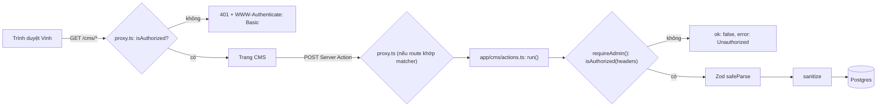

# Kiểm tra dữ liệu và bảo mật

> Phiên bản: `zod` 4.6.7, `sanitize-html` 2.18.1, `next` 16.4.3, `openai` 7.47.0 (theo `node_modules/*/package.json`) · Nguồn: `node_modules/zod/v4/` (`classic/schemas.d.ts`, `core/schemas.js`, `core/api.d.ts`, `core/errors.d.ts`), `node_modules/sanitize-html/README.md` + `index.js`, `node_modules/next/dist/docs/01-app/02-guides/data-security.md`, `03-api-reference/03-file-conventions/proxy.md`, `02-guides/environment-variables.md`, `03-api-reference/02-components/image.md` · Kiểm lần cuối: 2026-11-03 @ dfd7e8f

Hành vi Zod và sanitize-html ghi trong tài liệu này đã được chạy thử bằng `npx tsx` với chính `lib/post-input.ts`, `lib/sanitize.ts`, `lib/images.ts` của repo.

## Tóm tắt cho agent

[BM-01]

- Mọi Server Action trong `app/cms/actions.ts` phải chạy qua `run()` — `run()` gọi `requireAdmin()` trước mọi thứ. Không dựa vào `proxy.ts`: Server Action là POST tới route đang dùng nó, đổi route hoặc matcher là mất bảo vệ.
- Mọi dữ liệu từ client vào action phải `safeParse` bằng schema Zod trong `lib/post-input.ts`, rồi `throw new Error(firstError(parsed.error))` khi lỗi. Không tin kiểu TypeScript của tham số.
- Dùng cú pháp **Zod 4**: `z.url({ protocol, error })` (không `z.string().url()`), tham số `error` (không `message`, không `errorMap`), `z.input<>` cho kiểu form, `z.infer<>`/`z.output<>` cho kiểu sau parse.
- HTML thân bài phải qua `sanitizePostHtml()` khi **ghi** (`savePost`, `createPost`) và khi **hiển thị** (`app/(site)/bai-viet/[slug]/page.tsx:46`).
- Ảnh từ URL chỉ chấp nhận host trong `IMAGE_HOSTS` (`lib/images.ts:3`). Danh sách này dùng chung cho validate Zod và `next.config.ts` `images.remotePatterns` — chỉ sửa ở một chỗ.
- Link affiliate trên website: nguyên link Shopee, `target="_blank"`, `rel="sponsored nofollow noopener"` (`components/site/product-card.tsx:34-39`). Không chuyển hướng qua domain của site.
- `.env` không bao giờ commit (`.gitignore:34-35`). Biến mới: thêm vào `.env.example` với giá trị giả. Không đặt bí mật trong biến `NEXT_PUBLIC_*`.
- Website không thu thập dữ liệu cá nhân người đọc (NFR-7). Không thêm analytics, cookie theo dõi, pixel hay ảnh từ host lạ.

## Khái niệm cốt lõi

### [BM-02] Zod 4 khác Zod 3 ở những điểm repo dùng

`import { z } from "zod"` trỏ tới bản classic v4 (`node_modules/zod/index.d.ts`).

| Việc | Zod 4 (dùng) | Zod 3 (không dùng) |
|---|---|---|
| URL | `z.url({ protocol: /^https?$/, error: "..." })` (`classic/schemas.d.ts:216`) | `z.string().url()` — v4 đánh dấu `@deprecated Use z.url()` (`:115-116`) |
| URL http(s) có domain | `z.httpUrl()` (`:217`) | — |
| Thông báo lỗi | `{ error: "..." }` hoặc chuỗi trực tiếp | `message` — v4 `@deprecated` (`core/api.d.ts:8-10`); `errorMap` không còn |
| Enum từ object | `z.enum(obj)` (`:611`) | `z.nativeEnum(obj)` — v4 vẫn có nhưng đã gộp vào `z.enum` |
| Kiểu đầu vào/ra | `z.input<T>`, `z.output<T>` = `z.infer<T>` (`core/core.d.ts:53-63`) | giống |
| Gom lỗi | `z.flattenError`, `z.treeifyError`, `z.prettifyError` (`core/errors.d.ts:157-224`) | `err.flatten()`, `err.format()` — v4 `@deprecated` |

Hành vi `z.url` ở 4.6.7 (`core/schemas.js:225-330`, đã chạy thử):

- Tự `trim()` đầu vào và bỏ tab/xuống dòng; output là chuỗi đã trim, **không** chuẩn hoá trừ khi `normalize: true`.
- Có `protocol` khớp `/^https?$/` thì bắt buộc dạng `http://`/`https://` — `http:x.com`, `javascript:alert(1)`, `ftp://...`, chuỗi rỗng đều bị từ chối.
- **Không** giới hạn hostname nếu không truyền `hostname`.

### [BM-03] Hai lớp kiểm tra quyền CMS



- Lớp 1, `proxy.ts` (Next 16 đổi tên `middleware` thành Proxy, chạy Node.js runtime — `proxy.md:255`): chặn **trang** `/cms`, `/cms/*` trừ đúng `/cms/upload`, và `/api/:path*` (`proxy.ts`; `/cms/upload` tự `requireAdmin()` theo AD-24), trả 401 để trình duyệt hiện hộp đăng nhập.
- Lớp 2, `requireAdmin()` (`lib/require-admin.ts:5-9`): kiểm lại header `authorization` **bên trong** mỗi action. Đây là lớp bắt buộc. Tài liệu Next: Server Function "are handled as POST requests to the route where they are used, so a Proxy matcher that excludes a path will also skip Server Function calls on that path" và "Always verify authentication and authorization inside each Server Function rather than relying on Proxy alone" (`proxy.md:249-251`; `data-security.md:281-291`).
- Trình duyệt tự gửi lại header Basic Auth cho request cùng origin sau khi đăng nhập, nên action gọi từ trang CMS mang theo credentials.
- CSRF: Server Action chỉ nhận POST và Next so `Origin` với `Host`/`X-Forwarded-Host`, lệch là huỷ (`data-security.md:546-552`). Không tắt cơ chế này; chỉ thêm `serverActions.allowedOrigins` khi có reverse proxy đổi host.

### [BM-04] Sanitize HTML bằng allowlist

`sanitize-html` giữ **chỉ** thẻ/thuộc tính/scheme được liệt kê; thẻ ngoài danh sách bị bỏ thẻ nhưng giữ chữ bên trong (`disallowedTagsMode: 'discard'` mặc định, `README.md:253`); nội dung `script`/`style`/`textarea`/... bị bỏ hẳn (`nonTextTags`, `README.md:724`).

## Dự án dùng như thế nào

### [BM-05] Schema trong `lib/post-input.ts`

| Trường | Schema | Kết quả sau parse |
|---|---|---|
| chữ tuỳ chọn (`price`, `seoTitle`, `seoDescription`) | `optionalText = z.string().trim().transform((s) => s \|\| null)` (`:4`) | `""`/khoảng trắng → `null` |
| ảnh (`image`, `featuredImage`) | `imageUrl`: `trim` → `refine(!s \|\| isAllowedImageUrl(s), "Ảnh phải là link https từ Shopee hoặc Supabase")` → `\|\| null` (`:5-9`) | `null` hoặc URL hợp lệ |
| `name` | `z.string().trim().min(1, "Thiếu tên sản phẩm")` (`:12`) | |
| `affiliateUrl` | `z.url({ protocol: /^https?$/, error: "Link affiliate không hợp lệ" })` (`:15`) | URL đã trim; **mọi host** http(s) đều qua |
| `title` | `trim().min(1, "Thiếu tiêu đề")` (`:19`) | |
| `slug` | `z.string().trim()` (`:20`) | rỗng → action tự sinh từ tiêu đề |
| `excerpt` | `optionalText.refine(... <= 500, "Tóm tắt tối đa 500 ký tự")` (`:21`) | khớp `@db.VarChar(500)` |
| `category` | `z.enum(["MEO_VAT", "GOM_LINK"])` (`:23`, `:36`) | lặp với Prisma enum — xem [PR-07] |
| `content` | `z.string()` (`:24`) | **chưa** sanitize; action sanitize sau |
| `tags`, `seoKeywords` | `z.array(z.string().trim().min(1))` (`:25`, `:28`) | |
| `products` | `z.array(productInputSchema)` (`:29`, `:38`) | |
| `useAi` | `z.boolean()` (`:39`) | |

Ba schema xuất ra: `productInputSchema`, `postInputSchema` (lưu bài), `newPostSchema` (tạo bài). Kiểu xuất là **kiểu đầu vào**: `ProductInput`, `PostInput`, `NewPostInput` = `z.input<...>` (`:32-33`, `:41`) — form giữ `""` chứ không `null`; action nhận kiểu đầu vào và tự parse ra kiểu đầu ra.

`firstError` (`:43-45`) lấy `issues[0].message`, mặc định "Dữ liệu không hợp lệ". Zod duyệt hết và gom mọi issue (`continue: !def.abort`), nhưng UI chỉ hiện một lỗi.

### [BM-06] Luồng form → Server Action → DB

Form CMS **không** dùng `<form action>`/`FormData`. Client Component giữ state, gọi action như hàm async với object có kiểu:

1. `components/cms/post-editor.tsx:41` dựng `PostInput` từ state (tags/keywords tách bằng dấu phẩy, `:21`).
2. `savePost(id, current())` (`post-editor.tsx:56`) → `app/cms/actions.ts:72`.
3. `run()` → `requireAdmin()` (`actions.ts:21-24`).
4. `postInputSchema.safeParse(input)`; lỗi → `throw new Error(firstError(...))` (`actions.ts:74-75`).
5. `sanitizePostHtml(content)`, `uniqueSlug(...)` (`actions.ts:82-83`), ghi Prisma (`actions.ts:78-87`).
6. `updateTag(POSTS_TAG)` (`actions.ts:88`) — xem [PR-12].
7. `run()` bắt mọi lỗi, `console.error` phía server, trả `{ ok: false, error: e.message }` (`actions.ts:25-28`); client hiện `toast.error(res.error)` (`post-editor.tsx:57-59`).

Kiểu trả về `Result<T> = ({ ok: true } & T) | { ok: false; error: string }` (`actions.ts:19`). Action không ném lỗi ra client; client luôn kiểm `res.ok`.

`createPost` (`actions.ts:43-70`) parse `newPostSchema`, rồi nếu `useAi` thì ghi bản nháp AI: chỉ `sanitizePostHtml(draft.content)` và cắt `excerpt` 500 ký tự (`:53-58`) — các trường khác của AI **không** qua `postInputSchema`. Bài mới luôn `DRAFT`; khi Vinh bấm Lưu, toàn bộ bài mới qua `postInputSchema`.

`setPostStatus`, `deletePost` nhận `id` thô và `status` có kiểu union TypeScript (`actions.ts:93,112`) — không có Zod. `status` lạ sẽ bị Prisma từ chối (enum), `id` lạ ném lỗi "not found"; cả hai vẫn sau `requireAdmin()`.

### [BM-07] Zod trong `lib/ai.ts`

- Schema đầu ra AI (`postDraftSchema`, `threadsSchema`, `seoReportSchema`, `lib/ai.ts:35-43,81,102-105`) được truyền vào `zodTextFormat(schema, name)` của `openai/helpers/zod` để ép Structured Output (`:25`).
- `ask<T extends z.ZodType>` trả `res.output_parsed as z.infer<T>` (`:18-29`); `output_parsed` rỗng → ném lỗi tiếng Việt (`:27`).
- Schema AI chỉ ép **hình dạng**, không ép độ dài/nội dung. Các giới hạn trong prompt (`:51-55`: không link, ảnh, giá; độ dài) là yêu cầu mềm. Hàng rào thật là `sanitizePostHtml`, `slice(0, 500)`, và `postInputSchema` khi lưu. `analyzeSeo` tự kẹp `score` về 0–100 (`:128`).
- Không thêm `.min()`/`.refine()`/`.transform()` vào schema AI mà không kiểm `zodTextFormat` hỗ trợ — chưa kiểm được trong phiên này (xem phần cuối).

### [BM-08] Sanitize thân bài: `lib/sanitize.ts`

Cấu hình hiện tại (`lib/sanitize.ts:4-20`):

- Thẻ cho phép: `h2 h3 h4 p br hr strong em b i u ul ol li blockquote a img figure figcaption table thead tbody tr th td`. Không có `h1` (trang đã có `h1` tiêu đề), `script`, `style`, `iframe`, `form`, `div`, `span`.
- Thuộc tính: chỉ `a[href title target rel]`, `img[src alt width height]`. Mọi `class`, `style`, `id`, `on*` bị bỏ.
- Scheme: `http`, `https`, `mailto`. `javascript:` bị bỏ `href`. `allowProtocolRelative` để mặc định `true` (`README.md:193`) → `href="//evil.com"` **được giữ** (đã chạy thử).
- `transformTags.a = simpleTransform("a", { rel: "noopener" })`: `simpleTransform` mặc định **merge và ghi đè** (`index.js:1273-1291`) → mọi `<a>` có `rel="noopener"`, `rel` tác giả viết (kể cả `sponsored nofollow`) bị thay.
- Chạy thử: `<a href="https://shopee.vn/x" rel="sponsored nofollow">` → `rel="noopener"`; `` → giữ nguyên `src`; `<h1>`, `<script>`, `<iframe>`, `style`, `class`, `onerror` → bị bỏ.

Sanitize ở **hai** điểm: khi ghi (`app/cms/actions.ts:56,82`) và khi render (`app/(site)/bai-viet/[slug]/page.tsx:46`), sau đó `withHeadingIds` chèn `id` cho `<h2>` (`lib/content.ts:11-21`) — hàm này giả định `<h2>` không còn thuộc tính, điều chỉ đúng vì đã sanitize. HTML được render bằng `dangerouslySetInnerHTML` (`page.tsx:111`). Xem trước trong CMS dùng `<iframe sandbox="">` (`components/cms/post-editor.tsx:171-177`) nên an toàn cả khi chưa sanitize.

**Vì sao thân bài không được chứa link và ảnh.** PRD FR-13: "Thân bài không chứa link, ảnh hay giá; Sản phẩm hiển thị riêng bên dưới"; §7: "Không chèn link nội bộ vào thân bài". Lý do kỹ thuật:

- Link trong thân bài mất `sponsored nofollow` do transform ở trên → vi phạm FR-25 nếu là link Shopee, và né được nơi duy nhất quản lý Link affiliate (Sản phẩm, FR-3).
- `` trong thân bài là thẻ HTML thô, không qua `next/image` và không qua `IMAGE_HOSTS` → trình duyệt người đọc tải thẳng từ host bất kỳ: host đó thấy IP/User-Agent người đọc (trái NFR-7) và ảnh không tối ưu ảnh hưởng Core Web Vitals (NFR-5).

Hiện trạng: allowlist **vẫn cho** `a` và `img`; chỉ prompt AI (`lib/ai.ts:51`) cấm. Khi Vinh dán HTML tay, link/ảnh vẫn lọt. Siết allowlist là **Dự kiến** — xem [BM-31]. Cho tới lúc đó: không viết code mới chèn link/ảnh vào `content`, và không dựa vào sanitize để chặn chúng.

### [BM-09] HTTP Basic Auth: `lib/auth.ts`

`isAuthorized(authHeader)` (`lib/auth.ts:7-13`):

- **Fail closed:** thiếu `ADMIN_USERNAME` hoặc `ADMIN_PASSWORD`, hoặc header không bắt đầu bằng `"Basic "` → `false` (`:8-10`). Quên cấu hình env = CMS khoá hẳn, không mở.
- Giải base64 thành `user:pass` (`:11`), so với `${user}:${pass}` bằng `timingSafeEqual` trên **SHA-256 digest** của hai chuỗi (`:3`, `:12`). Băm trước để hai buffer luôn dài 32 byte — `timingSafeEqual` ném lỗi nếu độ dài khác — và để thời gian so không lộ độ dài hay vị trí ký tự sai.
- Dùng `node:crypto`; chạy được trong `proxy.ts` vì Proxy dùng Node.js runtime (`proxy.md:255`).
- Basic Auth chỉ là base64, không mã hoá: production phải chạy HTTPS.
- Không có đăng xuất, khoá sau nhiều lần sai, hay nhiều tài khoản — đúng phạm vi một Người vận hành (NFR-6).

### [BM-10] `proxy.ts`

- `proxy()` trả `NextResponse.next()` khi hợp lệ, ngược lại 401 + `WWW-Authenticate: Basic realm="CMS", charset="UTF-8"` (`proxy.ts:4-10`).
- `matcher: ["/cms", "/cms/((?!upload$).*)", "/api/:path*"]` (`proxy.ts`). Loại trừ `/cms/upload` vì proxy chỉ đệm body tối đa 10 MB (AD-24); đã kiểm 2026-11-05: `/cms`, `/cms.rsc`, `/cms/uploads` trả 401, `/cms/upload` lọt proxy. Giá trị matcher phải là hằng số để Next phân tích lúc build (`proxy.md:136`).
- Route **ngoài** matcher là public: `/`, `/[category]`, `/bai-viet/*`, `/styleguide`, `robots.txt`, `sitemap.xml`. `robots.ts` chặn index `/cms`, `/api/`, `/styleguide` (`app/robots.ts:6`) — đó là SEO, không phải bảo mật.

### [BM-11] `requireAdmin()` và `run()`

```ts
// lib/require-admin.ts
export async function requireAdmin() {
  if (!isAuthorized((await headers()).get("authorization"))) {
    throw new Error("Unauthorized");
  }
}

// app/cms/actions.ts:21-29
async function run<T extends object>(fn: () => Promise<T>): Promise<Result<T>> {
  try {
    await requireAdmin();
    return { ok: true, ...(await fn()) };
  } catch (e) {
    console.error(e);
    return { ok: false, error: e instanceof Error ? e.message : "Có lỗi xảy ra" };
  }
}
```

- Mọi hàm `export async` trong file `"use server"` là một endpoint POST công khai (`data-security.md:281`). Cả 6 action hiện có (`createPost`, `savePost`, `setPostStatus`, `deletePost`, `runSeoCheck`, `runThreads`) đều `return run(...)`. Hàm phụ (`uniqueSlug`, `productRows`) **không** export nên không thành endpoint.
- `requireAdmin()` chạy **trước** `safeParse` và trước mọi lệnh DB/AI. Action AI (`runSeoCheck`, `runThreads`) cũng phải bảo vệ: chúng tiêu tiền OpenAI.
- `requireAdmin()` đọc `headers()` nên không được gọi trong hàm `"use cache"` (`use-cache.md:241`).
- Trang CMS đọc DB trực tiếp (`app/cms/page.tsx:24`, `app/cms/posts/[id]/page.tsx:17`) và chỉ được proxy bảo vệ — chúng nằm dưới `/cms` nên đang an toàn; đừng di chuyển truy vấn dữ liệu nháp ra ngoài `/cms`.

### [BM-12] Allowlist host ảnh: `lib/images.ts`

```ts
export const IMAGE_HOSTS = ["down-vn.img.susercontent.com", "cf.shopee.vn", "*.supabase.co"];
```

- `next.config.ts:2,7` import `IMAGE_HOSTS` và map thành `remotePatterns: [{ protocol: "https", hostname }]` cho `next/image`.
- `isAllowedImageUrl` (`lib/images.ts:5-16`) dùng trong `imageUrl` của Zod: chấp nhận đường dẫn bắt đầu bằng `/` (ảnh trong `public/`), hoặc URL `https:` có hostname khớp; `"*.x"` khớp bằng `hostname.endsWith(".x")`.
- Mọi ảnh public render bằng `next/image` (`components/site/product-card.tsx:17`, `post-card.tsx`, trang bài `page.tsx:96`), nên host lạ sẽ làm `next/image` báo lỗi — validate Zod giúp chặn từ lúc lưu.
- Chạy thử: `http://cf.shopee.vn/x` → từ chối; `https://cf.shopee.vn.evil.com/x` → từ chối; `https://a.b.supabase.co/x` → **chấp nhận**; `//evil.com/x.png` → **chấp nhận** (vì bắt đầu bằng `/`). Xem [BM-26], [BM-27].

### [BM-13] Bí mật và biến môi trường

| Biến | Phía | Ghi chú |
|---|---|---|
| `DATABASE_URL`, `DIRECT_URL` | server, CLI | xem [PR-05] |
| `ADMIN_USERNAME`, `ADMIN_PASSWORD` | server | thiếu → CMS khoá ([BM-09]) |
| `OPENAI_API_KEY`, `OPENAI_MODEL` | server | thiếu key → `lib/ai.ts:9-11` ném lỗi tiếng Việt |
| `NEXT_PUBLIC_SITE_URL` | **nhúng vào bundle client** | chỉ chứa URL công khai (`lib/site.ts:2`) |

- `.gitignore:34-35`: `.env*` bị bỏ qua, trừ `.env.example`. `.env.example` chỉ chứa placeholder (`[PASSWORD]`, `<project-ref>`, key rỗng).
- Biến không có tiền tố `NEXT_PUBLIC_` chỉ có ở Node.js; biến có tiền tố được **inline lúc build** vào JS gửi xuống trình duyệt (`environment-variables.md:156-164`).
- Next tự nạp `.env` cho app; script ngoài Next (`prisma.config.ts`, `prisma/seed.ts`) tự `import "dotenv/config"`.
- Không in giá trị `.env` ra log/terminal/tài liệu. Khi cần biết DB đích, dùng `grep -o '@[^/]*' .env` (chỉ in host:port).
- Thông báo lỗi trả về client qua `run()` là `e.message` nguyên văn — không đưa bí mật, chuỗi kết nối hay prompt vào message của `Error`.

### [BM-14] Thuộc tính link affiliate

`components/site/product-card.tsx:34-42`:

```tsx
<a href={product.affiliateUrl} target="_blank" rel="sponsored nofollow noopener" ...>
  Xem trên Shopee
</a>
```

- `sponsored nofollow`: theo FR-25 (đánh dấu link trả tiền với công cụ tìm kiếm, NFR-8). `noopener`: tab Shopee không truy cập được `window.opener`.
- `href` là nguyên `affiliateUrl` lưu trong DB — không qua `/go/...` hay redirect của site (FR-25, R-7, PRD §7).
- Nhãn công khai affiliate hiện khi bài có ít nhất một sản phẩm (`app/(site)/bai-viet/[slug]/page.tsx:108`, FR-24).

### [BM-15] Bảo mật CMS theo PRD (NFR-6, FR-25)

- **NFR-6:** "chỉ Người vận hành truy cập được CMS và các thao tác ghi. Mọi thao tác ghi đều kiểm tra quyền phía server." → [BM-09]–[BM-11].
- **FR-25:** link affiliate nguyên bản, không qua đường dẫn chuyển hướng của website, `rel="sponsored nofollow"`, mở tab mới → [BM-14].

### [BM-16] Quyền riêng tư người đọc (NFR-7)

- **NFR-7:** "không thu thập dữ liệu cá nhân của người đọc. Lượt xem và Lượt tim chỉ dùng định danh ẩn danh tối thiểu để chống trùng." FR-33 nhắc lại: "Không lưu dữ liệu định danh người đọc."
- Hiện trạng đã kiểm bằng `grep`: site public không có analytics, cookie hay `localStorage` do code ứng dụng đặt, không có pixel. Chỉ `next-themes` (`app/layout.tsx:33`) lưu lựa chọn sáng/tối trong `localStorage` của trình duyệt — không gửi về server. Ảnh public đi qua `next/image` (được tối ưu và phục vụ từ domain của site). Ngoại lệ: `` trong thân bài ([BM-08]).
- Quy tắc khi thêm tính năng tương tác (Dự kiến FR-33, FR-35): không lưu IP, User-Agent đầy đủ, email hay id tài khoản bên thứ ba; không thêm script bên thứ ba; định danh chống trùng chỉ là giá trị ngẫu nhiên ẩn danh hoặc băm có muối và có hạn dùng.

## Công thức

### [BM-17] Thêm một trường form có validate, từ đầu tới cuối

Ví dụ minh hoạ: thêm `Product.note` (ghi chú ngắn, tuỳ chọn, ≤ 200 ký tự).

1. **DB:** thêm `note String? @db.VarChar(200)` vào `Product`, chạy migration theo [PR-15].
2. **Zod** (`lib/post-input.ts`), dùng lại helper sẵn có và giới hạn khớp DB:

   ```ts
   export const productInputSchema = z.object({
     // ...
     note: optionalText.refine((s) => !s || s.length <= 200, "Ghi chú tối đa 200 ký tự"),
   });
   ```

   `ProductInput` (`z.input`) tự có `note: string`; output là `string | null`.
3. **Giá trị rỗng ban đầu:** thêm `note: ""` vào `emptyProduct` (`components/cms/fields.tsx:11`) và vào ánh xạ `initial` (`note: p.note ?? ""`) ở `app/cms/posts/[id]/page.tsx:39-44`.
4. **Ô nhập:** thêm `<Input>` trong `ProductFields` (`components/cms/fields.tsx`), `onChange={(e) => update(i, { note: e.target.value })}`.
5. **Action:** không cần sửa `savePost` nếu trường đi theo `products` (spread qua `productRows`, `app/cms/actions.ts:40-41`) — nhưng phải sửa kiểu tham số `productRows` để có `note`. Trường ở cấp `Post` đi qua `...rest` (`actions.ts:76-81`).
6. **Hiển thị:** nếu là chữ thuần, render bằng JSX `{value}` (React tự escape). Không bao giờ `dangerouslySetInnerHTML` cho trường mới; nếu thật sự cần HTML thì qua `sanitizePostHtml`.
7. **Cache:** nếu trường hiện ở trang public, chắc chắn hàm đọc trong `lib/posts.ts` lấy trường đó và action gọi `updateTag`.
8. **Kiểm:** `npx tsc --noEmit`, `npm run lint`; thử lưu giá trị quá dài để thấy toast lỗi tiếng Việt.

### [BM-18] Thêm một Server Action có bảo vệ

```ts
// app/cms/actions.ts — thêm vào cuối file, KHÔNG tạo file "use server" mới trừ khi cần
const renameSchema = z.object({ id: z.uuid(), title: z.string().trim().min(1, "Thiếu tiêu đề") });

export async function renamePost(input: z.input<typeof renameSchema>) {
  return run(async () => {
    const parsed = renameSchema.safeParse(input);
    if (!parsed.success) throw new Error(firstError(parsed.error));
    const { id, title } = parsed.data;
    await db.post.update({ where: { id }, data: { title }, select: { id: true } });
    updateTag(POSTS_TAG);
    return {};
  });
}
```

Quy tắc:

1. Thân hàm export **chỉ** là `return run(async () => { ... })`. Không có lệnh nào chạy trước `run`.
2. Tham số là `unknown` về bản chất: `safeParse` mọi thứ, kể cả `id` (`z.uuid()` khớp `@default(uuid())`). Schema dùng lại nên đặt trong `lib/post-input.ts`.
3. Ném `Error` với câu tiếng Việt cho lỗi người dùng; `run` chuyển thành `{ ok: false, error }`.
4. Trả về object tối thiểu client cần (không trả nguyên bản ghi, không trả `content` nếu không cần).
5. Gọi `updateTag` cho mọi tag cache bị ảnh hưởng ([PR-12]).
6. Client gọi action và luôn kiểm `res.ok` rồi `toast.error(res.error)` (mẫu `components/cms/post-editor.tsx:55-63`).
7. File action mới (nếu buộc phải tách) cũng phải `"use server"` ở dòng 1 và có hàm `run` tương đương gọi `requireAdmin()`; tốt hơn là import `run` dùng chung thay vì chép.

Route Handler mới dưới `app/api/` cũng phải tự gọi `requireAdmin()` (hoặc `isAuthorized(request.headers.get("authorization"))`) đầu hàm, dù `proxy.ts` đã chặn `/api/:path*`.

### [BM-19] Cho phép một host ảnh mới

1. Thêm hostname vào `IMAGE_HOSTS` (`lib/images.ts:3`). Chỉ hostname, không scheme, không path. Ưu tiên host cụ thể; chỉ dùng `"*.x"` khi host con thay đổi theo tài khoản (như Supabase project ref).
2. Không sửa `next.config.ts` — nó đọc `IMAGE_HOSTS`. Khởi động lại `next dev` vì `next.config.ts` chỉ đọc lúc khởi động.
3. Cập nhật thông báo lỗi ở `lib/post-input.ts:8` nếu danh sách nguồn ảnh mô tả trong đó không còn đúng.
4. Kiểm: lưu một Sản phẩm với ảnh từ host mới → không báo lỗi; mở trang bài → ảnh hiện, không có lỗi `next/image` "hostname is not configured".
5. Host upload (A4, Câu hỏi mở 1 của PRD) phải là host do dự án kiểm soát — không thêm host CDN công cộng cho phép bất kỳ ai đăng ảnh.

### [BM-20] Thêm một biến môi trường bí mật

1. Thêm `TEN_BIEN=""` (giá trị giả) và một dòng comment vào `.env.example`.
2. Đọc ở server bằng `process.env.TEN_BIEN`; thiếu thì ném lỗi tiếng Việt rõ ràng hoặc fail closed như `lib/auth.ts:10` — không có giá trị mặc định cho bí mật.
3. Không dùng tiền tố `NEXT_PUBLIC_`. Không đọc biến trong Client Component.
4. Báo Vinh thêm biến vào môi trường deploy; agent không tự ghi vào `.env` thật của production.

## Bẫy hay gặp

### [BM-21] Server Action không qua `run()`

- Triệu chứng: action chạy được khi gọi bằng `curl -X POST` không có header `Authorization`.
- Nguyên nhân: action mới viết thẳng logic, hoặc tính toán trước `run`, hoặc tin rằng `proxy.ts` đã chặn.
- Cách đúng: [BM-18]. Review mọi `export async function` trong file `"use server"`.

### [BM-22] Viết Zod theo cú pháp v3

- Triệu chứng: cảnh báo deprecated, hoặc lỗi kiểu ở `errorMap`, `invalid_type_error`, `required_error`.
- Nguyên nhân: kiến thức Zod 3.
- Cách đúng: `z.url({...})`, `z.email()`, `z.uuid()` cấp cao nhất; `{ error: "..." }`; `z.enum(obj)`; `z.treeifyError`/`z.flattenError` thay `err.format()`/`err.flatten()` ([BM-02]).

### [BM-23] Nhầm `z.input` với `z.infer`

- Triệu chứng: form báo lỗi kiểu khi gán `""` cho trường `string | null`, hoặc action nhận `null` ở chỗ form gửi `""`.
- Nguyên nhân: schema có `.transform()` nên input (`string`) khác output (`string | null`).
- Cách đúng: props/state form và tham số action dùng `z.input<>`; dữ liệu sau `safeParse` (ghi DB) dùng `parsed.data` (kiểu output).

### [BM-24] Thông báo lỗi tiếng Anh hiện cho người dùng

- Triệu chứng: toast "Invalid input: expected string, received undefined" (đã chạy thử với `postInputSchema.safeParse({})`).
- Nguyên nhân: issue đầu tiên đến từ kiểm tra kiểu mặc định, không có `error` tuỳ chỉnh; `firstError` chỉ lấy `issues[0]`.
- Cách đúng: gửi đủ trường từ client (giá trị rỗng `""`, `[]` thay vì bỏ trường); với trường người dùng nhập, luôn có thông báo tiếng Việt qua `min(1, "...")`, `refine(..., "...")` hoặc `{ error: "..." }`.

### [BM-25] Tưởng sanitize giữ `rel` của link

- Triệu chứng: link Shopee trong thân bài không có `sponsored nofollow`.
- Nguyên nhân: `simpleTransform("a", { rel: "noopener" })` ghi đè `rel` ([BM-08]).
- Cách đúng: link affiliate chỉ đi qua Sản phẩm/`ProductCard`; không chèn vào `content`.

### [BM-26] Đường dẫn ảnh `//host` lọt validate

- Triệu chứng: `featuredImage = "//evil.com/x.png"` được lưu.
- Nguyên nhân: `isAllowedImageUrl` chấp nhận mọi chuỗi bắt đầu bằng `/` (`lib/images.ts:6`); `"//..."` là URL protocol-relative tới host khác.
- Cách đúng: khi sửa `lib/images.ts`, chấp nhận đường dẫn nội bộ bằng `url.startsWith("/") && !url.startsWith("//")`. Đừng viết thêm kiểm tra ảnh mới dựa trên `startsWith("/")`.

### [BM-27] Wildcard của `IMAGE_HOSTS` không khớp `next/image`

- Triệu chứng: Zod nhận `https://a.b.supabase.co/...` nhưng trang lỗi "hostname is not configured".
- Nguyên nhân: `isAllowedImageUrl` khớp `"*.x"` bằng `endsWith` (mọi tầng subdomain); `remotePatterns` hiểu `*` là **một** tầng subdomain, `**` mới là nhiều tầng (`image.md:568-571`).
- Cách đúng: chỉ dùng `"*.x"` cho host một tầng; khi cần nhiều tầng, sửa cả `isAllowedImageUrl` và mẫu `**` cho khớp nhau.

### [BM-28] Gọi `requireAdmin()` trong hàm cache

- Triệu chứng: lỗi `next-request-in-use-cache`, có thể chỉ hiện khi `next start`.
- Nguyên nhân: `requireAdmin()` đọc `headers()`.
- Cách đúng: kiểm quyền ở action/page ngoài hàm `"use cache"`; dữ liệu CMS không cache ([PR-12]).

### [BM-29] Tin dữ liệu AI như dữ liệu đã kiểm

- Triệu chứng: bản nháp AI có tiêu đề rỗng, tag chứa khoảng trắng, link/ảnh trong `content`.
- Nguyên nhân: schema AI chỉ ép hình dạng; `createPost` không chạy `postInputSchema` trên bản nháp ([BM-06], [BM-07]).
- Cách đúng: mọi đầu ra AI ghi vào DB phải qua sanitize và, nếu là trường người dùng sửa được, qua schema Zod tương ứng trước khi ghi.

### [BM-30] `affiliateUrl` nhận mọi host

- Triệu chứng: link affiliate trỏ tới trang lạ hoặc `shopee.vn/search?...` vẫn lưu được.
- Nguyên nhân: `z.url` chỉ ép `http(s)` (`lib/post-input.ts:15`), không có `hostname`.
- Cách đúng: hiện chấp nhận (Vinh là người duy nhất nhập). Khi làm FR-3, thêm `hostname` regex cho domain Shopee — xem [BM-32].

## Dự kiến

**Dự kiến** — chưa có trong code, theo PRD `_bmad-output/planning-artifacts/prds/prd-affiliate-project-2026-11-03/prd.md` và `addendum.md` A4.

### [BM-31] Siết allowlist thân bài theo FR-13

**Dự kiến.** Bỏ `a`, `img`, `figure`, `figcaption` khỏi `allowedTags` (và thuộc tính tương ứng) trong `lib/sanitize.ts` để sanitize thực thi "thân bài không chứa link, ảnh". Trước khi siết: kiểm bài đang có trong DB có dùng các thẻ này không, vì sanitize lúc render sẽ xoá chúng khỏi trang public ngay.

### [BM-32] Validate Link affiliate theo FR-3/FR-25

**Dự kiến.** `affiliateUrl` chỉ nhận link Shopee chính chủ (ví dụ `z.url({ protocol: /^https$/, hostname: /.../, error: "..." })`); link tìm kiếm của seed sẽ bị từ chối (A4). Danh sách domain Shopee chính xác chưa xác minh — cần Vinh chốt.

### [BM-33] Host upload ảnh

**Dự kiến.** Thêm host lưu trữ upload vào `IMAGE_HOSTS` khi chốt Câu hỏi mở 1 (A4), theo [BM-19]. Upload phải qua Server Action có `requireAdmin()` và kiểm loại/kích thước file phía server.

### [BM-34] Lượt xem, Lượt tim, Tìm kiếm (FR-33, FR-35, FR-36)

**Dự kiến.**

- Là thao tác ghi **từ người đọc chưa đăng nhập** — ngoại lệ duy nhất với NFR-6, nên không dùng `run()`/`requireAdmin()` nhưng phải: validate Zod (id bài, không nhận trường khác), giới hạn tần suất (FR-35: giả định ≤ 30 lần/phút mỗi nguồn), không lưu dữ liệu định danh (NFR-7, FR-33).
- Không đếm Người vận hành khi đang đăng nhập CMS (FR-33, giả định) — kiểm bằng `isAuthorized` trên header, không bằng cookie theo dõi.
- Tìm kiếm không dấu (FR-36): từ khoá người đọc đưa vào truy vấn qua Prisma (tham số hoá), không ghép chuỗi SQL; nếu cần `$queryRaw`, dùng tagged template, không `$queryRawUnsafe`.
- Trang tìm kiếm `noindex` (NFR-8, giả định).

## Checklist khi viết workflow / review

[BM-40] Checklist review bảo mật — dùng nguyên văn.

- [ ] Mọi `export async function` trong file `"use server"` có thân là `return run(async () => ...)` (hoặc gọi `requireAdmin()` ở dòng đầu tiên).
- [ ] Route Handler mới dưới `app/api/` tự kiểm quyền; route CMS mới nằm dưới `/cms`.
- [ ] Không đổi `matcher` của `proxy.ts` theo hướng thu hẹp; không chuyển trang/hành động CMS ra ngoài `/cms`.
- [ ] Mọi đầu vào action đi qua `schema.safeParse` + `firstError`; không có trường nào dùng thẳng từ tham số.
- [ ] Schema dùng cú pháp Zod 4 (`z.url`, `z.uuid`, `{ error }`, `z.enum`), có thông báo tiếng Việt cho trường người dùng nhập.
- [ ] Giới hạn độ dài trong Zod khớp `@db.VarChar(n)` trong Prisma.
- [ ] Kiểu form/tham số dùng `z.input<>`; dữ liệu ghi DB lấy từ `parsed.data`.
- [ ] HTML từ người dùng hoặc AI qua `sanitizePostHtml` trước khi lưu và trước khi `dangerouslySetInnerHTML`; không có `dangerouslySetInnerHTML` mới cho dữ liệu chưa sanitize (`JsonLd` đã escape `<`).
- [ ] Không chèn link hay ảnh vào `content`; link affiliate chỉ qua Sản phẩm.
- [ ] Link affiliate render với `target="_blank" rel="sponsored nofollow noopener"`, `href` là nguyên link Shopee, không qua redirect của site.
- [ ] URL ảnh mới được validate bằng `isAllowedImageUrl`; host mới thêm vào `IMAGE_HOSTS` (không sửa `remotePatterns` riêng).
- [ ] Ảnh public render bằng `next/image`, không `` thô tới host ngoài.
- [ ] Không có bí mật trong code, log, thông báo lỗi trả về client, hay biến `NEXT_PUBLIC_*`; biến mới có trong `.env.example` với giá trị giả.
- [ ] Không commit `.env*` (trừ `.env.example`).
- [ ] Không thêm analytics, pixel, cookie theo dõi, script bên thứ ba, hay lưu IP/User-Agent người đọc (NFR-7).
- [ ] Lỗi người dùng là `Error` tiếng Việt; không để lộ message thô của Prisma/OpenAI có thể chứa chi tiết hạ tầng.
- [ ] Thay đổi chạm tới [BM-31]–[BM-34] đã đối chiếu FR/NFR tương ứng trong PRD.

## Tham khảo

- `node_modules/zod/v4/classic/schemas.d.ts`, `v4/core/schemas.js` (`$ZodURL`, `validateURL`), `v4/core/api.d.ts`, `v4/core/errors.d.ts`, `v4/core/core.d.ts`, `node_modules/zod/README.md`.
- `node_modules/sanitize-html/README.md` (allowedTags, `disallowedTagsMode`, `allowProtocolRelative`, `simpleTransform`), `node_modules/sanitize-html/index.js:1273`.
- `node_modules/next/dist/docs/01-app/02-guides/data-security.md` (Server Action bảo mật, CSRF).
- `node_modules/next/dist/docs/01-app/03-api-reference/03-file-conventions/proxy.md` (matcher, runtime, Server Function và Proxy).
- `node_modules/next/dist/docs/01-app/01-getting-started/07-mutating-data.md:32`.
- `node_modules/next/dist/docs/01-app/02-guides/environment-variables.md` (`NEXT_PUBLIC_`).
- `node_modules/next/dist/docs/01-app/03-api-reference/02-components/image.md` (`remotePatterns`, wildcard).
- `node_modules/openai/helpers/zod.d.ts` (`zodTextFormat`).
- PRD: `prd.md` NFR-5, NFR-6, NFR-7, NFR-8, FR-3, FR-13, FR-24, FR-25, FR-33, FR-35, §7; `addendum.md` A4.
- Liên quan: `docs/nen-tang-ky-thuat/prisma-7.md` ([PR-05], [PR-07], [PR-12], [PR-15]).
