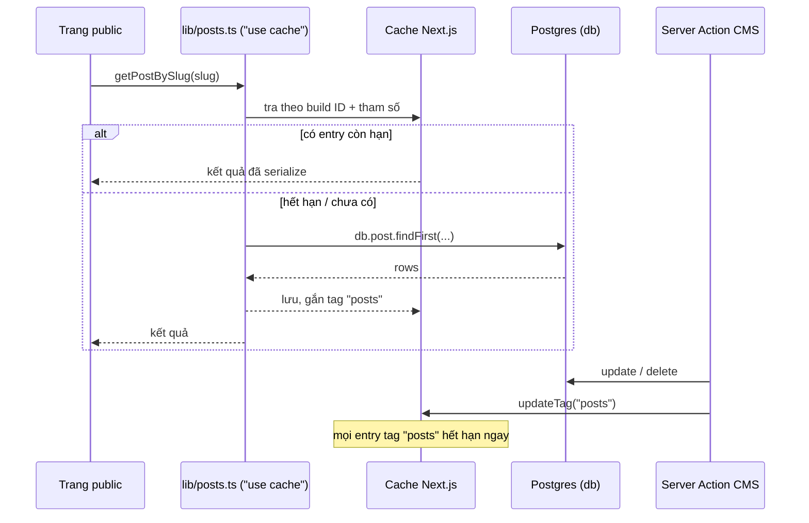

# Prisma 7.10

> Phiên bản: `prisma` 7.10.1, `@prisma/client` 7.10.1, `@prisma/adapter-pg` 7.10.1, `pg` ^8.23.1 (theo `package.json` và `node_modules/*/package.json`) · Nguồn: `node_modules/prisma/` (CLI `build/cli.js`, `config.d.ts`), `node_modules/@prisma/config/dist/index.d.ts`, `node_modules/@prisma/adapter-pg/README.md` + `dist/index.d.ts`, client sinh ra trong `generated/prisma/` · Kiểm lần cuối: 2026-11-03 @ dfd7e8f

## Tóm tắt cho agent

[PR-01]

- Không import `@prisma/client`. Import `PrismaClient`, enum, kiểu model và namespace `Prisma` từ `@/generated/prisma/client` (trong `prisma/` dùng đường dẫn tương đối `../generated/prisma/client`).
- Không tạo `new PrismaClient()` trong code ứng dụng. Dùng `db` từ `lib/db.ts` (singleton, driver adapter `PrismaPg`). Prisma 7 **bắt buộc** truyền `adapter` (hoặc `accelerateUrl`).
- URL database không nằm trong `schema.prisma`. CLI đọc URL từ `prisma.config.ts` (`DIRECT_URL ?? DATABASE_URL`); runtime đọc `DATABASE_URL` trong `lib/db.ts`. Prisma 7 **không tự nạp `.env`** — `prisma.config.ts` và `prisma/seed.ts` tự `import "dotenv/config"`.
- `generated/` bị gitignore và được sinh lại bởi `postinstall` (`prisma generate`). Sửa `schema.prisma` → chạy `npx prisma generate`, kể cả sau `migrate dev`.
- Chỉ chạy `prisma migrate dev` với Postgres cục bộ (docker, cổng 54329). Không bao giờ chạy `migrate dev`, `migrate reset`, `db push`, `db seed` vào Supabase/production từ phiên agent. Production chỉ nhận `prisma migrate deploy`, do Vinh chạy.
- Luôn đặt tên migration: `npx prisma migrate dev --name <snake_case>`. Trong môi trường không tương tác, thiếu `--name` sẽ ra migration không tên.
- `npm run db:seed` **xoá toàn bộ** `Post` (và `Product` theo cascade) trước khi tạo dữ liệu mẫu.
- Mọi truy vấn bài public đi qua `lib/posts.ts` (có `"use cache"` + `cacheTag("posts")`). Ghi dữ liệu ảnh hưởng tới trang public thì gọi `updateTag(POSTS_TAG)` trong Server Action.
- Xoá `Post` hiện xoá luôn `Product` của nó (`onDelete: Cascade`). PRD sẽ đổi điều này — xem [PR-30].

## Khái niệm cốt lõi

### [PR-02] Generator `prisma-client` sinh code TypeScript vào repo

`prisma/schema.prisma:1-4` dùng `provider = "prisma-client"` (không phải `prisma-client-js` cũ) với `output = "../generated/prisma"`. Generator này sinh **mã nguồn TypeScript** vào `generated/prisma/`, không vào `node_modules/.prisma`:

| File | Nội dung | Dùng ở đâu |
|---|---|---|
| `generated/prisma/client.ts` | `PrismaClient`, `Prisma` namespace, kiểu `Post`/`Product`, re-export enum | Code server (`lib/db.ts:2`, `prisma/seed.ts:3`) |
| `generated/prisma/browser.ts` | `Prisma` namespace bản browser, enum, kiểu model — **không có** `PrismaClient` | Client Component nếu cần enum/kiểu |
| `generated/prisma/enums.ts` | `Category`, `Status` dạng `const` object + union type | Có thể import trực tiếp |
| `generated/prisma/models/*.ts` | `PostSelect`, `PostInclude`, `PostWhereInput`, `PostCreateInput`, `PostGetPayload`... | Qua `Prisma.<Tên>` |

Thư mục này nằm trong `.gitignore:45` (`/generated`) và được tạo lại bởi `"postinstall": "prisma generate"` (`package.json`). Không sửa tay file trong đó.

Enum sinh ra là object `as const`, không phải TypeScript `enum` (`generated/prisma/enums.ts`):

```ts
export const Category = { MEO_VAT: 'MEO_VAT', GOM_LINK: 'GOM_LINK' } as const
export type Category = (typeof Category)[keyof typeof Category]
```

Vì vậy chuỗi literal `"MEO_VAT"` gán thẳng được cho kiểu `Category` (repo làm vậy ở `prisma/seed.ts:26`).

### [PR-03] `prisma.config.ts` là nơi cấu hình CLI

`prisma.config.ts:1-14`:

```ts
import "dotenv/config";
import { defineConfig } from "prisma/config";

export default defineConfig({
  schema: "prisma/schema.prisma",
  migrations: {
    path: "prisma/migrations",
    seed: "tsx prisma/seed.ts",
  },
  // CLI (migrate) cần kết nối trực tiếp, không qua pgbouncer.
  datasource: {
    url: process.env.DIRECT_URL ?? process.env.DATABASE_URL,
  },
});
```

- Khối `datasource` trong `schema.prisma:6-8` chỉ còn `provider`. Kiểu `Datasource` của config chỉ có `url` và `shadowDatabaseUrl` (`node_modules/@prisma/config/dist/index.d.ts:26-29`) — không có `directUrl` như Prisma 5/6. "URL trực tiếp cho migrate" được thực hiện bằng cách cho `datasource.url` ưu tiên `DIRECT_URL`.
- `migrations.seed` là lệnh shell mà `prisma db seed` chạy (`index.d.ts:133-135`). Không còn khoá `prisma.seed` trong `package.json`.
- CLI in "Loaded Prisma config from prisma.config.ts." mỗi lần chạy; nếu không thấy dòng này, bạn đang chạy sai thư mục.
- Repo dùng `process.env.X` thay vì helper `env("X")` của `prisma/config`. `env()` ném `PrismaConfigEnvError` khi thiếu biến (`index.d.ts:57`, `:179`); giữ `process.env` để `postinstall` → `prisma generate` chạy được trên máy/CI không có `.env`.

### [PR-04] Driver adapter `@prisma/adapter-pg`

Prisma 7 chạy query compiler bằng TypeScript/WASM (`npx prisma --version` báo `Query Compiler : enabled`) và kết nối DB qua driver adapter. Kiểu `PrismaClientOptionsWithAdapter` trong `generated/prisma/internal/prismaNamespace.ts:875-895` ghi rõ adapter là **required** trừ khi dùng Prisma Accelerate.

`PrismaPg` nhận `pg.Pool | pg.PoolConfig | string` và tuỳ chọn thứ hai `PrismaPgOptions` (`node_modules/@prisma/adapter-pg/dist/index.d.ts:42,57-79`). Mặc định adapter **không cache prepared statement có tên** (chỉ bật khi truyền `statementNameGenerator`), nên dùng được với pgbouncer chế độ transaction.

### [PR-05] Ba chuỗi kết nối và ai dùng chuỗi nào

| Môi trường | Biến | Đích | Ai dùng |
|---|---|---|---|
| Dev cục bộ | `DATABASE_URL`, `DIRECT_URL` | `localhost:54329` (docker `postgres:17-alpine`, `docker-compose.yml:4-11`) | cả runtime và CLI |
| Supabase runtime | `DATABASE_URL` | pooler cổng **6543**, `?pgbouncer=true` (`.env.example:1-2`) | `lib/db.ts:9` |
| Supabase migrate | `DIRECT_URL` | cổng **5432** session/direct (`.env.example:3-4`) | `prisma.config.ts:12` |

- `?pgbouncer=true` là tham số kiểu cũ của Prisma engine. Với `adapter-pg`, `pg-connection-string` parse nó thành khoá `pgbouncer` mà `pg` bỏ qua (đã thử `parse()`), và adapter không có xử lý riêng cho nó. Tham số này vô hại nhưng không phải thứ làm cho kết nối tương thích pgbouncer — điều đó đến từ [PR-04].
- Migrate cần kết nối trực tiếp/session: lệnh DDL, advisory lock và shadow database không chạy ổn qua pooler transaction mode.

## Dự án dùng như thế nào

### [PR-06] Client singleton `lib/db.ts`

`lib/db.ts:1-12`:

```ts
import { PrismaPg } from "@prisma/adapter-pg";
import { PrismaClient } from "@/generated/prisma/client";

const globalForPrisma = globalThis as unknown as { prisma?: PrismaClient };

export const db =
  globalForPrisma.prisma ??
  new PrismaClient({
    adapter: new PrismaPg({ connectionString: process.env.DATABASE_URL }),
  });

if (process.env.NODE_ENV !== "production") globalForPrisma.prisma = db;
```

- Lưu vào `globalThis` khi dev để hot reload không tạo thêm pool kết nối mỗi lần sửa file.
- `DATABASE_URL` được Next.js nạp từ `.env`; script ngoài Next (seed) phải tự `import "dotenv/config"` (`prisma/seed.ts:1`).
- `prisma/seed.ts:5-7` tạo client riêng vì chạy bằng `tsx` ngoài Next. Đây là ngoại lệ duy nhất được phép.

### [PR-07] Quy ước schema trong repo

Theo `prisma/schema.prisma`:

- Khoá chính: `id String @id @default(uuid())` (`:11`, `:32`). Không dùng `autoincrement`.
- Tên model PascalCase số ít, tên trường camelCase, **không** `@@map`/`@map` — bảng và cột Postgres mang đúng tên model/trường, có dấu nháy (`"Post"`, `"featuredImage"`) như trong `prisma/migrations/20261102104412_init/migration.sql`.
- Chuỗi dài dùng `@db.Text` (`content`, `:14`); giới hạn độ dài cứng dùng `@db.VarChar(n)` (`excerpt`, `:15`) và phải khớp validate Zod (`lib/post-input.ts:21`, xem [BM-05]).
- Trường tuỳ chọn là `String?` và lưu `null`, không lưu chuỗi rỗng. Zod chuyển `""` → `null` trước khi ghi (`lib/post-input.ts:4`).
- Danh sách ngắn (tags, keywords) dùng mảng Postgres `String[]` (`:18`, `:21`), không tách bảng.
- `createdAt @default(now())`, `updatedAt @updatedAt` (`:24-25`). `updatedAt` được dùng làm `key` remount editor (`app/cms/posts/[id]/page.tsx:25`) và `lastModified` sitemap (`app/sitemap.ts:17`).
- Mỗi khoá ngoại có `@@index` riêng (`Product @@index([postId])`, `:41`). Index ghép phục vụ truy vấn public: `@@index([status, category, publishedAt])` (`:28`) khớp `where { status, category } orderBy publishedAt` trong `lib/posts.ts`.
- Comment tiếng Việt ngắn đặt cuối dòng để ghi ý nghĩa nghiệp vụ (`:14`, `:16`, `:36`).
- Enum Postgres native (`CREATE TYPE "Category" AS ENUM`, `migration.sql:2`). Giá trị enum viết HOA, không dấu.

Giá trị enum `Category` đang bị lặp ở ba nơi, phải sửa cùng lúc: `prisma/schema.prisma:44-47`, `lib/categories.ts:1` (`CategoryKey` + nhãn/slug), `lib/post-input.ts:23,36` (`z.enum([...])`).

### [PR-08] Import kiểu, enum và `Prisma` namespace

```ts
// Server
import { PrismaClient, Prisma, Category, Status, type Post, type Product } from "@/generated/prisma/client";
// Client Component (không kéo PrismaClient/runtime vào bundle)
import { Category, type Post } from "@/generated/prisma/browser";
```

- `Prisma` namespace (`generated/prisma/internal/prismaNamespace.ts`) chứa kiểu đầu vào của mọi model qua `export type * from '../models'` (`:22`): `Prisma.PostSelect`, `Prisma.PostInclude`, `Prisma.PostWhereInput`, `Prisma.PostCreateInput`, `Prisma.PostUncheckedCreateInput`, `Prisma.PostUpdateInput`, `Prisma.PostGetPayload<...>`, `Prisma.TransactionClient` (`:969`).
- Lớp lỗi runtime cũng nằm trong `Prisma`: `Prisma.PrismaClientKnownRequestError` (`:32`), `PrismaClientValidationError` (`:44`)...
- Không có `Prisma.validator` trong client đã sinh (đã grep `internal/prismaNamespace.ts`). Dùng `satisfies Prisma.PostSelect` thay thế — xem [PR-17].
- Code hiện tại **không** import kiểu từ Prisma vào UI: `lib/categories.ts:1` tự khai báo `CategoryKey`, editor tự khai báo `Status` (`components/cms/post-editor.tsx:19`). Giữ nguyên khi sửa nhỏ; khi thêm code mới cần kiểu model, import từ `browser.ts` thay vì khai báo lại.

### [PR-09] Mẫu truy vấn đang dùng

**`select` cho danh sách, `include` cho trang chi tiết.**

- Thẻ bài (`lib/posts.ts:9-18`) dùng `cardSelect` `as const`: chỉ lấy trường cần hiển thị, kèm `products: { select: { image: true }, orderBy: { sortOrder: "asc" }, take: 1 }` để lấy ảnh dự phòng. `content` được select chỉ để tính `readingMinutes` rồi bị bỏ trong `toCard` (`:31-37`) — không trả `content` ra ngoài thẻ.
- Trang bài (`lib/posts.ts:87-90`) và editor CMS (`app/cms/posts/[id]/page.tsx:17-20`) dùng `include: { products: { orderBy: { sortOrder: "asc" } } }` vì cần toàn bộ trường.
- Danh sách CMS dùng `_count: { select: { products: true } }` (`app/cms/page.tsx:26`) thay vì tải cả mảng sản phẩm.

**Thứ tự.** Bài public luôn `orderBy: { publishedAt: "desc" }` (`lib/posts.ts:42`); CMS `updatedAt: "desc"` (`app/cms/page.tsx:25`); sản phẩm trong bài luôn `sortOrder: "asc"`. `sortOrder` là chỉ số mảng lúc lưu (`app/cms/actions.ts:40-41`) — không tự đặt tay.

**Lọc bài public.** Luôn trải `published` (`{ status: "PUBLISHED" }`, `lib/posts.ts:41`) vào `where`. Đọc một bài public dùng `findFirst({ where: { ...published, slug } })`, không `findUnique({ where: { slug } })`, vì phải lọc thêm `status`.

**Tìm-hoặc-ném.** `findUniqueOrThrow` khi id chắc chắn tồn tại (`app/cms/actions.ts:95`); `findUnique` + `notFound()` trong page (`app/cms/posts/[id]/page.tsx:17-21`).

**Slug duy nhất.** `uniqueSlug` (`app/cms/actions.ts:31-38`) thử `slug`, `slug-2`, ... bằng `findFirst({ where: { slug, NOT: { id: excludeId } } })`. Ràng buộc `@unique` (`Post_slug_key`, `migration.sql:42`) là hàng rào cuối nếu hai request trùng lúc.

### [PR-10] Ghi lồng nhau và cascade

- Tạo bài kèm sản phẩm: `db.post.create({ data: { ..., products: { create: productRows(products) } } })` (`app/cms/actions.ts:64-67`).
- Lưu bài **thay toàn bộ** sản phẩm: `products: { deleteMany: {}, create: productRows(products) }` trong một `update` (`app/cms/actions.ts:84`). `deleteMany: {}` nghĩa là xoá mọi Product thuộc bài này, rồi tạo lại theo thứ tự form. Hệ quả: `Product.id` đổi sau mỗi lần lưu — không tham chiếu `Product.id` từ chỗ khác trong mô hình hiện tại.
- Xoá bài: `db.post.delete` (`app/cms/actions.ts:114`); Product bị xoá ở **mức DB** bởi `ON DELETE CASCADE` (`schema.prisma:39`, `migration.sql:51`).
- Ghi luôn kèm `select` tối thiểu (`select: { id: true }`, `select: { slug: true }`) để không kéo `content` về không cần thiết.

### [PR-11] Transaction

Code hiện tại **không** gọi `$transaction`; tính nguyên tử dựa vào nested write trong một lệnh `create`/`update` ([PR-10]). API có sẵn trong client đã sinh (`generated/prisma/internal/class.ts:183-185`):

```ts
// Dạng mảng: các lệnh độc lập, chạy tuần tự trong một transaction
await db.$transaction([db.post.update(...), db.product.deleteMany(...)]);

// Dạng interactive: cần đọc rồi ghi dựa trên kết quả đọc
await db.$transaction(async (tx) => {
  const post = await tx.post.findUniqueOrThrow({ where: { id }, select: { publishedAt: true } });
  await tx.post.update({ where: { id }, data: { status: "PUBLISHED", publishedAt: post.publishedAt ?? new Date() } });
}, { timeout: 5000, isolationLevel: "Serializable" });
```

- Mặc định `maxWait` 2000 ms, `timeout` 5000 ms (`prismaNamespace.ts:799-806`); đổi toàn cục qua `transactionOptions` của `PrismaClient`.
- Trong callback chỉ dùng `tx`, không dùng `db` (lệnh qua `db` nằm ngoài transaction). Kiểu tham số là `Prisma.TransactionClient`.
- Không gọi OpenAI hay việc chậm khác bên trong interactive transaction: nó giữ một kết nối pooler và dễ vượt `timeout`. `createPost` gọi AI **trước** khi ghi (`app/cms/actions.ts:52-67`) — giữ thứ tự đó.

### [PR-12] Truy vấn có cache trong `lib/posts.ts`

Mỗi hàm đọc public (`getLatestPosts`, `getPostsByCategory`, `getRelatedPosts`, `getPostBySlug`, `getPublishedSlugs`) có `"use cache"`, `cacheLife("days")`, `cacheTag(POSTS_TAG)` (`lib/posts.ts:44-108`, `POSTS_TAG = "posts"` ở `:7`).



- Khoá cache gồm build ID và tham số hàm (`node_modules/next/dist/docs/01-app/03-api-reference/01-directives/use-cache.md:81-88`). Mỗi `slug`/`category`/`limit` khác nhau là một entry.
- Giá trị trả về phải serialize được (Date được phép, class instance thì không — `use-cache.md:148-169`). Trả về object thuần từ Prisma là ổn; **không** trả `Prisma.Decimal` hay instance tự định nghĩa từ hàm cache.
- Hồ sơ `days`: stale 5 phút, revalidate 1 ngày, expire 1 tuần (`cacheLife.md:145`). Không có `updateTag`, sửa trên DB có thể không hiện trên site tới 1 ngày.
- Ghi từ CMS gọi `updateTag(POSTS_TAG)` (`app/cms/actions.ts:88,107,115`). `updateTag` chỉ gọi được trong Server Action (`updateTag.md`); ở Route Handler dùng `revalidateTag`. Comment ở `lib/posts.ts:6` nói `revalidateTag` nhưng code dùng `updateTag` — code là đúng.
- `createPost` **không** gọi `updateTag` vì bài mới luôn là `DRAFT` (không xuất hiện ở truy vấn public).
- Không gọi `headers()`/`cookies()` (kể cả `requireAdmin()`) trong hàm `"use cache"` — sẽ lỗi `next-request-in-use-cache` (`use-cache.md:241`).
- Truy vấn CMS **không** cache: `app/cms/page.tsx:23` gọi `await connection()` trước khi đọc DB để luôn động.
- `generateStaticParams` gọi `getPublishedSlugs()` (`app/(site)/bai-viet/[slug]/page.tsx:18-21`) → `next build` cần kết nối được DB qua `DATABASE_URL`.

### [PR-13] Migrations

- Thư mục: `prisma/migrations/<timestamp>_<tên>/migration.sql` + `migration_lock.toml` (`provider = "postgresql"`). Migration đầu: `20261102104412_init`. Commit cả thư mục migration; không sửa migration đã được áp dụng ở bất kỳ DB dùng chung nào.
- Tên: `--name` được slug hoá với dấu `_` và cắt 200 ký tự (CLI 7.10.1). Đặt tên snake_case mô tả thay đổi: `add_product_pinned`, `create_category_table`.

| Lệnh | Khi nào | Ghi chú đã kiểm trong CLI 7.10.1 |
|---|---|---|
| `npx prisma migrate dev --name <ten>` | Dev cục bộ, sau khi sửa schema | Tạo + áp migration. Thiếu `--name` ở môi trường không tương tác → tên rỗng. Có cảnh báo mất dữ liệu ở môi trường không tương tác → lỗi `MigrateDevEnvNonInteractiveError`. Cần reset (drift) → in lý do rồi thoát mã 130, **không** tự reset. Mã lệnh không gọi generator và không gọi seed. |
| `npx prisma migrate dev --create-only --name <ten>` | Cần sửa SQL tay (backfill dữ liệu, đổi kiểu cột) | Tạo file, không áp; sửa xong chạy lại `migrate dev`. |
| `npx prisma generate` | Sau mọi thay đổi schema | Sinh lại `generated/prisma`. |
| `npx prisma migrate status` | Kiểm tra | Chỉ đọc. |
| `npx prisma migrate deploy` | Staging/production | Chỉ áp migration có sẵn. Vinh chạy, không phải agent. |
| `npx prisma migrate reset` | Chỉ DB cục bộ | Xoá sạch dữ liệu. |

- `migrate dev` dùng shadow database (tạo tạm). Trên Postgres docker với user `postgres` việc này chạy được; trên Supabase thì không nên thử. Kiểu config có `shadowDatabaseUrl` nếu sau này cần.
- Trước mọi lệnh CLI chạm DB, kiểm `.env` trỏ về đâu mà không in mật khẩu:

```bash
grep -o '@[^/]*' .env   # phải thấy @localhost:54329
```

### [PR-14] Seed

- Chạy: `npm run db:seed` → `prisma db seed` → lệnh trong `prisma.config.ts:8` (`tsx prisma/seed.ts`). Truyền tham số: `npx prisma db seed -- --arg value`.
- Trong CLI 7.10.1, chỉ `prisma db seed` gọi lệnh seed; `migrate dev`/`migrate reset` không tự seed.
- `prisma/seed.ts:163` gọi `db.post.deleteMany()` → xoá **mọi** bài và (cascade) mọi sản phẩm, rồi tạo 10 bài `PUBLISHED` với `publishedAt` lùi từng ngày (`:164-189`).
- Link sản phẩm mẫu là trang tìm kiếm Shopee (`prisma/seed.ts:20-21`), không phải Link affiliate thật.
- Seed dùng nested `create` giống CMS, nên khi đổi quan hệ Post–Product phải sửa seed cùng lúc.

## Công thức

### [PR-15] Thêm một trường vào model có sẵn

Ví dụ minh hoạ: thêm `Product.pinned`.

1. Sửa `prisma/schema.prisma`, thêm `pinned Boolean @default(false)`. Trường bắt buộc mới phải có `@default` hoặc migration sẽ cần backfill tay (`--create-only`).
2. Kiểm `.env` trỏ local ([PR-13]), bật DB: `docker compose up -d`.
3. `npx prisma migrate dev --name add_product_pinned` rồi `npx prisma generate`.
4. Đọc `migration.sql` vừa sinh, xác nhận chỉ có `ALTER TABLE ... ADD COLUMN`.
5. Cập nhật Zod (`lib/post-input.ts`), Server Action, form, chỗ hiển thị — theo [BM-17].
6. Nếu trường hiển thị ở trang public: thêm vào `cardSelect` hoặc dựa vào `include` trong `lib/posts.ts`; action ghi phải gọi `updateTag(POSTS_TAG)`.
7. Sửa `prisma/seed.ts` nếu trường cần dữ liệu mẫu.
8. `npx tsc --noEmit` và `npm run lint`.

### [PR-16] Thêm model mới + migration + cập nhật code

1. Thêm model theo [PR-07]: `id String @id @default(uuid())`, `createdAt`, `updatedAt`, quan hệ có `@relation(fields, references, onDelete)` ghi rõ, `@@index` cho mọi khoá ngoại và cho tổ hợp `where`/`orderBy` dùng ở trang public.
2. Chọn `onDelete` có chủ đích: `Cascade` khi bản ghi con không có ý nghĩa nếu thiếu cha; `Restrict` khi PRD cấm xoá cha còn con (ví dụ FR-28: không xoá Danh mục còn bài); `SetNull` khi trường tuỳ chọn.
3. `npx prisma migrate dev --create-only --name create_<ten>` → đọc SQL; thêm backfill nếu cần → `npx prisma migrate dev` → `npx prisma generate`.
4. Viết hàm đọc: đọc public đặt trong file `lib/<ten>.ts` theo mẫu `lib/posts.ts` (`"use cache"`, `cacheLife`, `cacheTag`); đọc CMS đặt trong page với `await connection()`.
5. Viết Server Action trong `app/cms/actions.ts` bọc bằng `run()` ([BM-18]), validate bằng Zod, gọi `updateTag` cho mọi tag bị ảnh hưởng.
6. Cập nhật seed, chạy `npm run db:seed` trên DB local.
7. Ghi lại thay đổi vào tài liệu này nếu khẳng định nào ở trên không còn đúng.

### [PR-17] Kiểu cho `select` dùng lại

`lib/posts.ts:20-29` hiện khai báo `CardRow` tay. Khi viết mới, suy kiểu từ Prisma để không lệch schema:

```ts
import type { Prisma } from "@/generated/prisma/client";

const cardSelect = {
  slug: true,
  title: true,
  products: { select: { image: true }, orderBy: { sortOrder: "asc" }, take: 1 },
} as const satisfies Prisma.PostSelect;

type CardRow = Prisma.PostGetPayload<{ select: typeof cardSelect }>;
```

Kiểu đầu vào ghi: `Prisma.PostCreateInput` (quan hệ lồng), `Prisma.PostUncheckedCreateInput` (gán thẳng `postId`), `Prisma.PostUpdateInput`. Dữ liệu đã qua `safeParse` của Zod truyền thẳng vào `data` được nếu kiểu output Zod khớp (như `savePost`, `app/cms/actions.ts:76-85`).

### [PR-18] Bắt lỗi ràng buộc duy nhất

```ts
import { Prisma } from "@/generated/prisma/client";

try {
  await db.post.create({ data });
} catch (e) {
  if (e instanceof Prisma.PrismaClientKnownRequestError && e.code === "P2002") {
    throw new Error("Đường dẫn đã tồn tại");
  }
  throw e;
}
```

`run()` (`app/cms/actions.ts:21-29`) trả `e.message` cho client; ném `Error` tiếng Việt để toast đọc được, đừng để lộ message thô của Prisma.

### [PR-19] Dựng DB cục bộ từ đầu

```bash
docker compose up -d                    # Postgres 17 ở localhost:54329
grep -o '@[^/]*' .env                   # xác nhận trỏ local
npx prisma migrate dev                  # áp migration có sẵn (không tạo mới nếu schema khớp)
npx prisma generate
npm run db:seed                         # xoá và tạo lại dữ liệu mẫu
```

## Bẫy hay gặp

### [PR-20] Import nhầm `@prisma/client`

- Triệu chứng: lỗi kiểu "Module has no exported member 'Post'" hoặc client không có model `post`.
- Nguyên nhân: generator `prisma-client` sinh vào `generated/prisma`, không vào `@prisma/client`. README của `@prisma/adapter-pg` vẫn ghi ví dụ `from '@prisma/client'` — đó là mẫu cũ.
- Cách đúng: `import { PrismaClient } from "@/generated/prisma/client"`.

### [PR-21] Quên `prisma generate`

- Triệu chứng: TypeScript báo trường/model mới không tồn tại dù migration đã chạy; hoặc clone mới báo thiếu `@/generated/prisma/client`.
- Nguyên nhân: `generated/` không commit; mã `migrate dev` 7.10.1 không gọi generator.
- Cách đúng: chạy `npx prisma generate` sau mỗi thay đổi schema; `npm install` tự chạy qua `postinstall`.

### [PR-22] CLI không thấy biến môi trường

- Triệu chứng: `migrate`/`seed` báo thiếu URL dù `.env` có.
- Nguyên nhân: Prisma 7 không tự nạp `.env` (CLI tự ghi "Environment variables declared in this file are NOT automatically loaded by Prisma").
- Cách đúng: giữ `import "dotenv/config"` ở dòng đầu `prisma.config.ts` và mọi script chạy ngoài Next.

### [PR-23] Chạy migrate qua pooler

- Triệu chứng: `migrate` treo, lỗi prepared statement hoặc advisory lock khi dùng Supabase.
- Nguyên nhân: `DIRECT_URL` thiếu nên `prisma.config.ts:12` rơi về `DATABASE_URL` (pooler 6543).
- Cách đúng: luôn đặt `DIRECT_URL` (cổng 5432) khi trỏ Supabase. Và dù sao, agent không chạy migrate vào Supabase.

### [PR-24] Agent chạy lệnh phá dữ liệu vào production

- Triệu chứng: mất bài thật sau `db:seed`, `migrate reset`, `db push`.
- Nguyên nhân: CLI dùng bất cứ URL nào `.env` đang trỏ; seed bắt đầu bằng `deleteMany()` (`prisma/seed.ts:163`).
- Cách đúng: kiểm `.env` trước ([PR-13]); chỉ chạy lệnh ghi vào `localhost:54329`; production chỉ `migrate deploy` do Vinh chạy.

### [PR-25] Sửa bài nhưng site không đổi

- Triệu chứng: CMS lưu thành công nhưng trang public vẫn nội dung cũ tới hàng giờ.
- Nguyên nhân: action mới ghi DB mà không `updateTag(POSTS_TAG)`, hoặc dùng tag khác với `cacheTag` ở hàm đọc.
- Cách đúng: mọi action ghi dữ liệu mà hàm `"use cache"` đọc phải gọi `updateTag` với đúng tag đó, sau khi ghi xong.

### [PR-26] Lưu bài làm đổi id sản phẩm

- Triệu chứng: tham chiếu tới `Product.id` (ví dụ log, thống kê) bị mất sau khi lưu bài.
- Nguyên nhân: `savePost` dùng `deleteMany: {}` + `create` ([PR-10]).
- Cách đúng: trong mô hình hiện tại, không lưu `Product.id` ở nơi khác. Khi chuyển sang Kho sản phẩm ([PR-30]), cập nhật bảng nối thay vì xoá-tạo Product.

### [PR-27] Thêm giá trị enum mà quên chỗ lặp

- Triệu chứng: Zod từ chối giá trị mới, hoặc `CATEGORIES[post.category]` trả `undefined` làm vỡ trang.
- Nguyên nhân: `Category` lặp ở schema, `lib/categories.ts`, `lib/post-input.ts` ([PR-07]).
- Cách đúng: sửa cả ba trong cùng thay đổi; hoặc trong code mới dùng `z.enum(Category)` với `Category` import từ `@/generated/prisma/enums` (Zod 4 nhận object enum, `node_modules/zod/v4/classic/schemas.d.ts:611`).

### [PR-28] Gọi việc chậm trong transaction

- Triệu chứng: `Transaction already closed` / hết thời gian chờ.
- Nguyên nhân: gọi AI hoặc mạng bên trong `$transaction(async (tx) => ...)`, vượt `timeout` 5000 ms.
- Cách đúng: chuẩn bị dữ liệu trước, chỉ đặt lệnh DB trong callback ([PR-11]).

## Dự kiến: thay đổi mô hình dữ liệu theo PRD

**Dự kiến** — chưa có trong code. Nguồn: `_bmad-output/planning-artifacts/prds/prd-affiliate-project-2026-11-03/prd.md` §3, §4.2, §4.7 và `addendum.md` A4. Thiết kế bảng cụ thể do bước architecture chốt; mục này chỉ ghi ràng buộc mà schema phải đáp ứng.

### [PR-30] Kho Sản phẩm dùng chung (FR-3, FR-4, FR-5)

**Dự kiến.**

- `Product` không còn thuộc riêng một `Post`. Một Sản phẩm nằm trong nhiều Bài web; xoá Bài web không xoá Sản phẩm (FR-4, A4).
- Hướng tự nhiên: bảng nối tường minh (ví dụ `PostProduct { postId, productId, sortOrder }`, khoá chính ghép `@@id([postId, productId])`) với `onDelete: Cascade` phía `Post` và **không** cascade phía `Product`. Thứ tự sản phẩm trong bài (`sortOrder`) chuyển sang bảng nối.
- `Product` cần thêm: trạng thái *hiện/ẩn* (FR-5), Danh mục (FR-3), Dữ liệu thô, thời điểm tạo (FR-12 đo SM-3).
- Migration phải chuyển dữ liệu: tạo dòng bảng nối từ `Product.postId` hiện có trước khi bỏ cột — làm bằng `--create-only` rồi sửa SQL tay. Không tự gộp sản phẩm trùng tên.
- `savePost` phải đổi từ `deleteMany + create` Product sang cập nhật bảng nối ([PR-26]).
- Sửa/ẩn Sản phẩm phải làm mới mọi Bài web và Trang bio đang dùng nó trong khoảng 1 phút (NFR-5): action sửa Sản phẩm phải `updateTag` các tag bài liên quan (hoặc một tag sản phẩm riêng mà các hàm đọc bài cũng gắn).
- Truy vấn public phải lọc Sản phẩm bị ẩn ở mọi nơi (FR-5: Link affiliate không còn xuất hiện trên website).
- Seed dùng link tìm kiếm Shopee sẽ bị validate FR-3 từ chối khi sửa (A4).

### [PR-31] Danh mục là bảng, Loại bài giữ enum (FR-28, FR-29)

**Dự kiến.**

- Enum `Category` (`MEO_VAT | GOM_LINK`) hiện mang nghĩa **Loại bài** (kiểu viết). Theo A4: giữ nó như enum Loại bài (có thể đổi tên), và tạo bảng **Danh mục** mới (tên, đường dẫn, mô tả, thứ tự hiển thị) dùng chung cho Bài web và Sản phẩm.
- Ràng buộc từ FR-28: không xoá Danh mục còn Bài web hoặc Sản phẩm → khoá ngoại `onDelete: Restrict`; đường dẫn Danh mục `@unique` và không trùng đường dẫn hệ thống (`cms`, `bai-viet`, `bio`, `tim-kiem`, `api`) — kiểm bằng Zod; đổi đường dẫn cần lưu đường dẫn cũ để chuyển hướng 301.
- Code đang dựa vào enum làm chủ đề và phải tách ra: route `app/(site)/[category]/page.tsx`, `lib/categories.ts` (nhãn, slug, mô tả), badge màu (giữ theo Loại bài), breadcrumb và JSON-LD (`app/(site)/bai-viet/[slug]/page.tsx`), `getRelatedPosts` (cùng Danh mục), `@@index([status, category, publishedAt])`.
- `/meo-vat`, `/gom-link` vẫn phải hoạt động (FR-28, giả định: trang theo Loại bài).
- Migration: tạo bảng, chèn Danh mục khởi tạo, gán `categoryId` cho bài hiện có, rồi mới đặt `NOT NULL` — các bước dữ liệu viết tay trong SQL.

### [PR-32] Bảng phục vụ tương tác người đọc (FR-33, FR-35)

**Dự kiến.** Lượt xem và Lượt tim cần lưu theo bài nhưng **không** lưu định danh người đọc (NFR-7, xem [BM-16]). Đếm có thể ghi rất thường xuyên — không đặt chúng trong hàm `"use cache"` và không gọi `updateTag("posts")` mỗi lượt xem.

## Checklist khi viết workflow / review

[PR-40]

- [ ] Import Prisma từ `@/generated/prisma/client` (server) hoặc `@/generated/prisma/browser` (client), không từ `@prisma/client`.
- [ ] Code ứng dụng dùng `db` từ `lib/db.ts`; không có `new PrismaClient` mới ngoài `prisma/seed.ts`.
- [ ] Sửa `schema.prisma` đi kèm thư mục migration mới có tên snake_case rõ nghĩa, và đã chạy `npx prisma generate`.
- [ ] Đã đọc `migration.sql`; thay đổi có dữ liệu (đổi kiểu, bỏ cột, NOT NULL mới) có bước backfill viết tay.
- [ ] Không có lệnh `migrate dev`/`reset`/`db push`/`db seed` nào chạy vào URL khác `localhost:54329`.
- [ ] Trường mới: tuỳ chọn → `?` và lưu `null`; bắt buộc → có `@default` hoặc backfill.
- [ ] Mỗi khoá ngoại có `@@index`; `onDelete` được chọn có chủ đích và khớp PRD.
- [ ] Giá trị enum mới đã cập nhật ở schema, `lib/categories.ts`, `lib/post-input.ts`.
- [ ] Danh sách dùng `select` tối thiểu; không trả `content` ra thẻ bài; dùng `_count` thay vì tải mảng để đếm.
- [ ] Truy vấn public lọc `status: "PUBLISHED"` và nằm trong hàm `"use cache"` có `cacheTag`.
- [ ] Mọi action ghi dữ liệu mà trang public đọc đều gọi `updateTag` với đúng tag.
- [ ] Không gọi `headers()`/`cookies()`/`requireAdmin()` trong hàm `"use cache"`.
- [ ] Interactive transaction chỉ chứa lệnh DB qua `tx`, không gọi AI/mạng.
- [ ] `prisma/seed.ts` vẫn chạy được với schema mới.
- [ ] Thay đổi chạm tới [PR-30]/[PR-31] tuân theo ràng buộc PRD ghi ở đó.

## Tham khảo

- `node_modules/prisma/build/cli.js` — hành vi `migrate dev`, `db seed` (bản bundle; tìm chuỗi `MigrateDevEnvNonInteractiveError`, `Running seed command`).
- `node_modules/@prisma/config/dist/index.d.ts` — kiểu `PrismaConfig`, `Datasource`, `migrations.seed`.
- `node_modules/@prisma/adapter-pg/README.md`, `node_modules/@prisma/adapter-pg/dist/index.d.ts` — `PrismaPg`, `PrismaPgOptions`.
- `generated/prisma/client.ts`, `browser.ts`, `enums.ts`, `internal/prismaNamespace.ts`, `internal/class.ts` — API client đã sinh (sau `npx prisma generate`).
- `npx prisma <lệnh> --help` — trợ giúp đúng phiên bản cài.
- `node_modules/next/dist/docs/01-app/03-api-reference/01-directives/use-cache.md`, `04-functions/cacheLife.md`, `04-functions/updateTag.md` — tương tác cache với truy vấn DB.
- Tài liệu online: <https://pris.ly/d/driver-adapters>, <https://pris.ly/prisma-config-env-vars>.
- PRD: `_bmad-output/planning-artifacts/prds/prd-affiliate-project-2026-11-03/prd.md`, `addendum.md` (A4).
- Liên quan: `docs/nen-tang-ky-thuat/kiem-tra-va-bao-mat.md` ([BM-05], [BM-17], [BM-18]).
